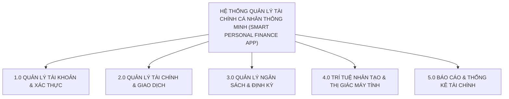
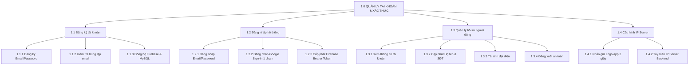
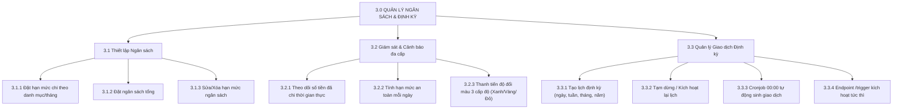
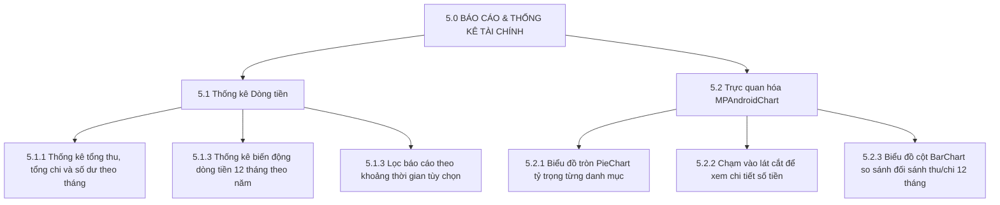

# TÀI LIỆU PHÂN TÍCH YÊU CẦU HỆ THỐNG VÀ BIỂU ĐỒ PHÂN CẤP CHỨC NĂNG (BFC)

**Đề tài:** XÂY DỰNG ỨNG DỤNG QUẢN LÝ TÀI CHÍNH CÁ NHÂN TRÊN NỀN TẢNG ANDROID TÍCH HỢP NHẬN DIỆN VÀ PHÂN LOẠI CHI TIÊU BẰNG TRÍ TUỆ NHÂN TẠO  
**Sinh viên thực hiện:** Nguyễn Duy Khánh — Mã SV: 2255010114 — Lớp: 22CN4  
**Giảng viên hướng dẫn:** TS. Nguyễn Mạnh Thắng  
**Khoa:** Công nghệ Thông tin – Trường Đại học Kiến trúc Hà Nội  

---

## 1. PHÂN TÍCH YÊU CẦU HỆ THỐNG

### 1.1. Yêu cầu chức năng (Functional Requirements - FR)
Hệ thống gồm 9 nhóm yêu cầu chức năng cốt lõi:

| Mã FR | Tên phân hệ / Chức năng | Mô tả chi tiết nghiệp vụ | Mức ưu tiên |
|:---:|:---|:---|:---:|
| **FR-01** | **Quản lý Xác thực & Người dùng** | Đăng ký Email; Đăng nhập Email hoặc Google Sign-In 1 chạm; Đồng bộ Firebase Auth với MySQL; Cập nhật hồ sơ cá nhân. | Bắt buộc (High) |
| **FR-02** | **Quản lý Tài khoản Ví** | Tạo nhiều loại ví (Tiền mặt, Ngân hàng, Ví điện tử); Theo dõi số dư tức thời; Tự động tăng/giảm số dư; Tính tổng số dư ròng. | Bắt buộc (High) |
| **FR-03** | **Quản lý Danh mục Thu Chi** | Cung cấp sẵn 11 danh mục chuẩn; Tạo danh mục cá nhân hóa; Tùy chỉnh màu sắc Hex và icon Material Design; Phân loại Thu/Chi. | Bắt buộc (High) |
| **FR-04** | **Quản lý Giao dịch Thu Chi** | Thêm, sửa, xóa giao dịch; Tự động bù trừ và rollback số dư ví an toàn; Đính kèm ảnh chứng từ; Lọc và tìm kiếm giao dịch theo ngày/tháng. | Bắt buộc (High) |
| **FR-05** | **Quản lý Ngân sách & Cảnh báo** | Đặt hạn mức chi theo tháng cho danh mục; Theo dõi tiến độ; Cảnh báo trực quan 3 cấp màu: Xanh (<80%), Vàng cam (80-100%), Đỏ (>100%). | Bắt buộc (High) |
| **FR-06** | **Quản lý Giao dịch Định kỳ** | Lên lịch lặp tự động (ngày, tuần, tháng, năm); Cronjob 00:00 tự động sinh giao dịch; Endpoint `/trigger` kích hoạt tức thì phục vụ demo. | Khuyến nghị (Medium) |
| **FR-07** | **Quét Hóa đơn Thông minh (AI)** | Chụp ảnh hóa đơn; Google ML Kit OCR nhận dạng chữ offline trên máy; Google Gemini 2.5 Flash bóc tách JSON (tiền, ngày, quán); Tự điền form. | Bắt buộc (High) |
| **FR-08** | **Nhận diện Sản phẩm Camera AI** | CameraX + YOLOv8n TFLite vẽ Bounding Box 18 lớp thời gian thực (35-40 FPS); Trích xuất 27 đặc trưng; Random Forest ONNX gợi ý danh mục < 2ms. | Bắt buộc (High) |
| **FR-09** | **Báo cáo & Thống kê Tài chính** | Thống kê tổng thu, tổng chi và dòng tiền theo tháng/năm; Biểu đồ tròn PieChart tỷ trọng danh mục; Biểu đồ cột BarChart so sánh 12 tháng. | Bắt buộc (High) |

### 1.2. Yêu cầu phi chức năng (Non-Functional Requirements - NFR)
- **NFR-01 (Hiệu năng):** YOLOv8 chạy trên điện thoại đạt 30–45 FPS; Suy luận Random Forest ONNX trên Java Backend < 2ms; OCR offline < 500ms; Bóc tách Gemini LLM < 2.5s.
- **NFR-02 (Bảo mật):** Xác thực không trạng thái (Stateless) qua Firebase ID Token; Không lưu mật khẩu thô trong MySQL; Lớp lọc `FirebaseAuthFilter` bảo vệ toàn bộ API nghiệp vụ.
- **NFR-03 (Độ tin cậy):** Tự động chuyển sang Rule-based Fallback khi không nạp được mô hình ONNX native; Đóng gói Docker Compose có tự động khởi động lại `restart: unless-stopped`.
- **NFR-04 (Giao diện):** Obsidian Dark Theme nền đen sâu `#090D16`, bề mặt thẻ `#161B2A`, điểm nhấn Royal Blue `#3B82F6` bảo vệ mắt và tiết kiệm pin OLED.

---

## 2. BIỂU ĐỒ PHÂN CẤP CHỨC NĂNG TỔNG QUÁT (BFC LEVEL 0)

---

## 3. CÁC BIỂU ĐỒ PHÂN CẤP CHỨC NĂNG CON CHI TIẾT (BFC LEVEL 1 & LEVEL 2)

### 3.1. Phân cấp Chức năng 1.0: Quản lý Tài khoản & Xác thực

### 3.2. Phân cấp Chức năng 2.0: Quản lý Tài chính & Giao dịch

```mermaid
graph TD
    F2["2.0 QUẢN LÝ TÀI CHÍNH & GIAO DỊCH"]
    
    F21["2.1 Quản lý Ví tài chính"]
    F22["2.2 Quản lý Danh mục Thu Chi"]
    F23["2.3 Quản lý Giao dịch Thu Chi"]
    
    F2 --> F21
    F2 --> F22
    F2 --> F23
    
    F21 --> F211["2.1.1 Tạo ví (Tiền mặt, Ngân hàng, Ví điện tử)"]
    F21 --> F212["2.1.2 Cập nhật tên ví & số dư ban đầu"]
    F21 --> F213["2.1.3 Xóa ví tài chính"]
    F21 --> F214["2.1.4 Tính tổng số dư ròng Dashboard"]
    
    F22 --> F221["2.2.1 Xem 11 danh mục mặc định hệ thống"]
    F22 --> F222["2.2.2 Thêm danh mục cá nhân hóa"]
    F22 --> F223["2.2.3 Tùy biến mã màu Hex & Icon Material"]
    F22 --> F224["2.2.4 Phân loại danh mục Thu/Chi"]
    
    F23 --> F231["2.3.1 Thêm giao dịch thu/chi"]
    F23 --> F232["2.3.2 Tự động trừ/cộng số dư ví"]
    F23 --> F233["2.3.3 Sửa giao dịch & bù trừ số dư"]
    F23 --> F234["2.3.4 Xóa giao dịch & rollback số dư ví"]
    F23 --> F235["2.3.5 Đính kèm ảnh hóa đơn/chứng từ"]
    F23 --> F236["2.3.6 Lọc giao dịch theo ngày/tháng"]
```

### 3.3. Phân cấp Chức năng 3.0: Quản lý Ngân sách & Định kỳ

### 3.4. Phân cấp Chức năng 4.0: Trí tuệ Nhân tạo & Thị giác Máy tính

```mermaid
graph TD
    F4["4.0 TRÍ TUỆ NHÂN TẠO & THỊ GIÁC MÁY TÍNH"]
    
    F41["4.1 Quét Hóa đơn Thông minh"]
    F42["4.2 Nhận diện Sản phẩm Camera AI"]
    F43["4.3 Phân loại Danh mục ONNX"]
    
    F4 --> F41
    F4 --> F42
    F4 --> F43
    
    F41 --> F411["4.1.1 Chụp/chọn ảnh hóa đơn từ thư viện"]
    F41 --> F412["4.1.2 Google ML Kit OCR nhận dạng chữ offline (400ms)"]
    F41 --> F413["4.1.3 Google Gemini 2.5 Flash bóc tách JSON (tiền, ngày, quán)"]
    F41 --> F414["4.1.4 Tự động điền dữ liệu vào form giao dịch"]
    
    F42 --> F421["4.2.1 CameraX thu nhận khung hình liên tục"]
    F42 --> F422["4.2.2 YOLOv8n TFLite nhận diện 18 lớp On-Device"]
    F42 --> F423["4.2.3 Vẽ Bounding Box thời gian thực 35-40 FPS"]
    F42 --> F424["4.2.4 Gửi danh sách nhãn & confidence lên Backend"]
    
    F43 --> F431["4.3.1 Trích xuất vector 27 đặc trưng kỹ thuật"]
    F43 --> F432["4.3.2 Suy luận qua Random Forest ONNX Java Backend (< 2ms)"]
    F43 --> F433["4.3.3 Gợi ý danh mục chi tiêu chuẩn xác"]
    F43 --> F434["4.3.4 Heuristic Rule-based Fallback an toàn"]
```

### 3.5. Phân cấp Chức năng 5.0: Báo cáo & Thống kê Tài chính

