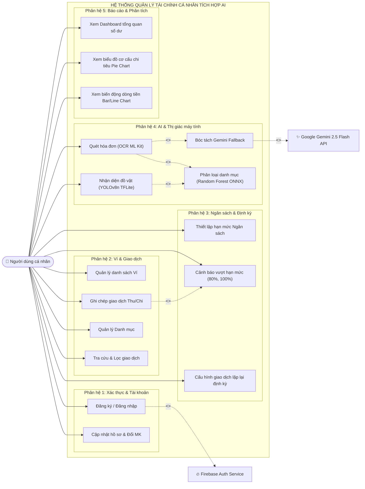
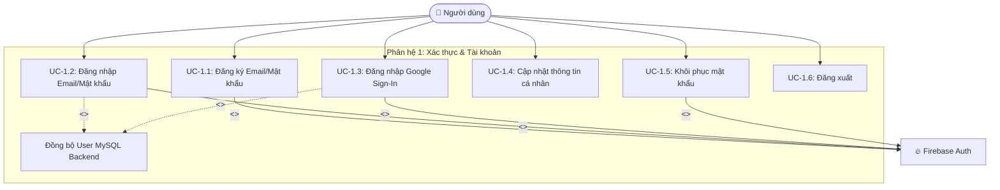
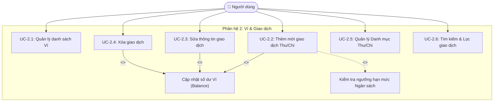
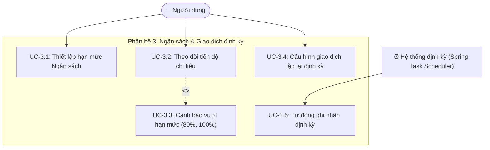
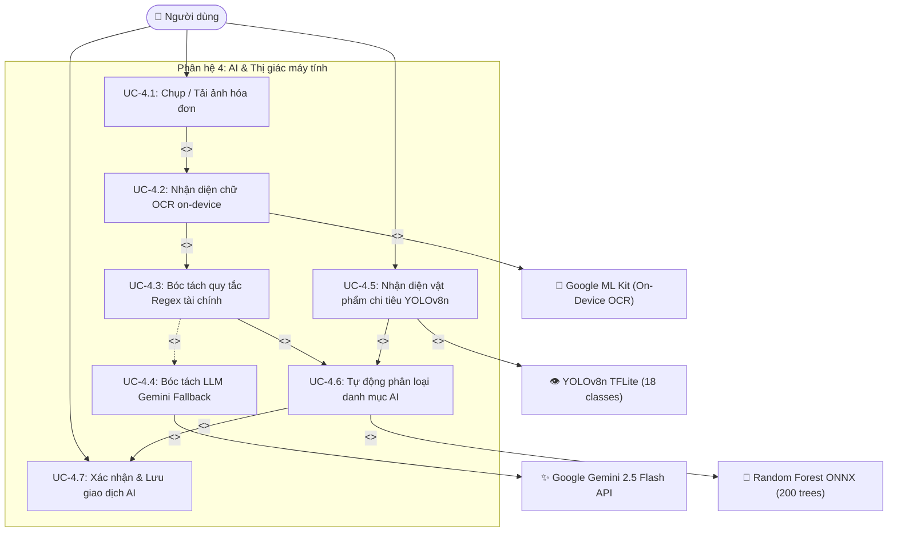
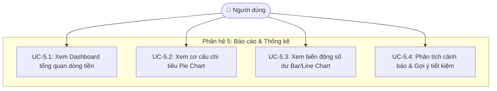

# HỒ SƠ THIẾT KẾ USE CASE HỆ THỐNG
## ỨNG DỤNG QUẢN LÝ TÀI CHÍNH CÁ NHÂN TÍCH HỢP COMPUTER VISION VÀ AI
**Sinh viên thực hiện:** Nguyễn Duy Khánh - MSV: 2255010114 - Lớp: 22CN4  
**Giảng viên hướng dẫn:** TS. Nguyễn Mạnh Thắng  
**Khoa:** Công nghệ Thông tin - Trường Đại học Kiến trúc Hà Nội  
**Phiên bản:** v1.2 (Tháng 11/2026 - Bám sát 100% kiến trúc dự án thực tế)

---

## 1. TỔNG QUAN VÀ XÁC ĐỊNH TÁC NHÂN (ACTORS)

| Tên Tác nhân (Actor) | Phân loại | Mô tả vai trò và phạm vi tương tác |
| :--- | :--- | :--- |
| **Người dùng cá nhân (End User / Chủ ví)** | Tác nhân chính (Primary Actor) | Người dùng trực tiếp sử dụng ứng dụng di động Android: thực hiện đăng ký/đăng nhập, tạo và quản lý ví tiền, ghi chép thu chi thủ công hoặc qua AI, thiết lập ngân sách và xem biểu đồ phân tích. |
| **Firebase Authentication Service** | Tác nhân phụ / Hệ thống ngoài (External Actor) | Dịch vụ đám mây của Google phụ trách xác thực người dùng qua JWT/OAuth2 (Google Sign-In, Email/Password), cấp định danh duy nhất `firebase_uid` và bảo mật phiên đăng nhập. |
| **Google Gemini AI Service (Gemini 2.5 Flash)** | Tác nhân phụ / Dịch vụ ngoài (External Actor) | Hệ thống trí tuệ nhân tạo LLM đám mây làm cơ chế dự phòng thông minh (Fallback) bóc tách thực thể hóa đơn khi Regex không tìm thấy trường dữ liệu. |

---

## 2. SƠ ĐỒ USE CASE TỔNG QUÁT TOÀN HỆ THỐNG

---

## 3. SƠ ĐỒ USE CASE PHÂN RÃ CHI TIẾT THEO TỪNG PHÂN HỆ

### 3.1. Phân hệ 1: Quản lý Tài khoản & Xác thực người dùng

| Mã UC | Tên Use Case | Tác nhân chính | Mô tả và Quan hệ phụ thuộc |
| :--- | :--- | :--- | :--- |
| **UC-1.1** | Đăng ký tài khoản mới | Người dùng, Firebase | Nhập họ tên, email, mật khẩu; Firebase tạo tài khoản người dùng. |
| **UC-1.2** | Đăng nhập Email/Mật khẩu | Người dùng, Firebase | Xác thực thông tin, cấp Firebase ID Token, `<<include>>` Đồng bộ User MySQL. |
| **UC-1.3** | Đăng nhập Google Sign-In | Người dùng, Firebase | Xác thực qua Google OAuth2, cấp JWT, tự động tạo User MySQL nếu lần đầu đăng nhập. |
| **UC-1.4** | Cập nhật hồ sơ cá nhân | Người dùng | Thay đổi họ tên, số điện thoại, ảnh đại diện Avatar. |
| **UC-1.5** | Đổi / Khôi phục mật khẩu | Người dùng, Firebase | Gửi email khôi phục mật khẩu qua Firebase. |
| **UC-1.6** | Đăng xuất | Người dùng, Firebase | Hủy phiên đăng nhập, xóa Token lưu trữ an toàn trong EncryptedSharedPreferences. |

---

### 3.2. Phân hệ 2: Quản lý Tài chính, Ví tiền & Giao dịch

| Mã UC | Tên Use Case | Tác nhân chính | Mô tả và Quan hệ phụ thuộc |
| :--- | :--- | :--- | :--- |
| **UC-2.1** | Quản lý danh sách Ví | Người dùng | Thêm mới, xem số dư, sửa thông tin các loại ví: Tiền mặt, Ngân hàng, Ví điện tử. |
| **UC-2.2** | Thêm mới giao dịch Thu/Chi | Người dùng | Nhập số tiền, chọn danh mục, chọn ví; `<<include>>` Cập nhật số dư ví, `<<extend>>` Kiểm tra ngân sách. |
| **UC-2.3** | Sửa thông tin giao dịch | Người dùng | Điều chỉnh số tiền, ngày, ghi chú; `<<include>>` Cập nhật lại số dư ví theo khoản chênh lệch. |
| **UC-2.4** | Xóa giao dịch | Người dùng | Xóa giao dịch khỏi lịch sử; `<<include>>` Hoàn trả số dư ví tương ứng. |
| **UC-2.5** | Quản lý Danh mục | Người dùng | Quản lý 11 danh mục mặc định của hệ thống và tạo thêm danh mục cá nhân. |
| **UC-2.6** | Tìm kiếm & Lọc giao dịch | Người dùng | Lọc lịch sử theo ngày bắt đầu/kết thúc, loại giao dịch, danh mục chi tiêu, loại ví. |

---

### 3.3. Phân hệ 3: Quản lý Ngân sách & Giao dịch định kỳ

| Mã UC | Tên Use Case | Tác nhân chính | Mô tả và Quan hệ phụ thuộc |
| :--- | :--- | :--- | :--- |
| **UC-3.1** | Thiết lập hạn mức Ngân sách | Người dùng | Cấu hình giới hạn chi tiêu theo từng danh mục trong tháng và giới hạn chi tiêu mỗi ngày. |
| **UC-3.2** | Theo dõi tiến độ chi tiêu | Người dùng, Hệ thống | Hiển thị thanh tiến độ phần trăm đã tiêu so với ngân sách đã đặt. |
| **UC-3.3** | Cảnh báo vượt hạn mức | Hệ thống | `<<extend>>` từ Ghi nhận chi tiêu: Cảnh báo màu vàng khi đạt 80% hạn mức, cảnh báo màu đỏ khi vượt 100%. |
| **UC-3.4** | Cấu hình giao dịch lặp lại | Người dùng | Thiết lập hóa đơn định kỳ (tiền nhà, tiền mạng, lương) theo chu kỳ Ngày, Tuần, Tháng, Năm. |
| **UC-3.5** | Tự động ghi nhận định kỳ | Hệ thống (Cronjob) | Spring Boot Scheduler quét tự động hàng ngày lúc 00:00 để ghi nhận giao dịch vào ví. |

---

### 3.4. Phân hệ 4: AI & Thị giác máy tính nhận diện tài chính

| Mã UC | Tên Use Case | Tác nhân chính | Mô tả và Quan hệ phụ thuộc |
| :--- | :--- | :--- | :--- |
| **UC-4.1** | Chụp / Tải ảnh hóa đơn | Người dùng | Chụp từ camera hoặc chọn từ thư viện ảnh thiết bị; `<<include>>` Tiền xử lý ảnh. |
| **UC-4.2** | Nhận diện chữ OCR on-device | Hệ thống (ML Kit) | Trích xuất văn bản thô từ ảnh hóa đơn trên thiết bị di động, không cần gửi ảnh lên cloud. |
| **UC-4.3** | Bóc tách quy tắc Regex | Hệ thống | Trích xuất Tên cửa hàng, Ngày thanh toán, Số tiền bằng bộ biểu thức chính quy tiếng Việt. |
| **UC-4.4** | Bóc tách LLM Gemini Fallback | Hệ thống, Gemini | `<<extend>>` từ Regex: Khi Regex không trích xuất được số tiền, gửi văn bản thô lên Gemini 2.5 Flash để nhận JSON cấu trúc. |
| **UC-4.5** | Nhận diện vật phẩm YOLOv8n | Người dùng, YOLO | Phát hiện thời gian thực trên Camera 18 lớp vật phẩm (food, clothes, drinks, shoes, books, v.v.). |
| **UC-4.6** | Tự động phân loại danh mục AI | Hệ thống (Random Forest) | Trích xuất 27 đặc trưng (từ vựng TF-IDF, số tiền, ngày giờ) đưa qua Random Forest ONNX Runtime để dự đoán Category ID. |
| **UC-4.7** | Xác nhận & Lưu giao dịch AI | Người dùng, Hệ thống | Điền sẵn Form giao dịch cho người dùng xác nhận hoặc điều chỉnh; lưu nhật ký `ai_scan_logs` để tái huấn luyện mô hình. |

---

### 3.5. Phân hệ 5: Báo cáo Thống kê & Phân tích tài chính

| Mã UC | Tên Use Case | Tác nhân chính | Mô tả và Quan hệ phụ thuộc |
| :--- | :--- | :--- | :--- |
| **UC-5.1** | Xem Dashboard tổng quan | Người dùng | Hiển thị tổng tài sản (Net Worth), tổng thu nhập và chi tiêu của tháng hiện tại. |
| **UC-5.2** | Xem cơ cấu chi tiêu Pie Chart | Người dùng | Biểu đồ tròn hiển thị phần trăm tỷ trọng chi tiêu của các danh mục (Ăn uống, Mua sắm, Di chuyển,...). |
| **UC-5.3** | Xem biến động số dư Bar/Line Chart | Người dùng | Biểu đồ cột/đường thể hiện dòng tiền thu chi theo từng ngày, tuần hoặc tháng. |
| **UC-5.4** | Phân tích cảnh báo & Gợi ý | Người dùng, Hệ thống | Đánh giá các danh mục chi tiêu bất thường hoặc vượt hạn mức để đề xuất điều chỉnh chi tiêu. |

---

## 4. BẢNG ĐẶC TẢ CHI TIẾT CÁC USE CASE QUAN TRỌNG

### 4.1. Đặc tả UC-1.2: Đăng nhập hệ thống (Email & Password / Google SSO)
* **Tác nhân:** Người dùng cá nhân, Firebase Authentication Service.
* **Tiền điều kiện:** Ứng dụng đã được cài đặt trên thiết bị Android; người dùng đã có tài khoản Firebase hoặc Google.
* **Hậu điều kiện:** Người dùng được cấp Token xác thực JWT; ứng dụng đồng bộ thông tin User từ MySQL và hiển thị Dashboard.
* **Luồng sự kiện chính (Normal Flow):**
  1. Người dùng mở ứng dụng và chọn hình thức đăng nhập (nhập Email/Password hoặc chọn 'Đăng nhập với Google').
  2. Ứng dụng gửi yêu cầu xác thực tới Firebase Authentication SDK.
  3. Firebase xác minh danh tính và trả về Firebase User cùng ID Token (JWT).
  4. Ứng dụng gửi ID Token lên Spring Boot Backend qua Header `Authorization: Bearer <token>`.
  5. Backend giải mã token bằng Firebase Admin SDK, kiểm tra sự tồn tại của User trong bảng `users` (nếu người dùng mới sẽ tự động khởi tạo bản ghi trong MySQL).
  6. Backend phản hồi thông tin hồ sơ và danh sách ví tài khoản.
  7. Ứng dụng lưu trạng thái đăng nhập vào EncryptedSharedPreferences và chuyển hướng tới Dashboard.
* **Luồng sự kiện ngoại lệ (Exception Flow):**
  * *3a. Sai mật khẩu hoặc tài khoản không tồn tại:* Hệ thống hiển thị thông báo lỗi chi tiết trên màn hình đăng nhập.
  * *4a. Mất kết nối mạng:* Hệ thống thông báo lỗi đường truyền mạng và cho phép thử lại.

---

### 4.2. Đặc tả UC-2.2: Thêm mới giao dịch thu chi thủ công
* **Tác nhân:** Người dùng cá nhân.
* **Tiền điều kiện:** Người dùng đã đăng nhập thành công và có ít nhất 01 ví tài khoản còn hiệu lực.
* **Hậu điều kiện:** Bản ghi giao dịch được lưu vào bảng `transactions`, số dư bảng `accounts` được cập nhật, chi tiêu bảng `budgets` được cộng dồn.
* **Luồng sự kiện chính (Normal Flow):**
  1. Người dùng nhấn nút '+' trên thanh Bottom Navigation.
  2. Hệ thống hiển thị màn hình thêm giao dịch (Gồm: Số tiền, Loại giao dịch, Danh mục, Ví nguồn, Ngày giao dịch, Ghi chú).
  3. Người dùng nhập số tiền thông qua bàn phím số tùy chỉnh, chọn danh mục chi tiêu và ví nguồn.
  4. Người dùng nhấn nút 'Lưu giao dịch'.
  5. Ứng dụng gửi yêu cầu `POST /api/transactions` kèm dữ liệu.
  6. Backend mở Database Transaction:
     - Tạo bản ghi trong `transactions`.
     - Cập nhật số dư `balance` của `accounts` (trừ đi nếu là EXPENSE, cộng vào nếu là INCOME).
     - Cập nhật `spent_amount` trong `budgets` nếu có ngân sách áp dụng cho danh mục này.
  7. Backend kiểm tra hạn mức ngân sách: nếu vượt 80% hoặc 100%, gửi kèm cảnh báo trong Response.
  8. Backend Commit Transaction và trả về kết quả thành công.
  9. Ứng dụng cập nhật giao diện Dashboard và hiển thị thông báo lưu thành công.
* **Luồng sự kiện ngoại lệ (Exception Flow):**
  * *3a. Số tiền không hợp lệ (<= 0):* Ứng dụng chặn lưu và báo lỗi 'Số tiền giao dịch phải lớn hơn 0'.
  * *6a. Lỗi Database Transaction:* Hệ thống tự động Rollback và trả về mã lỗi 500 kèm thông báo 'Không thể ghi nhận giao dịch'.

---

### 4.3. Đặc tả UC-4.2: Quét hóa đơn và Bóc tách thông tin thông minh (OCR + Gemini Fallback)
* **Tác nhân:** Người dùng cá nhân, Google ML Kit Text Recognition, Google Gemini 2.5 Flash API.
* **Tiền điều kiện:** Người dùng đã cấp quyền truy cập Camera / Bộ nhớ thiết bị.
* **Hậu điều kiện:** Thông tin hóa đơn (Số tiền, Ngày, Cửa hàng, Danh mục gợi ý) được tự động điền sẵn vào Form giao dịch.
* **Luồng sự kiện chính (Normal Flow):**
  1. Người dùng nhấn nút 'Quét hóa đơn' trên màn hình thêm giao dịch.
  2. Người dùng chụp ảnh hóa đơn hoặc chọn ảnh từ thư viện.
  3. Ứng dụng nạp ảnh vào mô hình Google ML Kit Text Recognition on-device để trích xuất toàn bộ chuỗi văn bản thô (Raw OCR text).
  4. Bộ lọc Regex tài chính phân tích chuỗi văn bản để tìm kiếm: Tổng tiền (Total/Tổng cộng), Ngày lập hóa đơn, Tên cửa hàng.
  5. *Điều kiện rẽ nhánh:*
     - **Nếu Regex bóc tách thành công đủ các trường:** Chuyển sang bước 7.
     - **Nếu Regex không tìm thấy tổng tiền (do hóa đơn mờ hoặc viết tắt):** Hệ thống kích hoạt Gemini Fallback: Gửi Raw OCR text lên Google Gemini 2.5 Flash API với Prompt trích xuất có cấu trúc, Gemini phản hồi kết quả dạng JSON.
  6. Mô hình Random Forest chạy qua ONNX Runtime để dự đoán Category ID phù hợp nhất.
  7. Ứng dụng hiển thị Form giao dịch với toàn bộ các trường đã được điền sẵn thông minh.
  8. Người dùng kiểm tra, chỉnh sửa nếu cần và nhấn 'Lưu giao dịch'.
* **Luồng sự kiện ngoại lệ (Exception Flow):**
  * *2a. Ảnh chụp quá tối hoặc không có văn bản:* ML Kit trả về chuỗi rỗng; hệ thống thông báo 'Không tìm thấy nội dung hóa đơn trong ảnh'.
  * *5a. Gọi Gemini thất bại do mất mạng:* Ứng dụng giữ lại các trường văn bản đã bóc tách từ ML Kit và để trống số tiền để người dùng tự nhập.

---

### 4.4. Đặc tả UC-4.3: Nhận diện vật phẩm chi tiêu bằng mô hình YOLOv8n TFLite
* **Tác nhân:** Người dùng cá nhân, Mô hình YOLOv8n TFLite On-device.
* **Tiền điều kiện:** Người dùng mở Camera quét đồ vật trên thiết bị Android.
* **Hậu điều kiện:** Vật phẩm được phát hiện với Bounding Box, nhãn lớp (Class Label) và độ tin cậy (Confidence). Tự động đề xuất danh mục chi tiêu tương ứng.
* **Luồng sự kiện chính (Normal Flow):**
  1. Người dùng chọn chế độ 'Quét vật phẩm AI' trên ứng dụng.
  2. CameraX Preview kích hoạt xem trước thời gian thực.
  3. Ứng dụng trích xuất từng khung hình (Frame) kích thước 640x640 và nạp vào mô hình YOLOv8n TFLite (18 lớp vật phẩm tài chính).
  4. Mô hình xử lý suy luận on-device và trả về tọa độ Bounding Boxes kèm nhãn vật phẩm và Confidence Score.
  5. Ứng dụng vẽ khung nhận diện trực quan trên màn hình theo thời gian thực (Obsidian Neon styling).
  6. Khi người dùng nhấn nút Chụp hoặc cố định vật phẩm:
     - Nhãn vật phẩm được chuyển qua bộ phân loại để gán danh mục tương ứng (ví dụ: 'food' -> 'Ăn uống', 'clothes' -> 'Mua sắm').
  7. Ứng dụng mở Form giao dịch với danh mục đã được chọn sẵn tự động.
* **Luồng sự kiện ngoại lệ (Exception Flow):**
  * *3a. Khởi tạo GPU delegate thất bại:* Hệ thống tự động chuyển sang chế độ suy luận bằng CPU đa luồng (4 threads).
