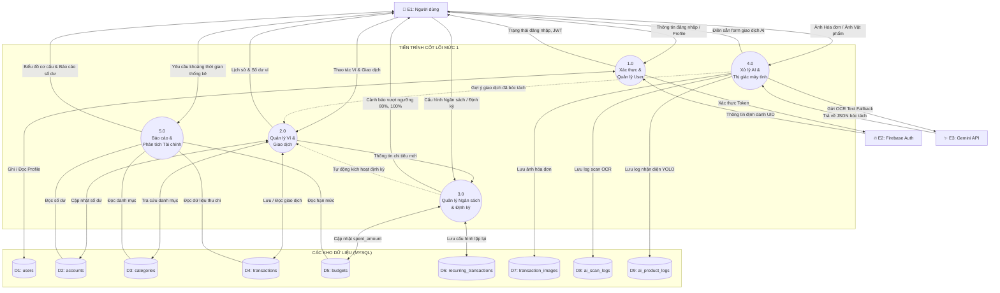
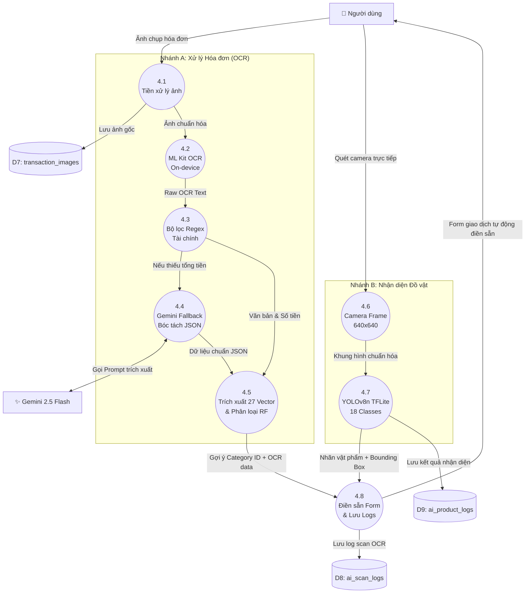

# HỒ SƠ THIẾT KẾ SƠ ĐỒ LUỒNG DỮ LIỆU (DFD)
## ỨNG DỤNG QUẢN LÝ TÀI CHÍNH CÁ NHÂN TÍCH HỢP THỊ GIÁC MÁY TÍNH VÀ AI
**Sinh viên thực hiện:** Nguyễn Duy Khánh - MSV: 2255010114 - Lớp: 22CN4  
**Giảng viên hướng dẫn:** TS. Nguyễn Mạnh Thắng  
**Khoa:** Công nghệ Thông tin - Trường Đại học Kiến trúc Hà Nội  
**Phiên bản:** v1.2 (Tháng 11/2026 - Chuẩn DFD Gane-Sarson / Yourdon)

---

## 1. CÁC THÀNH PHẦN CỦA HỆ THỐNG DFD

### 1.1. Tác nhân ngoài (External Entities)

| Mã | Tên Tác nhân | Phân loại | Mô tả luồng dữ liệu vào / ra |
| :---: | :--- | :--- | :--- |
| **E1** | **Người dùng cá nhân (End User)** | Thực thể chính | Gửi dữ liệu đăng ký/đăng nhập, giao dịch thu chi, ngân sách, ảnh hóa đơn, ảnh vật phẩm. Nhận kết quả xác thực, thông báo cảnh báo ngân sách, gợi ý AI điền sẵn form, biểu đồ báo cáo tài chính. |
| **E2** | **Firebase Auth Service** | Dịch vụ ngoài | Nhận yêu cầu xác thực JWT. Trả về thông tin danh tính, Token định danh duy nhất (`firebase_uid`). |
| **E3** | **Google Gemini AI Service** | Dịch vụ AI đám mây | Nhận chuỗi văn bản OCR thô và Prompt bóc tách. Trả về đối tượng JSON cấu trúc hóa gồm: `merchant`, `amount`, `date`. |

### 1.2. Danh mục Kho dữ liệu (Data Stores - 9 Bảng MySQL)

| Mã Kho | Tên Bảng MySQL | Mục đích và nội dung lưu trữ |
| :---: | :--- | :--- |
| **D1** | `users` | Hồ sơ người dùng: `user_id`, `firebase_uid`, `email`, `full_name`, `avatar_url`, `auth_provider`. |
| **D2** | `accounts` | Danh sách ví tài khoản: `account_id`, `user_id`, `account_name`, `account_type`, `balance`, `currency`. |
| **D3** | `categories` | Danh mục thu/chi: `category_id`, `user_id`, `category_name`, `category_type`, `icon`, `color`, `is_default`. |
| **D4** | `transactions` | Lịch sử giao dịch: `transaction_id`, `user_id`, `account_id`, `category_id`, `amount`, `transaction_type`, `date`. |
| **D5** | `budgets` | Hạn mức chi tiêu: `budget_id`, `user_id`, `category_id`, `amount_limit`, `daily_amount_limit`, `spent_amount`, `start/end_date`. |
| **D6** | `recurring_transactions` | Cấu hình lặp lại: `recurring_id`, `user_id`, `account_id`, `category_id`, `amount`, `repeat_type`, `next_run_date`. |
| **D7** | `transaction_images` | Ảnh hóa đơn: `image_id`, `transaction_id`, `image_url`, `ocr_text`, `uploaded_at`. |
| **D8** | `ai_scan_logs` | Nhật ký bóc tách OCR: `ai_scan_log_id`, `raw_ocr_text`, `detected_merchant`, `detected_amount`, `suggested_category_id`. |
| **D9** | `ai_product_logs` | Nhật ký nhận diện vật phẩm: `ai_product_log_id`, `raw_yolo_json`, `suggested_category_id`. |

---

## 2. DFD MỨC NGỮ CẢNH (CONTEXT LEVEL 0)

Sơ đồ ngữ cảnh mô tả mối quan hệ trao đổi thông tin tổng quát giữa toàn bộ hệ thống phần mềm với các thực thể bên ngoài:

```mermaid
flowchart LR
    E1["👤 E1: Người dùng cá nhân"]
    E2["🔥 E2: Firebase Auth Service"]
    E3["✨ E3: Google Gemini 2.5 Flash"]

    P0(("0.0<br/>HỆ THỐNG QUẢN LÝ<br/>TÀI CHÍNH CÁ NHÂN<br/>TÍCH HỢP AI"))

    %% Luong E1 -> P0
    E1 -->|1. Yêu cầu ĐK / ĐN<br/>2. Thông tin Ví & Danh mục<br/>3. Giao dịch Thu / Chi<br/>4. Cấu hình Ngân sách & Định kỳ<br/>5. Ảnh Hóa đơn / Ảnh Vật phẩm<br/>6. Yêu cầu xem Báo cáo| P0

    %% Luong P0 -> E1
    P0 -->|1. Token xác thực, Trạng thái phiên<br/>2. Số dư ví, Lịch sử giao dịch<br/>3. Cảnh báo vượt ngân sách 80%/100%<br/>4. Form giao dịch điền sẵn từ AI<br/>5. Biểu đồ thu chi Pie / Bar Chart| E1

    %% Luong P0 <-> E2
    P0 -->|Gửi Token yêu cầu xác minh| E2
    E2 -->|Trả về Firebase UID & Profile| P0

    %% Luong P0 <-> E3
    P0 -->|Gửi Raw OCR Text + Prompt JSON| E3
    E3 -->|Trả về JSON bóc tách {merchant, amount, date}| P0
```

---

## 3. DFD MỨC ĐỈNH (LEVEL 1)

Ở mức đỉnh, hệ thống được phân rã thành 5 tiến trình cốt lõi và kết nối với 9 kho dữ liệu:



---

## 4. DFD MỨC DƯỚI ĐỈNH (LEVEL 2)

### 4.1. DFD Mức 2 cho Tiến trình 2.0: Quản lý Ví và Giao dịch Thu Chi

```mermaid
flowchart TD
    E1["👤 Người dùng"]
    
    P21(("2.1<br/>Quản lý<br/>Ví tài khoản"))
    P22(("2.2<br/>Tiếp nhận &<br/>Kiểm tra GD"))
    P23(("2.3<br/>Ghi nhận<br/>Giao dịch"))
    P24(("2.4<br/>Điều chỉnh<br/>Số dư Ví"))
    P25(("2.5<br/>Kích hoạt<br/>Đồng bộ Ngân sách"))

    D2[("D2: accounts")]
    D3[("D3: categories")]
    D4[("D4: transactions")]
    P3_Target(("3.0: Ngân sách"))

    E1 -->|Thông tin ví mới / sửa ví| P21
    P21 <-->|Ghi / Đọc thông tin ví| D2

    E1 -->|Nhập giao dịch Thu/Chi| P22
    P22 <---|Tra cứu danh mục| D3
    P22 -->|Dữ liệu giao dịch hợp lệ| P23
    P23 -->|Lưu bản ghi giao dịch| D4
    
    P23 -->|Lệnh thay đổi số dư| P24
    P24 <-->|Cập nhật balance (+/-)| D2
    P24 -->|Thông báo số dư mới| E1

    P23 -->|Chuyển tiếp (category_id, amount)| P25
    P25 -->|Kích hoạt cập nhật chi tiêu| P3_Target
```

---

### 4.2. DFD Mức 2 cho Tiến trình 3.0: Quản lý Ngân sách và Giao dịch Định kỳ

```mermaid
flowchart TD
    E1["👤 Người dùng"]
    Cron["⏰ Spring Scheduler (00:00 Daily)"]

    P31(("3.1<br/>Thiết lập<br/>Hạn mức"))
    P32(("3.2<br/>Cộng dồn<br/>Chi tiêu Ngân sách"))
    P33(("3.3<br/>Kiểm tra Ngưỡng<br/>& Cảnh báo"))
    P34(("3.4<br/>Cấu hình<br/>GD Định kỳ"))
    P35(("3.5<br/>Thực thi Định kỳ<br/>Tự động"))

    D5[("D5: budgets")]
    D6[("D6: recurring_transactions")]
    P2_Target(("2.0: Quản lý Ví & GD"))
    From_P2(("Chi tiêu mới từ 2.0"))

    E1 -->|Nhập hạn mức tháng / ngày| P31
    P31 -->|Lưu ngân sách| D5

    From_P2 -->|Giao dịch chi tiêu mới| P32
    P32 <-->|Cập nhật spent_amount| D5
    P32 -->|Dữ liệu chi tiêu tích lũy| P33
    P33 -->|Cảnh báo vượt 80% (Vàng) / 100% (Đỏ)| E1

    E1 -->|Cấu hình chu kỳ định kỳ| P34
    P34 -->|Lưu cấu hình lặp lại| D6

    Cron -->|Kích hoạt quét hằng ngày| P35
    P35 <-->|Đọc các bản ghi đến hẹn & cập nhật next_run_date| D6
    P35 -->|Lệnh tạo giao dịch tự động| P2_Target
```

---

### 4.3. DFD Mức 2 cho Tiến trình 4.0: AI Pipeline & Thị giác máy tính


