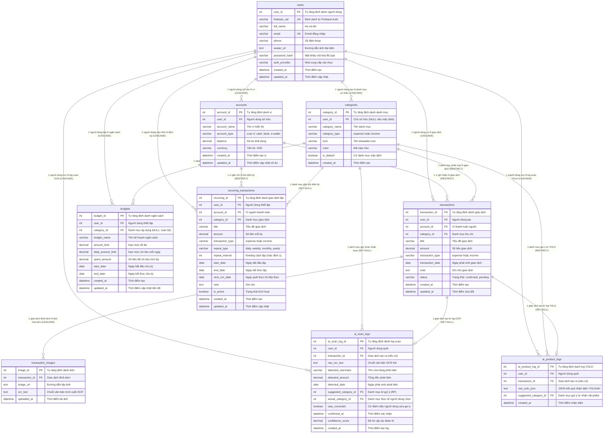

# HỒ SƠ THIẾT KẾ SƠ ĐỒ THỰC THỂ QUAN HỆ (ERD)
## ỨNG DỤNG QUẢN LÝ TÀI CHÍNH CÁ NHÂN TÍCH HỢP THỊ GIÁC MÁY TÍNH VÀ AI
**Sinh viên thực hiện:** Nguyễn Duy Khánh - MSV: 2255010114 - Lớp: 22CN4  
**Giảng viên hướng dẫn:** TS. Nguyễn Mạnh Thắng  
**Khoa:** Công nghệ Thông tin - Trường Đại học Kiến trúc Hà Nội  
**Hệ quản trị CSDL:** MySQL 8.0+ (InnoDB Engine, utf8mb4)  
**Phiên bản:** v1.2 (Tháng 11/2026 - Chuẩn thiết kế ERD đầy đủ 9 bảng bám sát 100% `database/schema.sql`)

---

## 1. SƠ ĐỒ THỰC THỂ QUAN HỆ ĐẦY ĐỦ (FULL ERD DIAGRAM)

Dưới đây là sơ đồ ERD chi tiết thể hiện toàn bộ 9 thực thể, các trường thuộc tính, kiểu dữ liệu, khóa chính (PK), khóa ngoại (FK) và liên kết quan hệ 1:1, 1:N:

---

## 2. MA TRẬN PHÂN TÍCH BẢN SỐ QUAN HỆ (CARDINALITY)

| Thực thể nguồn | Bản số | Thực thể đích | Tên Khóa ngoại (FK) | Hành vi Ràng buộc (ON DELETE) | Mô tả ý nghĩa nghiệp vụ |
| :--- | :---: | :--- | :--- | :--- | :--- |
| `users` | 1 : N | `accounts` | `accounts.user_id` | **CASCADE** | Một người dùng có nhiều ví tài khoản; xóa user sẽ xóa sạch ví thuộc về họ. |
| `users` | 1 : N | `categories` | `categories.user_id` | **CASCADE** | Một người dùng có thể tạo nhiều danh mục tùy biến cá nhân. |
| `users` | 1 : N | `transactions` | `transactions.user_id` | **CASCADE** | Một người dùng sở hữu toàn bộ lịch sử giao dịch phát sinh. |
| `users` | 1 : N | `budgets` | `budgets.user_id` | **CASCADE** | Một người dùng có thể đặt nhiều hạn mức chi tiêu cho các danh mục khác nhau. |
| `users` | 1 : N | `recurring_transactions` | `recurring_transactions.user_id` | **CASCADE** | Một người dùng quản lý danh sách các hóa đơn định kỳ tự động. |
| `users` | 1 : N | `ai_scan_logs` | `ai_scan_logs.user_id` | **CASCADE** | Lưu vết lịch sử bóc tách hóa đơn OCR của từng cá nhân. |
| `users` | 1 : N | `ai_product_logs` | `ai_product_logs.user_id` | **CASCADE** | Lưu vết lịch sử nhận diện vật phẩm YOLO của từng cá nhân. |
| `accounts` | 1 : N | `transactions` | `transactions.account_id` | **RESTRICT** | Một ví có nhiều giao dịch; không cho phép xóa ví khi còn bản ghi giao dịch chưa dọn dẹp. |
| `accounts` | 1 : N | `recurring_transactions` | `recurring_transactions.account_id` | **RESTRICT** | Không cho phép xóa ví khi còn lịch giao dịch định kỳ đang hoạt động. |
| `categories` | 1 : N | `transactions` | `transactions.category_id` | **RESTRICT** | Bảo toàn tính toàn vẹn báo cáo chi tiêu, không cho phép xóa danh mục khi còn giao dịch liên kết. |
| `categories` | 1 : N | `budgets` | `budgets.category_id` | **SET NULL** | Nếu xóa danh mục, hạn mức ngân sách vẫn giữ nguyên và gán về NULL (ngân sách chung). |
| `categories` | 1 : N | `recurring_transactions` | `recurring_transactions.category_id` | **SET NULL** | Nếu xóa danh mục, giao dịch định kỳ giữ nguyên số tiền và gán danh mục về NULL. |
| `categories` | 1 : N | `ai_scan_logs` | `ai_scan_logs.suggested_category_id` | **SET NULL** | Lưu trữ kết quả AI đề xuất danh mục; nếu danh mục bị xóa đặt FK về NULL. |
| `categories` | 1 : N | `ai_product_logs` | `ai_product_logs.suggested_category_id` | **RESTRICT** | Nhãn vật phẩm YOLO phải thuộc một danh mục hợp lệ trong hệ thống. |
| `transactions` | 1 : 1..N | `transaction_images` | `transaction_images.transaction_id` | **CASCADE** | Một giao dịch có ảnh hóa đơn đính kèm; khi xóa giao dịch, ảnh đính kèm tự động xóa theo. |
| `transactions` | 1 : 1 | `ai_scan_logs` | `ai_scan_logs.transaction_id` | **SET NULL** | Khi xóa giao dịch được tạo từ scan hóa đơn, log OCR vẫn được giữ lại để học máy. |
| `transactions` | 1 : 1 | `ai_product_logs` | `ai_product_logs.transaction_id` | **SET NULL** | Khi xóa giao dịch, log nhận diện YOLO vẫn được giữ lại để thống kê mô hình. |

---

## 3. NGUYÊN TẮC TOÀN VẸN DỮ LIỆU TÀI CHÍNH VÀ HỌC MÁY

1. **Bảo vệ Tính toàn vẹn Dòng tiền (`RESTRICT`):**
   * Các bảng tham chiếu trung tâm như `accounts` và `categories` được bảo vệ bằng ràng buộc `RESTRICT`. Điều này ngăn chặn triệt để tình trạng xóa nhầm ví tài khoản hoặc danh mục khi đang có dòng tiền phát sinh, loại bỏ hoàn toàn rủi ro sai lệch tổng tài sản (Net Worth).

2. **Cách ly Dữ liệu Người dùng (`CASCADE`):**
   * Mọi bảng nghiệp vụ phụ thuộc đều kết nối trực tiếp đến `users(user_id)` qua `ON DELETE CASCADE`. Điều này tuân thủ nghiêm ngặt tiêu chuẩn bảo mật dữ liệu người dùng (User Data Isolation), giúp việc xóa dữ liệu người dùng diễn ra triệt để, không để lại dữ liệu rác (orphan records) trong cơ sở dữ liệu.

3. **Bảo tồn Dữ liệu Huấn luyện AI (`SET NULL`):**
   * Hai bảng nhật ký học máy `ai_scan_logs` và `ai_product_logs` liên kết với `transactions(transaction_id)` qua ràng buộc `ON DELETE SET NULL`. Nhờ vậy, ngay cả khi người dùng quyết định hủy hoặc xóa một giao dịch thu chi, tập dữ liệu thô (Raw OCR text, Bounding box JSON, confidence score) vẫn được bảo toàn nguyên vẹn trong kho dữ liệu, tạo nguồn dataset phong phú phục vụ tinh chỉnh (Fine-tuning) và tái huấn luyện (Active Retraining) các mô hình AI sau này.
