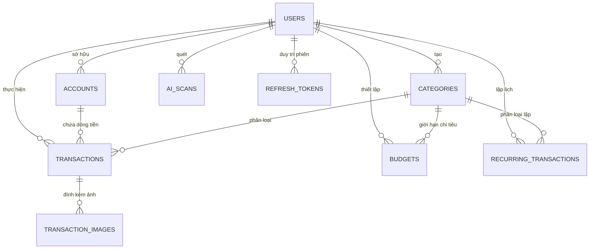

# 💻 TÀI LIỆU CHUYÊN SÂU: KIẾN TRÚC BACKEND SPRING BOOT & CƠ SỞ DỮ LIỆU MYSQL
**Mã tài liệu:** `02_BACKEND_SPRING_BOOT_MYSQL`  
**Đề tài:** Xây dựng ứng dụng quản lý tài chính cá nhân thông minh tích hợp Trí tuệ Nhân tạo và Thị giác Máy tính trên nền tảng Android  
**Sinh viên thực hiện:** Nguyễn Duy Khánh — Lớp: 22CN4 — Mã SV: 2255010114  
**Giảng viên hướng dẫn:** TS. Nguyễn Mạnh Thắng  
**Cơ sở đào tạo:** Khoa Công nghệ Thông tin – Trường Đại học Kiến trúc Hà Nội  

---

## 📌 MỤC LỤC CHI TIẾT
1. [Kiến trúc Tổng thể Hệ thống Backend (Layered Architecture)](#1-kiến-trúc-tổng-thể-hệ-thống-backend-layered-architecture)
2. [Thiết kế Cơ sở Dữ liệu Quan hệ MySQL 8.0 (ERD 9 Bảng)](#2-thiết-kế-cơ-sở-dữ-liệu-quan-hệ-mysql-80-erd-9-bảng)
   - [2.1 Sơ đồ thực thể liên kết (Entity Relationship Diagram)](#21-sơ-đồ-thực-thể-liên-kết-entity-relationship-diagram)
   - [2.2 Chi tiết cấu trúc 9 bảng dữ liệu](#22-chi-tiết-cấu-trúc-9-bảng-dữ-liệu)
   - [2.3 Ràng buộc toàn vẹn & Tối ưu hóa Index](#23-ràng-buộc-toàn-vẹn--tối-ưu-hóa-index)
3. [Phân hệ Nghiệp vụ Cốt lõi (Core Business Services)](#3-phân-hệ-nghiệp-vụ-cốt-lõi-core-business-services)
   - [3.1 Module Quản lý Ví & Chuyển tiền (AccountService)](#31-module-quản-lý-ví--chuyển-tiền-accountservice)
   - [3.2 Module Quản lý Giao dịch Thu/Chi (TransactionService)](#32-module-quản-lý-giao-dịch-thuchi-transactionservice)
   - [3.3 Module Danh mục & Ánh xạ từ khóa AI (CategoryService)](#33-module-danh-mục--ánh-xạ-từ-khóa-ai-categoryservice)
   - [3.4 Module Ngân sách & Cảnh báo vượt ngưỡng (BudgetService)](#34-module-ngân-sách--cảnh-báo-vượt-ngưỡng-budgetservice)
   - [3.5 Module Giao dịch định kỳ tự động (RecurringTransactionService)](#35-module-giao-dịch-định-kỳ-tự-động-recurringtransactionservice)
   - [3.6 Module Báo cáo Thống kê dòng tiền (ReportService)](#36-module-báo-cáo-thống-kê-dòng-tiền-reportservice)
   - [3.7 Module Tích hợp AI ONNX & Quét hóa đơn (AiScanService & GeminiService)](#37-module-tích-hợp-ai-onnx--quét-hóa-đơn-aiscanservice--geminiservice)
4. [Bảo mật Hệ thống & Xác thực (Spring Security & Firebase Admin SDK)](#4-bảo-mật-hệ-thống--xác-thực-spring-security--firebase-admin-sdk)
5. [Đặc tả Hệ thống RESTful API (Endpoints Specification)](#5-đặc-tả-hệ-thống-restful-api-endpoints-specification)
6. [Bộ Kiểm thử Tự động Toàn diện (88 Test Cases Đạt 100%)](#6-bộ-kiểm-thử-tự-động-toàn-diện-88-test-cases-đạt-100)
7. [Đóng gói Docker Container & Triển khai Hệ thống](#7-đóng-gói-docker-container--triển-khai-hệ-thống)

---

## 1. KIẾN TRÚC TỔNG THỂ HỆ THỐNG BACKEND (LAYERED ARCHITECTURE)

Hệ thống Backend được xây dựng trên nền tảng **Java 21 (LTS)** và **Spring Boot 3.2.5**, áp dụng mô hình kiến trúc phân tầng chuẩn doanh nghiệp (Enterprise Layered Architecture) nhằm phân tách độc lập các trách nhiệm:

```text
┌────────────────────────────────────────────────────────┐
│ 1. CONTROLLER LAYER (com.example.financebackend.controller) │
│ • Nhận request HTTP từ Android App (REST API JSON)     │
│ • Kiểm tra tính hợp lệ dữ liệu (@Valid, DTOs)          │
│ • Điều hướng đến Service và trả về ApiResponse<T>      │
└───────────────────────────┬────────────────────────────┘
                            │
                            ▼
┌────────────────────────────────────────────────────────┐
│ 2. SERVICE LAYER (com.example.financebackend.service)  │
│ • Chứa toàn bộ Logic nghiệp vụ tài chính               │
│ • Quản lý giao dịch dữ liệu (@Transactional)           │
│ • Tích hợp ONNX Runtime Java & Gemini REST Client      │
└───────────────────────────┬────────────────────────────┘
                            │
                            ▼
┌────────────────────────────────────────────────────────┐
│ 3. REPOSITORY LAYER (com.example.financebackend.repository) │
│ • Giao tiếp với Database qua Spring Data JPA/Hibernate │
│ • Tối ưu truy vấn dữ liệu (JPQL, Derived Queries)      │
└───────────────────────────┬────────────────────────────┘
                            │
                            ▼
┌────────────────────────────────────────────────────────┐
│ 4. DATABASE LAYER (MySQL 8.0 Community Server)        │
│ • Lưu trữ bền vững 9 bảng dữ liệu quan hệ              │
│ • Đảm bảo các thuộc tính ACID trong quản lý tiền tệ   │
└────────────────────────────────────────────────────────┘
```

### Xử lý Ngoại lệ Tập trung (Global Exception Handling)
Hệ thống sử dụng `@RestControllerAdvice` trong lớp `GlobalExceptionHandler.java` để bắt mọi ngoại lệ phát sinh trong quá trình thực thi:
* `ResourceNotFoundException`: Báo lỗi HTTP 404 khi không tìm thấy ví tiền, giao dịch hoặc danh mục.
* `BadRequestException`: Báo lỗi HTTP 400 khi số tiền không hợp lệ, tên danh mục bị trùng lặp, hoặc vượt ngưỡng ngân sách.
* Mọi phản hồi lỗi đều được bọc trong cấu trúc chuẩn:
  ```json
  {
    "success": false,
    "message": "Danh mục 'Ăn uống' đã tồn tại trong hệ thống",
    "data": null
  }
  ```

---

## 2. THIẾT KẾ CƠ SỞ DỮ LIỆU QUAN HỆ MYSQL 8.0 (ERD 9 BẢNG)

### 2.1 Sơ đồ thực thể liên kết (Entity Relationship Diagram)
Cơ sở dữ liệu bao gồm **9 bảng quan hệ chặt chẽ**, phản ánh đầy đủ mô hình dòng tiền cá nhân và tích hợp AI:



### 2.2 Chi tiết cấu trúc 9 bảng dữ liệu

#### 1. Bảng `users` (Thông tin người dùng)
Lưu trữ định danh người dùng đăng ký qua Email hoặc Google/Firebase:
* `user_id` (INT, PK, Auto Increment): Mã định danh duy nhất.
* `firebase_uid` (VARCHAR(128), UNIQUE): Mã định danh liên kết tài khoản Firebase.
* `email` (VARCHAR(100), UNIQUE): Địa chỉ email đăng nhập.
* `password_hash` (VARCHAR(255)): Mật khẩu đã băm (nếu dùng đăng ký thường).
* `full_name` (VARCHAR(100)): Họ tên hiển thị của người dùng.
* `avatar_url` (VARCHAR(255)): Đường dẫn ảnh đại diện.
* `auth_provider` (VARCHAR(20)): Phương thức đăng nhập (`google`, `email`, `demo`).
* `created_at`, `updated_at` (TIMESTAMP): Thời gian khởi tạo và cập nhật.

#### 2. Bảng `accounts` (Ví và tài khoản tài chính)
Quản lý các nguồn tiền của người dùng:
* `account_id` (INT, PK, Auto Increment): Mã ví.
* `user_id` (INT, FK -> users): Người sở hữu ví.
* `account_name` (VARCHAR(50)): Tên ví (ví dụ: *Ví tiền mặt*, *Vietcombank*, *MB Bank*).
* `account_type` (VARCHAR(20)): Phân loại ví (`cash`, `bank`, `e-wallet`).
* `balance` (DECIMAL(15,2)): Số dư tiền mặt hiện tại (chuẩn số thực độ chính xác cao).
* `currency` (VARCHAR(5)): Đơn vị tiền tệ (mặc định: `VND`).

#### 3. Bảng `categories` (Danh mục chi tiêu và thu nhập)
Quản lý cây danh mục dòng tiền:
* `category_id` (INT, PK, Auto Increment): Mã danh mục.
* `user_id` (INT, FK -> users, NULLable): Nếu `NULL` là danh mục mặc định của hệ thống; nếu có `user_id` là danh mục cá nhân tự tạo.
* `category_name` (VARCHAR(50)): Tên danh mục (ví dụ: *Ăn uống, Di chuyển, Mua sắm, Lương*).
* `category_type` (VARCHAR(10)): Loại danh mục (`expense` - chi tiêu hoặc `income` - thu nhập).
* `icon_name` (VARCHAR(50)): Tên icon hiển thị trên Android (ví dụ: `ic_food`, `ic_transport`).
* `color_hex` (VARCHAR(10)): Mã màu hiển thị (ví dụ: `#FF5722`).
* `is_default` (BOOLEAN): Đánh dấu danh mục mặc định hệ thống.

#### 4. Bảng `transactions` (Giao dịch thu và chi)
Bảng trung tâm ghi nhận biến động dòng tiền:
* `transaction_id` (INT, PK, Auto Increment): Mã giao dịch.
* `user_id` (INT, FK -> users): Người thực hiện.
* `account_id` (INT, FK -> accounts): Ví thực hiện chi tiêu hoặc nhận tiền.
* `category_id` (INT, FK -> categories): Danh mục của khoản tiền.
* `amount` (DECIMAL(15,2)): Số tiền giao dịch (luôn là số dương).
* `transaction_type` (VARCHAR(10)): `EXPENSE` (khoản chi) hoặc `INCOME` (khoản thu).
* `transaction_date` (DATETIME): Ngày giờ phát sinh giao dịch.
* `note` (TEXT): Ghi chú chi tiết của người dùng.
* `ai_scan_id` (INT, FK -> ai_scans, NULLable): Đánh dấu nếu giao dịch được tạo từ tính năng quét AI.

#### 5. Bảng `budgets` (Ngân sách chi tiêu hàng tháng)
Quản lý hạn mức chi tiêu để kích hoạt cảnh báo:
* `budget_id` (INT, PK, Auto Increment): Mã ngân sách.
* `user_id` (INT, FK -> users): Người thiết lập.
* `category_id` (INT, FK -> categories): Danh mục áp dụng hạn mức (ví dụ: Ăn uống).
* `amount_limit` (DECIMAL(15,2)): Hạn mức tối đa được phép chi trong tháng.
* `month_year` (VARCHAR(7)): Tháng áp dụng định dạng `YYYY-MM` (ví dụ: `2026-11`).

#### 6. Bảng `recurring_transactions` (Giao dịch định kỳ tự động)
Quản lý các khoản tiền phát sinh cố định (tiền nhà, tiền điện, tiền mạng, trả góp):
* `recurring_id` (INT, PK, Auto Increment): Mã giao dịch định kỳ.
* `user_id`, `account_id`, `category_id` (INT, FK).
* `amount` (DECIMAL(15,2)): Số tiền cố định.
* `frequency` (VARCHAR(20)): Tần suất (`DAILY`, `WEEKLY`, `MONTHLY`, `YEARLY`).
* `start_date`, `end_date` (DATE): Thời gian bắt đầu và kết thúc hiệu lực.
* `next_due_date` (DATE): Ngày đến hạn phát sinh giao dịch tiếp theo.
* `is_active` (BOOLEAN): Trạng thái đang kích hoạt hay tạm dừng.

#### 7. Bảng `transaction_images` (Ảnh đính kèm giao dịch)
Lưu trữ ảnh hóa đơn hoặc ảnh sản phẩm chụp từ camera:
* `image_id` (INT, PK, Auto Increment): Mã ảnh.
* `transaction_id` (INT, FK -> transactions): Giao dịch sở hữu ảnh.
* `image_url` (VARCHAR(255)): Đường dẫn tệp tin trên máy chủ (lưu trong thư mục `backend/uploads/`).
* `file_name` (VARCHAR(100)): Tên gốc của tệp ảnh.

#### 8. Bảng `ai_scans` / `ai_scan_logs` (Nhật ký xử lý AI & Phản hồi)
Lưu vết các lượt phân tích hình ảnh và hóa đơn để đánh giá độ chính xác:
* `scan_id` (INT, PK, Auto Increment): Mã lượt quét.
* `user_id` (INT, FK -> users): Người quét.
* `scan_type` (VARCHAR(20)): `PRODUCT_CAMERA` (nhận diện vật thể) hoặc `INVOICE_OCR` (quét hóa đơn).
* `raw_input_text` (TEXT): Văn bản OCR thô hoặc danh sách nhãn YOLO.
* `predicted_category_id` (INT, FK -> categories): Danh mục do AI dự đoán.
* `confidence_score` (DECIMAL(5,4)): Điểm tin cậy của AI (từ 0.0000 đến 1.0000).
* `user_corrected_category_id` (INT, FK -> categories, NULLable): Danh mục do người dùng sửa lại (dùng để đo đạc độ chuẩn xác thực tế).

#### 9. Bảng `refresh_tokens` (Quản lý phiên đăng nhập)
* `token_id` (INT, PK, Auto Increment).
* `user_id` (INT, FK -> users).
* `token` (VARCHAR(255), UNIQUE): Chuỗi refresh token duy trì phiên.
* `expiry_date` (TIMESTAMP): Thời gian hết hạn.

---

## 3. PHÂN HỆ NGHIỆP VỤ CỐT LÕI (CORE BUSINESS SERVICES)

### 3.1 Module Quản lý Ví & Chuyển tiền (AccountService)
* **Tính toàn vẹn số dư:** Sử dụng `@Transactional` để đảm bảo khi một giao dịch chi tiêu được tạo, số dư của ví tương ứng **bắt buộc phải bị trừ đi ngay lập tức**.
* **Nghiệp vụ chuyển tiền (Account Transfer):**
  * Kiểm tra số dư ví nguồn có đủ tiền chuyển hay không.
  * Trừ tiền ví nguồn và cộng tiền ví đích trong cùng một Transaction cơ sở dữ liệu. Nếu một trong hai bước gặp lỗi, hệ thống tự động Rollback lại số dư ban đầu, không bao giờ xảy ra tình trạng "tiền bị bốc hơi".

### 3.2 Module Quản lý Giao dịch Thu/Chi (TransactionService)
* **Quy trình thêm giao dịch mới:**
  1. Kiểm tra tồn tại của Người dùng, Ví tiền và Danh mục.
  2. Lưu bản ghi vào bảng `transactions`.
  3. Cập nhật số dư trong bảng `accounts`:
     * Nếu `transaction_type == 'EXPENSE'`: $\text{Balance}_{\text{mới}} = \text{Balance}_{\text{cũ}} - \text{Amount}$
     * Nếu `transaction_type == 'INCOME'`: $\text{Balance}_{\text{mới}} = \text{Balance}_{\text{cũ}} + \text{Amount}$
  4. Nếu có ảnh tải lên qua `MultipartFile`, hệ thống kiểm tra định dạng ảnh (jpg, png), lưu vật lý vào thư mục `uploads/` và ghi nhận vào bảng `transaction_images`.

### 3.3 Module Danh mục & Ánh xạ từ khóa AI (CategoryService)
* **Chống trùng lặp danh mục:** Khi người dùng tạo danh mục mới, hệ thống tự động chuẩn hóa chuỗi (trim khoảng trắng, chuyển lowercase) để ngăn chặn việc tạo trùng tên (ví dụ: đã có *"Ăn uống"* thì không được tạo thêm *"ăn uống "*).
* **Bộ ánh xạ từ khóa AI (`mapKeywordToVietnameseName`):**  
  Khi Gemini AI hoặc mô hình YOLO trả về từ khóa tiếng Anh (`food`, `transport`, `shopping`, `bills`, `entertainment`, `health`), hàm ánh xạ sẽ tự động tìm kiếm danh mục tiếng Việt tương ứng trong CSDL của người dùng:
  * `food` $\rightarrow$ Tự động gán Danh mục **Ăn uống**
  * `transport` $\rightarrow$ Tự động gán Danh mục **Di chuyển**
  * `shopping` $\rightarrow$ Tự động gán Danh mục **Mua sắm**

### 3.4 Module Ngân sách & Cảnh báo vượt ngưỡng (BudgetService)
* Cho phép thiết lập mức chi tối đa cho từng danh mục trong tháng (ví dụ: Ăn uống tối đa 3.000.000 đ trong tháng 11/2026).
* **Thuật toán kiểm tra ngân sách thời gian thực:**
  $$\text{Tỷ lệ chi tiêu (\%)} = \frac{\sum \text{Các khoản chi trong tháng của danh mục}}{\text{Hạn mức ngân sách (amount\_limit)}} \times 100\%$$
* **Cơ chế cảnh báo thông minh:**
  * $\text{Tỷ lệ} \ge 80\%$: Trả về cảnh báo màu vàng (*"Bạn đã tiêu hết 80% ngân sách danh mục"*).
  * $\text{Tỷ lệ} \ge 100\%$: Trả về cảnh báo màu đỏ nguy hiểm (*"Cảnh báo: Bạn đã vượt quá hạn mức ngân sách!"*).

### 3.5 Module Giao dịch định kỳ tự động (RecurringTransactionService)
* Quản lý các khoản chi cố định hàng tháng mà người dùng không cần nhớ để nhập.
* **Tự động hóa qua Spring Scheduler:**
  Kích hoạt bằng `@EnableScheduling` trong `FinanceBackendApplication.java`.
  ```java
  @Scheduled(cron = "0 0 1 * * ?") // Chạy tự động lúc 01:00 AM mỗi đêm
  public void processRecurringTransactions() {
      LocalDate today = LocalDate.now();
      List<RecurringTransaction> dueList = recurringRepo.findDueTransactions(today);
      for (RecurringTransaction item : dueList) {
          // Tự động sinh ra giao dịch mới vào bảng transactions
          transactionService.createFromRecurring(item);
          // Cập nhật next_due_date cho chu kỳ tiếp theo
          item.setNextDueDate(calculateNextDate(item.getFrequency(), today));
      }
  }
  ```

### 3.6 Module Báo cáo Thống kê dòng tiền (ReportService)
* **Thống kê tổng quan:** Tính toán Tổng thu (Total Income), Tổng chi (Total Expense), Số tiền ròng (Net Savings) trong khoảng thời gian bất kỳ (theo tuần, tháng, quý, năm).
* **Phân tích tỷ trọng chi tiêu (PieChart / BarChart):** Nhóm các khoản chi theo danh mục, tính tổng tiền và tỷ lệ phần trăm đóng góp của từng nhóm chi tiêu để gửi cho Android hiển thị đồ thị trực quan.

### 3.7 Module Tích hợp AI ONNX & Quét hóa đơn (AiScanService & GeminiService)
* **Nạp mô hình ONNX:** Nạp mô hình `random_forest_model.onnx` bằng `OrtEnvironment` ngay khi khởi động ứng dụng. Khi nhận 27 đặc trưng từ Android, hệ thống suy luận phân loại trong vòng **< 2 mili-giây**.
* **Tích hợp Gemini 2.5 Flash:** Sử dụng `RestTemplate` gọi API của Google với cấu trúc JSON Schema chuẩn.
* **Bộ dự phòng Fallback Regex (`ReceiptParser`):** Nếu mất mạng hoặc hết quota Gemini, hệ thống tự động chuyển sang bóc tách số tiền và ngày tháng bằng Regex cục bộ, đảm bảo dịch vụ luôn thông suốt.

---

## 4. BẢO MẬT HỆ THỐNG & XÁC THỰC (SPRING SECURITY & FIREBASE ADMIN SDK)

Backend áp dụng kiến trúc bảo mật không trạng thái (**Stateless Authentication**):
1. **Khởi tạo Firebase Admin SDK (`FirebaseConfig.java`):** Nạp file `firebase-service-account.json` từ classpath để kết nối với Google.
2. **Bộ lọc xác thực (`FirebaseAuthFilter.java`):**
   * Can thiệp vào mọi request HTTP gửi đến (trừ các endpoint công khai như `/api/auth/**`, `/swagger-ui/**`).
   * Trích xuất token từ Header: `Authorization: Bearer <token>`.
   * Kiểm tra chữ ký số với Firebase: `FirebaseToken decodedToken = FirebaseAuth.getInstance().verifyIdToken(token)`.
   * Thiết lập thông tin người dùng vào `SecurityContextHolder`.
3. **Cấu hình CORS (`CorsConfig.java`):** Cho phép các thiết bị di động Android và trình duyệt Web cục bộ kết nối mà không bị chặn bởi chính sách Same-Origin Policy.

---

## 5. ĐẶC TẢ HỆ THỐNG RESTFUL API (ENDPOINTS SPECIFICATION)

| STT | Phương thức | Đường dẫn API (Endpoint) | Chức năng nghiệp vụ |
| :---: | :---: | :--- | :--- |
| **1** | `POST` | `/api/auth/firebase-login` | Đồng bộ người dùng Firebase và cấp phiên đăng nhập |
| **2** | `POST` | `/api/auth/demo-login` | Đăng nhập nhanh chế độ Demo |
| **3** | `GET` | `/api/accounts?userId={id}` | Lấy danh sách ví tài chính của người dùng |
| **4** | `POST` | `/api/accounts` | Tạo mới ví tiền mặt / tài khoản ngân hàng |
| **5** | `PUT` | `/api/accounts/{id}` | Cập nhật tên ví và số dư |
| **6** | `GET` | `/api/transactions?userId={id}` | Lấy danh sách toàn bộ giao dịch (có phân trang) |
| **7** | `POST` | `/api/transactions` | Tạo mới khoản thu hoặc chi tiêu (cộng/trừ số dư ví) |
| **8** | `PUT` | `/api/transactions/{id}` | Chỉnh sửa giao dịch và cập nhật lại số dư ví |
| **9** | `DELETE` | `/api/transactions/{id}` | Xóa giao dịch và hoàn trả số dư ví |
| **10** | `GET` | `/api/categories?userId={id}` | Lấy danh mục mặc định và danh mục cá nhân |
| **11** | `POST` | `/api/categories` | Thêm mới danh mục cá nhân (có kiểm tra trùng lặp) |
| **12** | `GET` | `/api/budgets?userId={id}&month={m}`| Lấy ngân sách tháng và trạng thái cảnh báo |
| **13** | `POST` | `/api/budgets` | Thiết lập hạn mức ngân sách mới |
| **14** | `GET` | `/api/recurring?userId={id}` | Lấy danh sách giao dịch định kỳ đang hoạt động |
| **15** | `POST` | `/api/recurring` | Tạo mới khoản chi định kỳ hàng tháng |
| **16** | `GET` | `/api/reports/monthly?userId={id}` | Lấy số liệu báo cáo thu chi và tỷ trọng danh mục |
| **17** | `POST` | `/api/ai-scan/classify` | API nhận diện hóa đơn (Gemini AI + Fallback Regex) |
| **18** | `POST` | `/api/ai-scan/product-classify` | API nhận 27 đặc trưng và suy luận Random Forest ONNX |

---

## 6. BỘ KIỂM THỬ TỰ ĐỘNG TOÀN DIỆN (88 TEST CASES ĐẠT 100%)

Hệ thống được kiểm thử tự động nghiêm ngặt bằng **JUnit 5** và **Mockito**:
* **Tổng số bài test tự động:** **88 Tests**
* **Tỷ lệ thành công:** **100% (88 Passed, 0 Failures, 0 Errors, 0 Skipped)**
* **Thời gian thực thi:** **~10.2 giây**

```text
[INFO] Results:
[INFO] Tests run: 88, Failures: 0, Errors: 0, Skipped: 0
[INFO] BUILD SUCCESS
```

### Bảng phân bố kiểm thử:
* **Controller Layer (Kiểm thử API Endpoint với `@WebMvcTest`):** 36 bài test cho 9 Controllers (kiểm tra status HTTP 200, 400, 404, định dạng JSON trả về).
* **Service Layer (Kiểm thử nghiệp vụ với Mockito Unit Test):** 52 bài test cho 8 Services (kiểm tra trừ tiền ví, cảnh báo ngân sách, chống trùng danh mục, mapping AI, cron job).

---

## 7. ĐÓNG GÓI DOCKER CONTAINER & TRIỂN KHAI HỆ THỐNG

Dự án được cấu hình sẵn sàng cho việc đóng gói và triển khai trên máy chủ thông qua Docker Compose (`docker-compose.yml`):
* **MySQL Container:** Chạy MySQL 8.0 trên cổng `3306`, tự động nạp kịch bản khởi tạo cơ sở dữ liệu `database/init.sql`.
* **Backend Container:** Đóng gói bằng **Multi-stage Dockerfile**:
  * Giai đoạn 1: Dùng Maven và OpenJDK 21 để biên dịch mã nguồn sang file `.jar`.
  * Giai đoạn 2: Dùng base image Eclipse Temurin JRE 21 siêu nhẹ (~180MB) để vận hành, cấu hình đọc biến môi trường kết nối database tự động.
* **Lệnh khởi chạy toàn bộ Backend và Database chỉ với 1 dòng:**
  ```bash
  docker compose up -d
  ```
