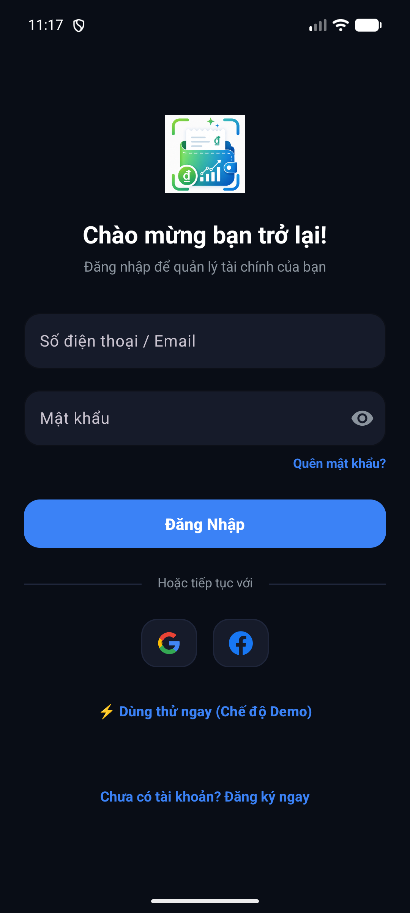
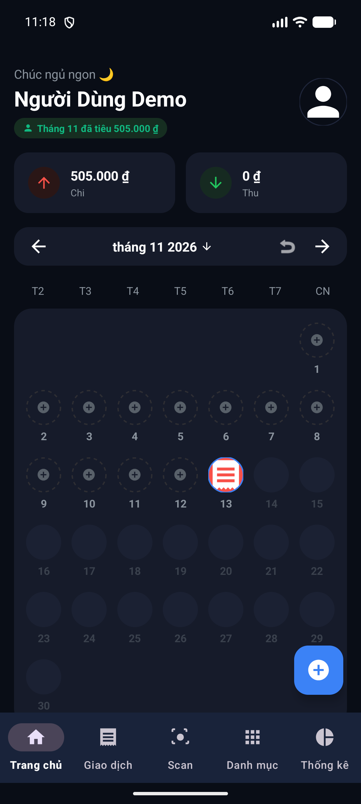
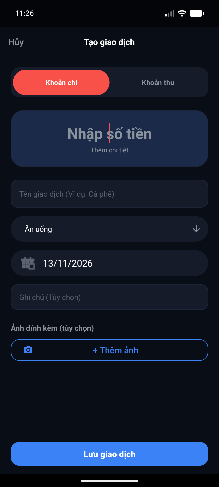
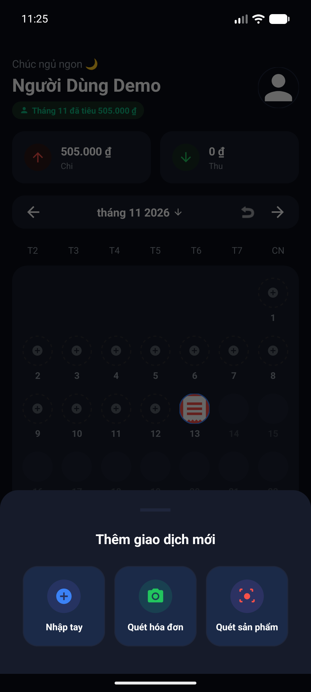
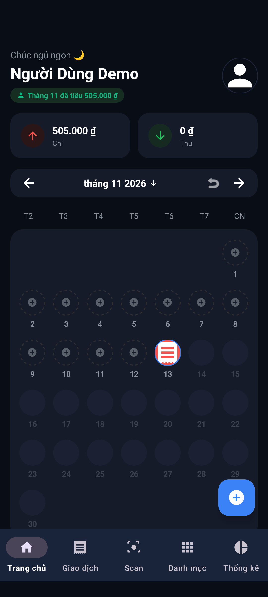
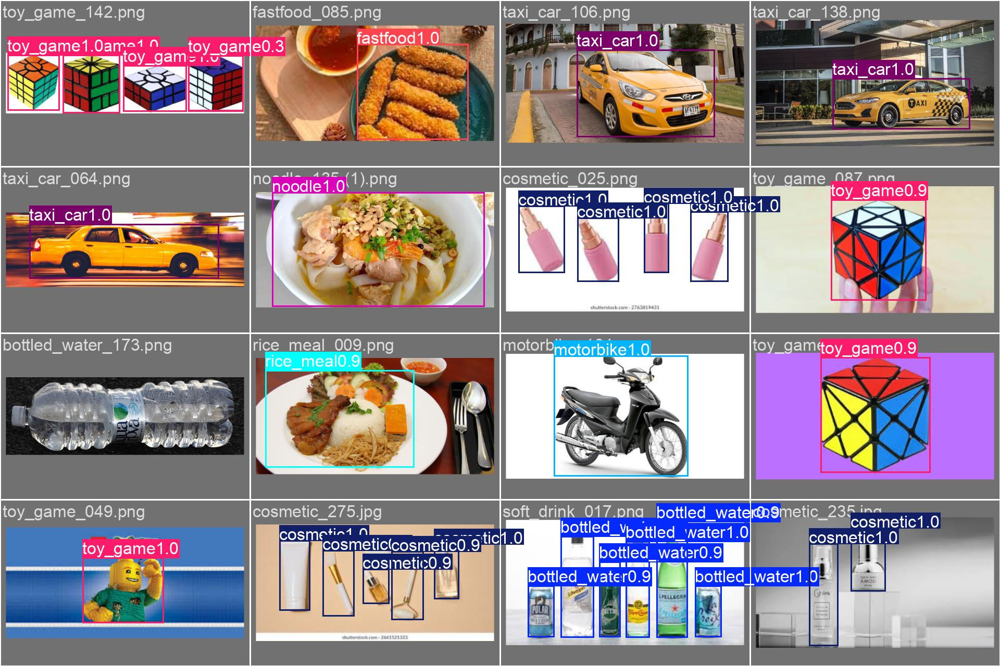
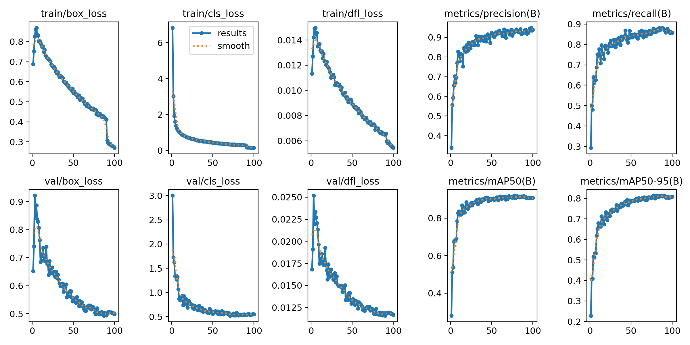
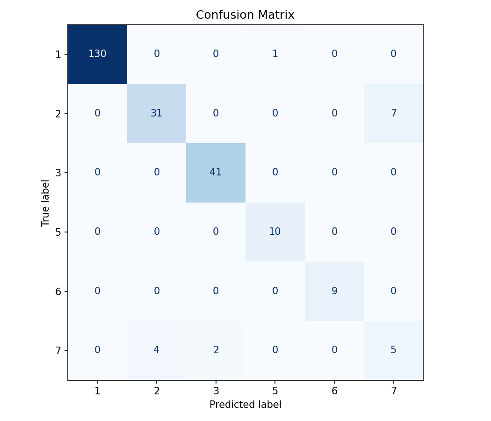
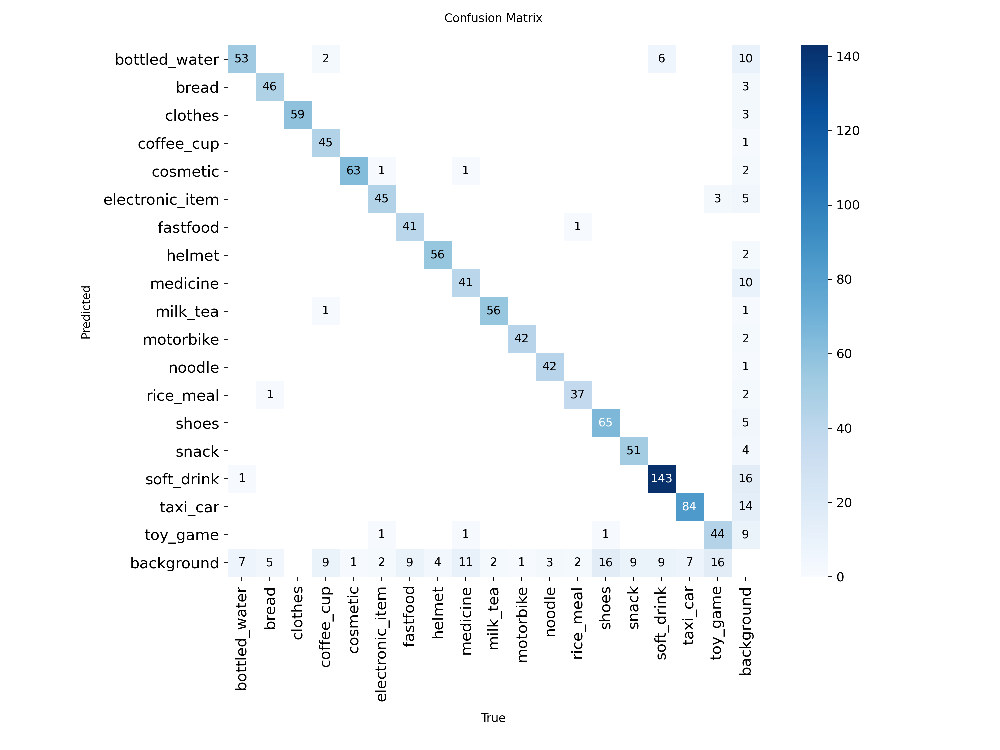
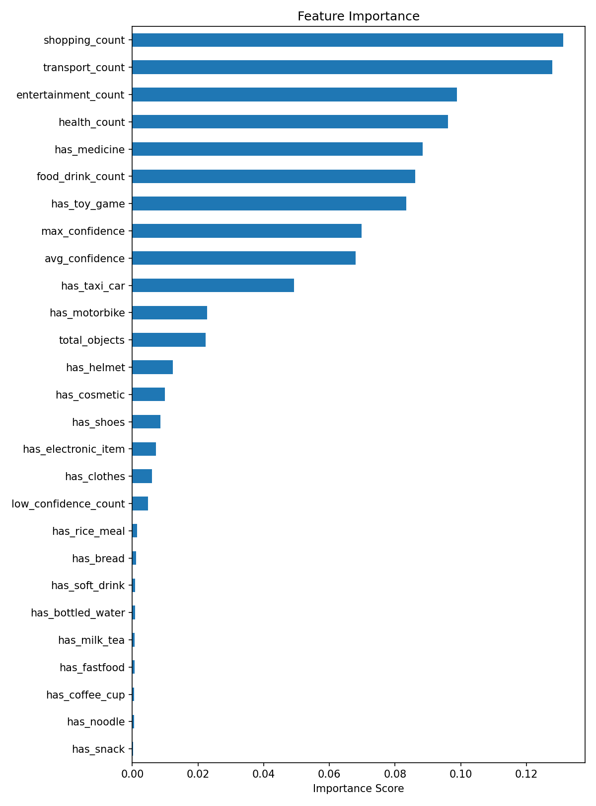

# 📱 TÀI LIỆU HƯỚNG DẪN GIAO DIỆN & LUỒNG HOẠT ĐỘNG
**Đề tài:** Xây dựng ứng dụng quản lý tài chính cá nhân thông minh tích hợp Trí tuệ Nhân tạo và Thị giác Máy tính trên nền tảng Android  
**Sinh viên thực hiện:** Nguyễn Duy Khánh — Lớp: 22CN4 — Mã SV: 2255010114  
**Giảng viên hướng dẫn:** TS. Nguyễn Mạnh Thắng  
**Cơ sở đào tạo:** Khoa Công nghệ Thông tin – Trường Đại học Kiến trúc Hà Nội  

---

## 📌 MỤC LỤC
1. [Tổng quan phong cách thiết kế & Điều hướng ứng dụng](#1-tổng-quan-phong-cách-thiết-kế--điều-hướng-ứng-dụng)
2. [Luồng 1: Khởi động ứng dụng & Xác thực người dùng (Authentication Flow)](#2-luồng-1-khởi-động-ứng-dụng--xác-thực-người-dùng)
3. [Luồng 2: Màn hình Tổng quan Tài chính (Dashboard)](#3-luồng-2-màn-hình-tổng-quan-tài-chính-dashboard)
4. [Luồng 3: Quy trình Thêm Giao dịch Mới (Step-by-Step Transaction Creation)](#4-luồng-3-quy-trình-thêm-giao-dịch-mới-step-by-step)
5. [Luồng 4: Quản lý & Lọc Giao dịch theo Thời gian (Timeline & Analytics)](#5-luồng-4-quản-lý--lọc-giao-dịch-theo-thời-gian)
6. [Luồng 5: Nhận diện Sản phẩm thông minh qua Camera (YOLOv8 + Random Forest)](#6-luồng-5-nhận-diện-sản-phẩm-thông-minh-qua-camera)
7. [Luồng 6: Quét Hóa đơn Tự động (OCR + Gemini AI)](#7-luồng-6-quét-hóa-đơn-tự-động-ocr--gemini-ai)

---

## 1. TỔNG QUAN PHONG CÁCH THIẾT KẾ & ĐIỀU HƯỚNG ỨNG DỤNG

* **Phong cách giao diện:** Áp dụng ngôn ngữ **Obsidian Dark Theme** (tông đen xám hiện đại, bảo vệ mắt và tiết kiệm điện năng cho màn hình AMOLED) kết hợp tiêu chuẩn **Material Design 3** của Google.
* **Cơ chế điều hướng (Navigation):**
  * **Thanh điều hướng dưới đáy (Bottom Navigation Bar):** Cố định 4 phân hệ chính: Trang chủ, Lịch sử giao dịch, Báo cáo thống kê, Cài đặt cá nhân.
  * **Nút hành động nổi ở trung tâm `[ + ]`:** Mở bảng tùy chọn nhập liệu thông minh (BottomSheet).
  * **Mô hình kiến trúc MVVM:** Sử dụng LiveData và ViewBinding, đảm bảo số dư ví và danh sách giao dịch cập nhật theo thời gian thực (Real-time).

---

## 2. LUỒNG 1: KHỞI ĐỘNG ỨNG DỤNG & XÁC THỰC NGƯỜI DÙNG

Khi người dùng mở ứng dụng, `LoginActivity` được kích hoạt.

  
*Hình 2.1: Màn hình Đăng nhập (LoginActivity) với đa dạng phương thức xác thực*

### Các thao tác và phản hồi:
* **Bước 1.1: Đăng nhập bằng Email & Mật khẩu:** Người dùng nhập Email, Mật khẩu $\rightarrow$ Nhấp nút **"Đăng nhập"** $\rightarrow$ Hệ thống xác thực qua Firebase Auth, đồng bộ với MySQL Backend và chuyển đến Trang chủ.
* **Bước 1.2: Đăng nhập 1 chạm với Google (Google Sign-In):** Nhấp nút **"Đăng nhập với Google"** $\rightarrow$ Google Play Services mở popup chọn tài khoản Gmail $\rightarrow$ Google cấp ID Token $\rightarrow$ Firebase xác thực $\rightarrow$ Backend tự động tạo tài khoản mới nếu chưa tồn tại.
* **Bước 1.3: Đăng nhập nhanh chế độ Demo (Quick Demo Login):** Nhấp nút **"Đăng nhập Demo"** $\rightarrow$ Vào thẳng màn hình chính với dữ liệu mẫu (ví tiền, giao dịch, biểu đồ) mà không cần mật khẩu hay tài khoản Google. Rất an toàn khi demo bảo vệ.
* **Bước 1.4: Cấu hình địa chỉ IP máy chủ Backend:** **Ấn giữ (Long-click) vào Logo** trên đỉnh màn hình $\rightarrow$ Bật hộp thoại nhập IP LAN máy tính (ví dụ: `192.168.1.5:8080`) để ứng dụng kết nối trực tiếp với Spring Boot.

---

## 3. LUỒNG 2: MÀN HÌNH TỔNG QUAN TÀI CHÍNH (DASHBOARD)

Sau khi đăng nhập, người dùng được đưa đến màn hình chính `MainActivity` (Fragment Home).

  
*Hình 3.1: Màn hình Trang chủ (Dashboard) hiển thị tổng số dư, thu chi tháng và giao dịch gần đây*

### Các khối chức năng trực quan:
1. **Thẻ Tổng tài sản (Total Balance Card):** Vị trí trên cùng, tính toán số dư thực tế từ tất cả các ví (Tiền mặt, Ngân hàng, Ví điện tử).
2. **Thẻ Dòng tiền trong tháng:**
   * **Thu nhập (Màu xanh):** Tổng số tiền đã thu trong tháng hiện tại.
   * **Chi tiêu (Màu đỏ cam):** Tổng số tiền đã chi tiêu trong tháng hiện tại.
3. **Danh sách Giao dịch gần đây (Recent Transactions):** Liệt kê các khoản thu/chi mới nhất kèm icon danh mục, ngày giờ và số tiền.
4. **Thanh điều hướng đáy (Bottom Navigation):** Chuyển đổi nhanh giữa Trang chủ, Sổ giao dịch, Báo cáo, Cài đặt.

---

## 4. LUỒNG 3: QUY TRÌNH THÊM GIAO DỊCH MỚI (STEP-BY-STEP)

Đây là quy trình thao tác cốt lõi của ứng dụng, gồm 3 bước:

### Bước 3.1: Mở bảng chọn phương thức nhập liệu
* **Thao tác:** Người dùng nhấp vào nút dấu cộng nổi **`[ + ]`** ở chính giữa Bottom Navigation.
* **Phản hồi:** Bảng chọn (Modal BottomSheet) trượt mượt mà từ đáy màn hình lên.

  
*Hình 4.1: Bảng BottomSheet chọn phương thức nhập (Nhập tay, Quét hóa đơn OCR, Nhận diện Camera AI)*

### Bước 3.2: Nhập thông tin chi tiết vào Form
* **Thao tác:** Người dùng nhấp chọn **"Nhập giao dịch thủ công"** $\rightarrow$ Form nhập liệu mở ra.

  
*Hình 4.2: Form nhập giao dịch thủ công (Chọn loại Chi/Thu, Danh mục, Ví, Số tiền, Ghi chú)*

* **Các trường nhập:**
  * Chọn loại: **Chi phí** (đỏ) hoặc **Thu nhập** (xanh).
  * Nhập số tiền bằng bàn phím số có tự động format dấu phẩy hàng nghìn.
  * Chọn icon Danh mục (Ăn uống, Di chuyển, Mua sắm, Hóa đơn...).
  * Chọn Ví nguồn tiền (Ví tiền mặt, Tài khoản Vietcombank...).
  * Nhập ghi chú, chọn ngày thực hiện.

### Bước 3.3: Bấm Lưu giao dịch & Cập nhật số dư
* **Thao tác:** Người dùng nhấp nút **"Lưu giao dịch"** màu xanh ở đáy màn hình.
* **Phản hồi:** Gửi API POST đến Spring Boot $\rightarrow$ Lưu vào MySQL $\rightarrow$ Tự động trừ/cộng tiền vào số dư ví $\rightarrow$ Đóng form và trở về màn hình danh sách giao dịch.

  
*Hình 4.3: Giao dịch mới hiển thị ngay lập tức trong danh sách và số dư ví được cập nhật chuẩn xác*

---

## 5. LUỒNG 4: QUẢN LÝ & LỌC GIAO DỊCH THEO THỜI GIAN

Người dùng nhấp vào tab **"Lịch sử"** trên Bottom Navigation để quản lý toàn bộ dòng tiền.

  
*Hình 5.1: Màn hình Danh sách toàn bộ giao dịch theo dòng thời gian Timeline*

* **Lọc theo từng Ngày:** Nhấp chọn một ngày cụ thể trên thanh cuộn ngày $\rightarrow$ Màn hình lọc chi tiết các khoản thu/chi phát sinh trong ngày đó và hiển thị tổng số tiền tiêu riêng trong ngày.

  
*Hình 5.2: Giao diện lọc chi tiết các khoản giao dịch phát sinh trong 1 ngày cụ thể*

* **Xem thống kê theo Tháng:** Nhấp chuyển sang chế độ **"Xem theo tháng"** $\rightarrow$ Hệ thống tổng hợp biến động toàn bộ dòng tiền thu/chi/tiết kiệm trong tháng.

  
*Hình 5.3: Giao diện thống kê và đối chiếu biến động dòng tiền theo Tháng*

---

## 6. LUỒNG 5: NHẬN DIỆN SẢN PHẨM THÔNG MINH QUA CAMERA (YOLOv8 + RANDOM FOREST)

Tính năng thông minh giúp người dùng không cần gõ tên mặt hàng hay tự chọn danh mục:
* **Bước 5.1:** Từ BottomSheet `[ + ]`, chọn **"Nhận diện sản phẩm qua Camera"**.
* **Bước 5.2:** CameraX kích hoạt, mô hình YOLOv8 TFLite nhận diện vật thể thời gian thực trực tiếp trên khung hình.

  
*Hình 6.1: Kết quả nhận diện đối tượng thực tế qua Camera bằng mô hình YOLOv8 TFLite*

* **Bước 5.3:** App tự động trích xuất vector 27 đặc trưng và gửi tới Random Forest ONNX trên Backend $\rightarrow$ Dự đoán danh mục (ví dụ: 'Ăn uống') trong **< 2ms** $\rightarrow$ Form thêm giao dịch mở ra với danh mục đã được chọn sẵn!

### Minh chứng huấn luyện mô hình AI:
| Minh chứng YOLOv8 | Minh chứng Random Forest |
| :---: | :---: |
|  *Hình 6.2: Đồ thị huấn luyện YOLOv8* |  *Hình 6.4: Ma trận nhầm lẫn Random Forest* |
|  *Hình 6.3: Ma trận nhầm lẫn YOLOv8* |  *Hình 6.5: Biểu đồ 27 đặc trưng Random Forest* |

---

## 7. LUỒNG 6: QUÉT HÓA ĐƠN TỰ ĐỘNG (OCR + GEMINI AI)

* **Bước 7.1:** Từ BottomSheet `[ + ]`, chọn **"Quét hóa đơn"** $\rightarrow$ Camera chụp hóa đơn.
* **Bước 7.2:** Google ML Kit OCR nhận diện toàn bộ văn bản thô dạng khối trên thiết bị (Offline).
* **Bước 7.3:** Gửi văn bản lên Backend $\rightarrow$ Gemini 2.5 Flash API (hoặc bộ Fallback Regex nội bộ) bóc tách: *Tên cửa hàng (Highlands Coffee), Số tiền (89.000 đ), Ngày tháng (2026-10-18), Danh mục (Ăn uống)*.
* **Bước 7.4:** Tự động điền vào Form giao dịch cho người dùng xác nhận và lưu chỉ với 1 chạm.
