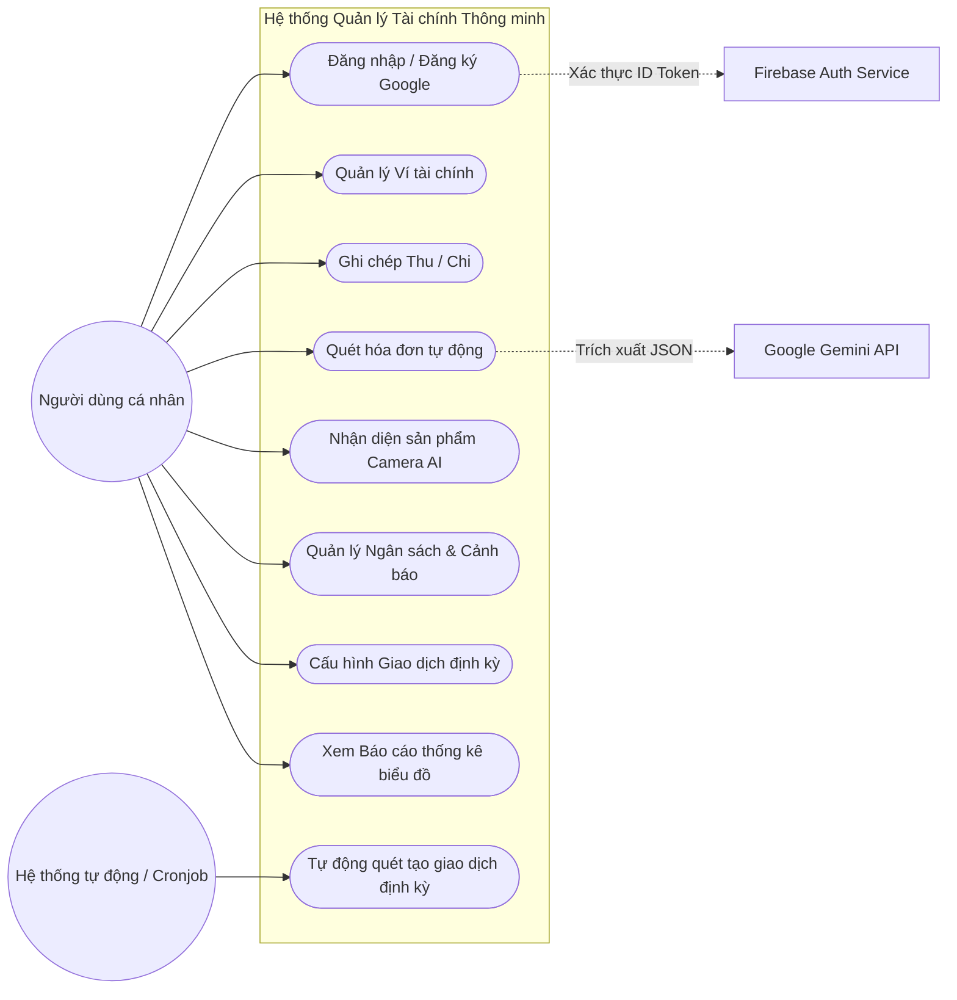
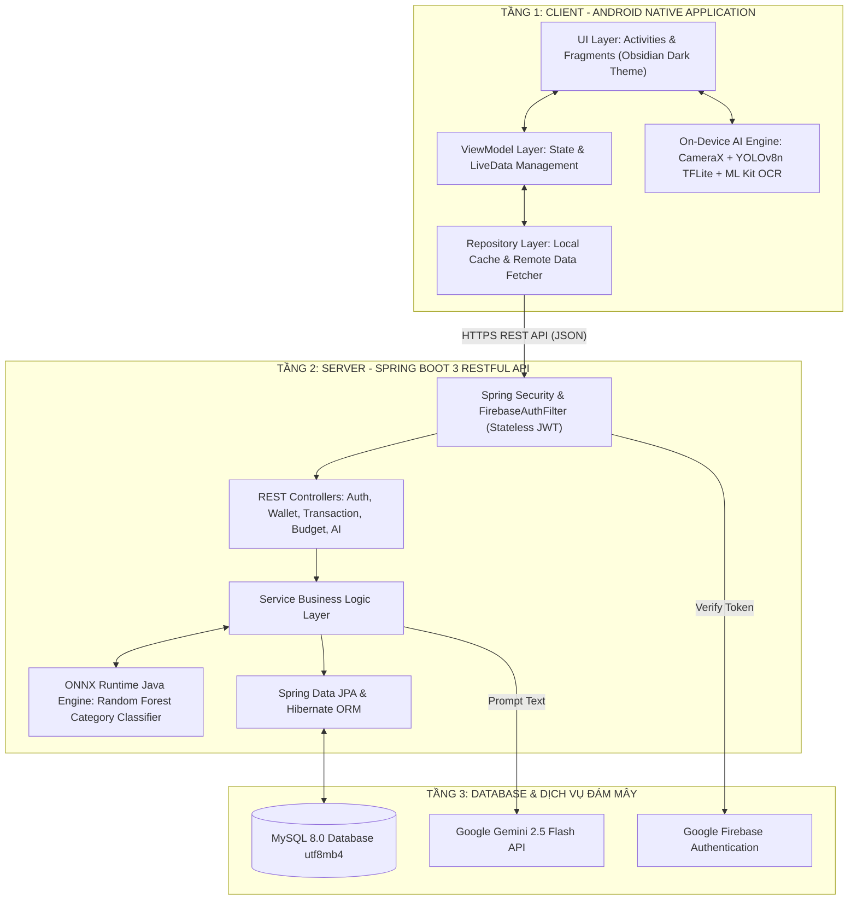
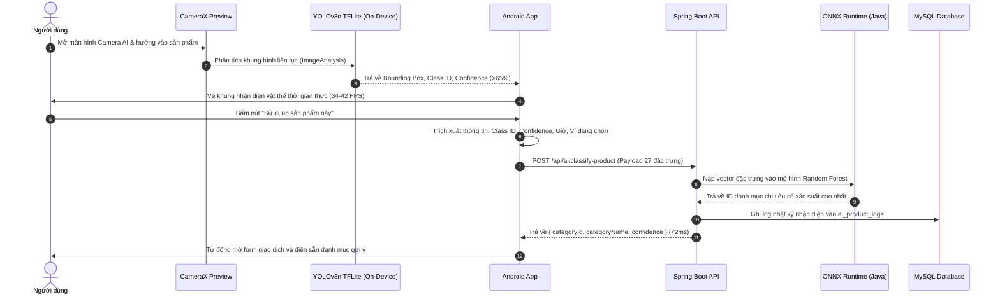
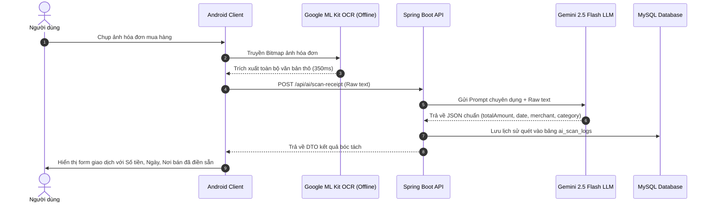
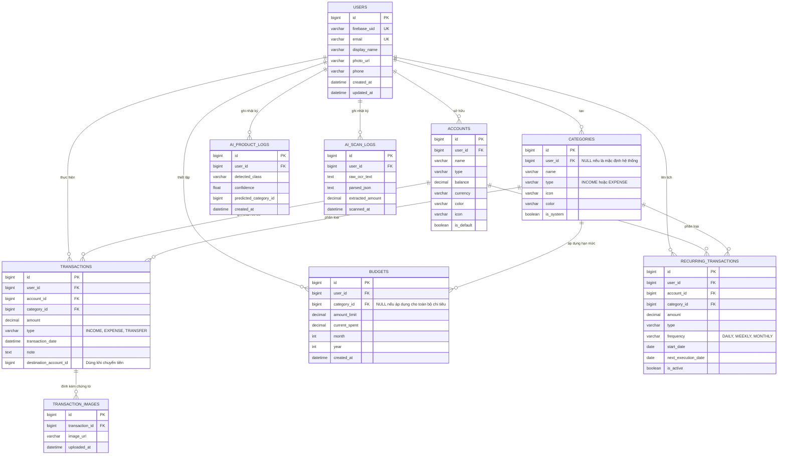

# TÀI LIỆU TOÀN VĂN THIẾT KẾ VÀ TRIỂN KHAI HỆ THỐNG
## DỰ ÁN ĐỒ ÁN TỐT NGHIỆP KỸ SƯ CÔNG NGHỆ THÔNG TIN

**Đề tài:** XÂY DỰNG ỨNG DỤNG QUẢN LÝ TÀI CHÍNH CÁ NHÂN TRÊN NỀN TẢNG ANDROID TÍCH HỢP NHẬN DIỆN VÀ PHÂN LOẠI CHI TIÊU BẰNG TRÍ TUỆ NHÂN TẠO  
**Sinh viên thực hiện:** Nguyễn Duy Khánh — Mã SV: 2255010114 — Lớp: 22CN4  
**Giáo viên hướng dẫn:** TS. Nguyễn Mạnh Thắng  
**Cơ sở đào tạo:** Khoa Công nghệ Thông tin – Trường Đại học Kiến trúc Hà Nội  

---

# MỤC 1: NGHIÊN CỨU TỔNG QUAN BÀI TOÁN & CƠ SỞ CÔNG NGHỆ (TUẦN 1)

## 1.1. Tổng quan bài toán Quản lý tài chính cá nhân trên thiết bị di động
Trong kỷ nguyên số hóa và sự bùng nổ của thanh toán không dùng tiền mặt (thẻ ngân hàng, ví điện tử MoMo/ZaloPay, chuyển khoản VietQR), các giao dịch mua sắm tiêu dùng diễn ra với tần suất cao nhưng phân tán. Người dùng rất dễ mất kiểm soát dòng tiền, dẫn đến chi tiêu vượt hạn mức và mất an toàn tài chính.

Khảo sát thực tiễn cho thấy trên 80% người dùng từ bỏ thói quen ghi chép tài chính chỉ sau 2-4 tuần do thao tác nhập liệu thủ công bằng bàn phím ảo quá cồng kềnh, tốn thời gian và dễ nhầm lẫn. Đề tài đặt mục tiêu giải quyết triệt để rào cản này bằng cách ứng dụng Thị giác máy tính (Computer Vision), Trí tuệ nhân tạo (AI) và Nhận dạng ký tự quang học (OCR) để tự động hóa 100% quy trình ghi chép chi tiêu.

## 1.2. Khảo sát và đánh giá các ứng dụng hiện có trên thị trường

| Tiêu chí so sánh | Money Lover | Sổ Thu Chi MISA | Spendee | **Hệ thống của đề tài** |
| :--- | :--- | :--- | :--- | :--- |
| **Ghi chép thủ công** | Đầy đủ, nhiều bước | Đầy đủ, phức tạp | Đầy đủ, trực quan | Tối ưu, nhanh chóng |
| **Quét hóa đơn (OCR)** | Có (Bản trả phí VIP đắt) | Có (Thu phí định kỳ) | Không có | **Tích hợp sẵn (ML Kit + Gemini 2.5 Flash)** |
| **Nhận diện sản phẩm qua Camera AI** | **Hoàn toàn không có** | **Hoàn toàn không có** | **Hoàn toàn không có** | **YOLOv8 On-Device thời gian thực (34–42 FPS)** |
| **Gợi ý danh mục tự động** | Dựa trên quy tắc cứng | Dựa trên quy tắc cứng | Học máy cơ bản | **Random Forest ONNX Backend (<2ms)** |
| **Bảo mật & Đồng bộ** | Đăng nhập tài khoản | Đăng nhập tài khoản | Đăng nhập tài khoản | **Firebase Auth + JWT Stateless an toàn** |
| **Giao diện người dùng** | Sáng/Tối cơ bản | Truyền thống | Hiện đại | **Obsidian Dark Theme chuyên nghiệp** |
| **Chi phí sử dụng** | Rất đắt (Gói định kỳ) | Tính phí theo năm | Tính phí theo tháng | **Mã nguồn mở, tối ưu chi phí** |

## 1.3. Nghiên cứu các công nghệ cốt lõi

### 1.3.1. Mô hình YOLOv8 và tối ưu hóa On-Device TensorFlow Lite
- **Kiến trúc:** YOLOv8 loại bỏ cấu trúc Anchor Box truyền thống, chuyển sang Anchor-Free Detect Head phân tách độc lập nhánh phân loại (Classification) và nhánh hồi quy tọa độ (Bounding Box Regression).
- **Hàm mất mát:** Kết hợp Complete IoU (CIoU) và Distribution Focal Loss (DFL) cho việc định vị vật thể, Binary Cross-Entropy (BCE) cho phân loại lớp:
  $$\mathcal{L}_{total} = \lambda_{box} \mathcal{L}_{CIoU} + \lambda_{cls} \mathcal{L}_{BCE} + \lambda_{dfl} \mathcal{L}_{DFL}$$
- **Chuyển đổi di động:** Xuất từ PyTorch `.pt` sang định dạng TFLite Float32 (kích thước tối ưu 6.3MB), tích hợp thư viện Android CameraX phân tích khung hình không khóa giao diện (Non-blocking ImageAnalysis).

### 1.3.2. Mô hình Random Forest và chuẩn mở Microsoft ONNX Runtime
- **Thuật toán:** Tập hợp (Ensemble) 200 cây quyết định độc lập được huấn luyện theo cơ chế Bootstrap Aggregating (Bagging).
- **Bộ đặc trưng:** Trích xuất 27 đặc trưng kỹ thuật bao gồm: mã lớp vật thể YOLO, độ tin cậy, thời gian trong ngày (giờ, buổi sáng/chiều/tối), ngày trong tuần, loại ví thanh toán, số tiền dự kiến, độ dài tên.
- **Nhúng Java Backend:** Mô hình được xuất từ Scikit-Learn sang chuẩn mở `.onnx` và nạp trực tiếp vào RAM JVM thông qua `onnxruntime` Java API, cho phép suy luận phân loại danh mục dưới 2ms, loại bỏ hoàn toàn chi phí khởi tạo tiến trình Python ngoài.

### 1.3.3. Kỹ thuật quét hóa đơn OCR kết hợp Google Gemini 2.5 Flash LLM
- **Giai đoạn 1 (Offline OCR):** Thư viện Google ML Kit Text Recognition quét toàn bộ văn bản từ hóa đơn trên điện thoại chỉ trong 300-400ms mà không tốn dữ liệu mạng.
- **Giai đoạn 2 (Semantic Extraction):** Chuỗi văn bản thô được gửi lên Backend và nạp vào mô hình ngôn ngữ lớn Google Gemini 2.5 Flash với System Prompt chuyên dụng yêu cầu trích xuất cấu trúc JSON:
  ```json
  {
    "merchant": "Highlands Coffee",
    "totalAmount": 85000,
    "transactionDate": "2026-11-14",
    "suggestedCategory": "Ăn uống"
  }
  ```
  Phương pháp này tiết kiệm hơn 70% lượng token và chi phí so với việc truyền ảnh trực tiếp lên Multimodal API.

### 1.3.4. Kiến trúc Android MVVM và Kotlin Coroutines
- **MVVM:** Tách biệt rõ ràng Model (Data/Repository), View (Activity/Fragment) và ViewModel (State/LiveData).
- **Coroutines & Lifecycle:** Chạy tác vụ mạng và AI trên `Dispatchers.IO`, trả kết quả về `Dispatchers.Main` an toàn qua `viewLifecycleOwner.lifecycleScope`, triệt tiêu hoàn toàn lỗi ANR (Application Not Responding) và rò rỉ bộ nhớ (Memory Leaks).

### 1.3.5. Nền tảng Spring Boot 3 và Kiến trúc RESTful API
- Xây dựng trên Java 21 LTS, áp dụng Spring Data JPA, Hibernate ORM và Connection Pool HikariCP hiệu năng cao.
- Kiểm soát bảo mật Stateless qua `FirebaseAuthFilter` kết hợp Spring Security, tự động giải mã và xác thực Firebase ID Token từ Google.

## 1.4. Xác định phạm vi 5 module chính của hệ thống
1. **Module 1 - Xác thực & Quản lý Tài khoản Ví:** Đăng nhập Email/Google 1 chạm, quản lý đa ví tài chính (Tiền mặt, Ngân hàng, Ví điện tử), chuyển tiền giữa các ví.
2. **Module 2 - Quản lý Giao dịch Thu Chi & Danh mục:** CRUD thu/chi, tự động cập nhật số dư thời gian thực, quản lý danh mục phân cấp tiếng Việt.
3. **Module 3 - Quản lý Ngân sách Cảnh báo & Giao dịch Định kỳ:** Đặt hạn mức chi tiêu, cảnh báo đổi màu 3 cấp độ (<80%, 80-100%, >100%), lịch lặp tự động bằng Cronjob 00:00.
4. **Module 4 - Phân hệ Trí tuệ Nhân tạo Thông minh:** Camera AI nhận diện vật thể YOLOv8n On-Device, Random Forest ONNX gợi ý danh mục, OCR ML Kit + Gemini 2.5 Flash trích xuất hóa đơn.
5. **Module 5 - Báo cáo Thống kê Tài chính Trực quan:** Biểu đồ PieChart cơ cấu danh mục và BarChart biến động thu chi 12 tháng bằng thư viện MPAndroidChart.

---

# MỤC 2: PHÂN TÍCH NGHIỆP VỤ & THIẾT KẾ HỆ THỐNG (TUẦN 2 - 3)

## 2.1. Phân tích yêu cầu hệ thống

### 2.1.1. Yêu cầu chức năng (Functional Requirements - FR)
- **FR-01: Quản lý xác thực người dùng:** Đăng ký, đăng nhập qua Email/Password và Google One-Tap Sign-In; cập nhật thông tin cá nhân.
- **FR-02: Quản lý tài khoản ví:** Khởi tạo, chỉnh sửa, xóa ví; xem số dư; chuyển tiền giữa các ví kèm ghi log giao dịch kép.
- **FR-03: Quản lý giao dịch thu chi:** Thêm mới giao dịch thu/chi; đính kèm ảnh chứng từ; lọc giao dịch theo ngày, tháng, ví.
- **FR-04: Quét hóa đơn thông minh (OCR + AI):** Chụp hóa đơn; ML Kit nhận dạng text offline; Gemini 2.5 Flash bóc tách tổng tiền, ngày, nơi bán; tự điền form giao dịch.
- **FR-05: Nhận diện sản phẩm qua Camera AI:** CameraX phân tích luồng video; YOLOv8n TFLite nhận diện 18 lớp sản phẩm thời gian thực; Random Forest gợi ý danh mục chi tiêu.
- **FR-06: Quản lý ngân sách & Cảnh báo:** Thiết lập hạn mức ngân sách tháng; thanh tiến độ đổi màu 3 cấp độ; thông báo cảnh báo khi chi tiêu vượt ngưỡng.
- **FR-07: Giao dịch định kỳ & Báo cáo:** Cấu hình giao dịch lặp chu kỳ (ngày, tuần, tháng); cronjob chạy tự động 00:00; báo cáo trực quan PieChart và BarChart.

### 2.1.2. Yêu cầu phi chức năng (Non-Functional Requirements - NFR)
- **Hiệu năng (Performance):** Tốc độ phản hồi API < 200ms; nhận diện Camera AI đạt 34–42 FPS; suy luận ONNX < 2ms; bóc tách hóa đơn < 2.5s.
- **Bảo mật (Security):** Toàn bộ giao tiếp qua HTTPS/TLS; xác thực Stateless qua Firebase JWT Token; mật khẩu băm chuẩn an toàn.
- **Tương thích (Compatibility):** Hỗ trợ Android 7.0 đến Android 14 (API level 24 đến 34); tương thích cấu hình 4KB Page Size của AVD mới.
- **Độ tin cậy & Ổn định:** Bộ test tự động đạt 86/86 Tests passed (100%); cơ chế tự động khôi phục kết nối HikariCP khi mất mạng tạm thời.

## 2.2. Thiết kế chức năng hệ thống

### 2.2.1. Biểu đồ phân cấp chức năng (Business Function Chart - BFC)

```mermaid
graph TD
    Root["HỆ THỐNG QUẢN LÝ TÀI CHÍNH CÁ NHÂN THÔNG MINH"]
    
    F1["1. Xác thực & Tài khoản"]
    F2["2. Quản lý Ví tài chính"]
    F3["3. Quản lý Giao dịch"]
    F4["4. Ngân sách & Định kỳ"]
    F5["5. Phân hệ Trí tuệ Nhân tạo"]
    F6["6. Báo cáo & Thống kê"]

    Root --> F1
    Root --> F2
    Root --> F3
    Root --> F4
    Root --> F5
    Root --> F6

    F1 --> F11["Đăng nhập / Đăng ký Email"]
    F1 --> F12["Google Sign-In 1 chạm"]
    F1 --> F13["Quản lý Hồ sơ cá nhân"]

    F2 --> F21["Thêm / Sửa / Xóa Ví"]
    F2 --> F22["Cộng/Trừ số dư tự động"]
    F2 --> F23["Chuyển tiền nội bộ giữa các ví"]

    F3 --> F31["Ghi chép Thu / Chi thủ công"]
    F3 --> F32["Phân loại Danh mục chi tiêu"]
    F3 --> F33["Lịch sử & Lọc theo ngày/tháng"]
    F3 --> F34["Đính kèm ảnh chứng từ"]

    F4 --> F41["Thiết lập hạn mức ngân sách"]
    F4 --> F42["Cảnh báo đổi màu 3 cấp độ"]
    F4 --> F43["Cấu hình giao dịch lặp định kỳ"]
    F4 --> F44["Cronjob tự động tạo giao dịch 00:00"]

    F5 --> F51["Camera AI nhận diện 18 lớp YOLOv8"]
    F5 --> F52["Gợi ý danh mục Random Forest ONNX"]
    F5 --> F53["Quét hóa đơn Google ML Kit OCR"]
    F5 --> F54["Bóc tách hóa đơn JSON Gemini LLM"]

    F6 --> F61["Biểu đồ cơ cấu chi tiêu PieChart"]
    F6 --> F62["Biểu đồ xu hướng thu chi BarChart"]
    F6 --> F63["Tổng kết thu nhập - chi tiêu ròng"]
```



### 2.2.2. Sơ đồ Use Case tổng quát



## 2.3. Thiết kế kiến trúc và luồng xử lý hệ thống

### 2.3.1. Kiến trúc hệ thống 3 tầng tổng thể



### 2.3.2. Sơ đồ Pipeline AI 2 giai đoạn (Two-Stage Pipeline)



### 2.3.3. Sơ đồ tuần tự chức năng Quét hóa đơn OCR + Gemini AI



## 2.4. Thiết kế cơ sở dữ liệu quan hệ chuẩn 3NF

### 2.4.1. Sơ đồ thực thể liên kết (ERD)



### 2.4.2. Đặc tả chi tiết 9 bảng dữ liệu
1. **`users`:** Lưu thông tin tài khoản đồng bộ từ Firebase Auth (ID, Firebase UID, Email, Họ tên, SĐT, Avatar, Ngày tạo).
2. **`accounts`:** Lưu các ví tài chính (Tiền mặt, Ngân hàng, Ví điện tử) với trường `balance` định dạng `DECIMAL(15,2)` chống sai số dấu phẩy động.
3. **`categories`:** Lưu danh mục thu chi; các danh mục có `user_id = NULL` và `is_system = TRUE` là danh mục dùng chung hệ thống.
4. **`transactions`:** Bảng trung tâm lưu mọi phát sinh thu/chi/chuyển tiền; liên kết chặt chẽ với bảng `accounts` và `categories`.
5. **`budgets`:** Lưu hạn mức ngân sách tháng; quản lý theo cặp `(user_id, category_id, month, year)`.
6. **`recurring_transactions`:** Lưu cấu hình hóa đơn định kỳ lặp lại theo chu kỳ ngày/tuần/tháng; có trường `next_execution_date` cho Cronjob quét.
7. **`transaction_images`:** Lưu trữ danh sách đường dẫn ảnh hóa đơn/chứng từ đính kèm với ràng buộc `ON DELETE CASCADE`.
8. **`ai_product_logs`:** Lưu lịch sử nhận diện của Camera AI YOLOv8 và kết quả dự đoán của Random Forest ONNX để phục vụ đánh giá mô hình.
9. **`ai_scan_logs`:** Lưu nhật ký OCR và JSON phản hồi từ Gemini 2.5 Flash phục vụ kiểm toán và phân tích lỗi bóc tách.

---

# MỤC 3: CÀI ĐẶT MÔI TRƯỜNG & KHỞI TẠO KHUNG DỰ ÁN (TUẦN 4)

## 3.1. Cấu hình môi trường phát triển
- **Hệ điều hành:** Windows 11 Pro 64-bit.
- **Android Studio:** Phiên bản Koala (2024.1.1) / Android Gradle Plugin 8.5.1, Gradle 8.7, Kotlin 1.9.24, Java 17.
- **IntelliJ IDEA:** Phiên bản 2024.1 Ultimate / Java JDK 21 LTS (Oracle OpenJDK 21.0.2).
- **Docker & Docker Compose:** Docker version 26.1.1, Docker Compose v2.27.0.

## 3.2. Cài đặt CSDL MySQL 8.0 & Cấu hình Docker Compose

Tệp `docker-compose.yml` tích hợp trọn gói hệ thống:
```yaml
version: '3.8'

services:
  mysql-db:
    image: mysql:8.0.36
    container_name: smart-finance-mysql
    restart: always
    environment:
      MYSQL_ROOT_PASSWORD: rootpassword
      MYSQL_DATABASE: smart_finance_db
      MYSQL_USER: finance_user
      MYSQL_PASSWORD: finance_password
    ports:
      - "3306:3306"
    volumes:
      - mysql_data:/var/lib/mysql
      - ./database/init.sql:/docker-entrypoint-initdb.d/init.sql
    command: --character-set-server=utf8mb4 --collation-server=utf8mb4_unicode_ci

  backend-api:
    build:
      context: ./backend
      dockerfile: Dockerfile
    container_name: smart-finance-backend
    restart: always
    ports:
      - "8080:8080"
    environment:
      SPRING_DATASOURCE_URL: jdbc:mysql://mysql-db:3306/smart_finance_db?useSSL=false&allowPublicKeyRetrieval=true&serverTimezone=Asia/Ho_Chi_Minh&characterEncoding=UTF-8
      SPRING_DATASOURCE_USERNAME: finance_user
      SPRING_DATASOURCE_PASSWORD: finance_password
      GEMINI_API_KEY: ${GEMINI_API_KEY}
    depends_on:
      - mysql-db

volumes:
  mysql_data:
```

Tập lệnh `database/init.sql` nạp sẵn seed data danh mục chuẩn tiếng Việt có dấu:
- **Thu nhập:** Lương tháng, Thưởng, Thu nhập làm thêm, Lợi nhuận đầu tư, Khác.
- **Chi tiêu:** Ăn uống, Mua sắm, Di chuyển & Xăng xe, Hóa đơn & Tiện ích, Giải trí, Y tế & Sức khỏe, Giáo dục, Quà biếu & Xã giao.

## 3.3. Cấu hình Firebase Authentication
1. Khởi tạo Project trên Google Firebase Console (`smart-finance-app`).
2. Kích hoạt Provider: **Email/Password** và **Google Sign-In**.
3. Tải tệp `google-services.json` đặt vào `android-app/app/`.
4. Tạo private key `firebase-service-account.json` cho Backend và khởi tạo Spring Bean:
   ```java
   @Configuration
   public class FirebaseConfig {
       @PostConstruct
       public void initFirebase() throws IOException {
           InputStream serviceAccount = getClass().getResourceAsStream("/firebase-service-account.json");
           FirebaseOptions options = FirebaseOptions.builder()
                   .setCredentials(GoogleCredentials.fromStream(serviceAccount))
                   .build();
           if (FirebaseApp.getApps().isEmpty()) {
               FirebaseApp.initializeApp(options);
           }
       }
   }
   ```
5. Xây dựng bộ lọc bảo mật `FirebaseAuthFilter` trong Spring Security để tự động trích xuất Bearer Token từ header `Authorization`, xác minh danh tính và lưu vào `SecurityContextHolder`.

## 3.4. Khởi tạo cấu trúc dự án chuẩn mực

### Dự án Android Native (Kotlin):
```
android-app/app/src/main/java/com/finance/smart/
├── data/
│   ├── api/          # Retrofit Interface, ApiClient
│   ├── model/        # Data classes DTOs
│   └── repository/   # AuthRepo, WalletRepo, TransactionRepo
├── ui/
│   ├── auth/         # LoginActivity, RegisterActivity
│   ├── dashboard/    # DashboardFragment (Tổng quan, Số dư, Biểu đồ)
│   ├── transaction/  # AddTransactionActivity, TransactionHistoryFragment
│   ├── wallet/       # WalletListFragment, TransferActivity
│   ├── budget/       # BudgetListFragment, AddBudgetActivity
│   ├── recurring/    # RecurringListFragment
│   └── ai/           # CameraAiActivity, ReceiptScanActivity
├── ai/
│   ├── YoloV8Detector.kt  # Wrapper nạp TFLite và xử lý Bounding Box
│   └── GraphicOverlay.kt   # Lớp vẽ khung nhận diện đè lên camera
└── viewmodel/        # Các ViewModel tương ứng từng màn hình
```

### Dự án Backend (Spring Boot 3 - Java 21):
```
backend/src/main/java/com/finance/backend/
├── controller/       # AuthController, WalletController, TransactionController...
├── service/          # WalletService, TransactionService, BudgetService...
├── repository/       # JpaRepository cho 9 bảng
├── model/
│   ├── entity/       # 9 JPA Entities ánh xạ CSDL
│   └── dto/          # Request/Response DTOs
├── security/         # FirebaseAuthFilter, SecurityConfig
├── ai/
│   ├── OnnxModelService.kt      # Nhúng ONNX Runtime Java phân loại danh mục
│   └── GeminiExtractionService.kt # Gọi Google Gemini 2.5 Flash API
├── scheduler/        # RecurringTransactionScheduler (Cronjob 00:00)
└── exception/        # GlobalExceptionHandler (@RestControllerAdvice)
```

---

# MỤC 4: HIỆN THỰC HÓA CÁC CHỨC NĂNG NGHIỆP VỤ CỐT LÕI (TUẦN 5 - 8)

## 4.1. Module 1: Đăng nhập & Đăng ký (Firebase Auth + Google Sign-In)
- **Đăng ký Email/Mật khẩu:** Xác thực độ mạnh mật khẩu tối thiểu 6 ký tự, kiểm tra trùng lặp email.
- **Google Sign-In 1 chạm (Google Identity Services API):** Cho phép người dùng đăng nhập bằng 1 chạm mà không cần gõ mật khẩu.
- **Cơ chế đồng bộ tự động:** Khi người dùng đăng nhập thành công trên Android, ID Token được gửi về Backend qua API `POST /api/auth/login`. Backend kiểm tra `firebase_uid`, nếu là người dùng mới sẽ tự động nạp vào bảng `users` và tự động tạo ngay 1 ví mặc định "Tiền mặt" với số dư 0 VNĐ.

## 4.2. Module 2: Quản lý Tài khoản Ví (Wallet Management)
- **Khởi tạo và phân loại ví:** Hỗ trợ 3 loại ví tiêu chuẩn: `CASH` (Tiền mặt), `BANK` (Tài khoản ngân hàng), `E_WALLET` (Ví điện tử). Người dùng có thể chọn màu sắc và biểu tượng nhận diện riêng.
- **Tự động cập nhật số dư thời gian thực:**
  - Giao dịch Thu: `Số dư mới = Số dư cũ + Số tiền`.
  - Giao dịch Chi: `Số dư mới = Số dư cũ - Số tiền`.
  - Kiểm tra điều kiện số dư ví không bị âm đối với các giao dịch chi tiêu lớn.
- **Chuyển tiền nội bộ (Wallet Transfer):** Thực hiện chuyển khoản giữa 2 ví thuộc cùng 1 người dùng trong 1 Database Transaction duy nhất (`@Transactional`): tự động trừ số dư ví nguồn, cộng số dư ví đích và sinh 2 bản ghi lịch sử giao dịch đối ứng.

## 4.3. Module 3: Quản lý Giao dịch Thu Chi & Danh mục
- **Thêm giao dịch thủ công:** Form nhập số tiền với bàn phím số tùy chỉnh, chọn danh mục thu/chi, chọn ví thanh toán, chọn ngày giờ thực tế và nhập ghi chú.
- **Đính kèm chứng từ:** Cho phép tải lên ảnh hóa đơn/phiếu thu và lưu trữ liên kết trong bảng `transaction_images`.
- **Lọc và tìm kiếm đa năng:** Hỗ trợ lọc giao dịch theo khoảng ngày, theo tháng tài chính, theo từng ví cụ thể hoặc theo nhóm danh mục; hỗ trợ tìm kiếm theo từ khóa ghi chú.

## 4.4. Module 4: Quản lý Danh mục Chi tiêu
- Hệ thống thiết kế sẵn 8 danh mục chi tiêu chuẩn và 5 danh mục thu nhập chuẩn tiếng Việt.
- Cho phép người dùng tự do tạo thêm các danh mục cá nhân hóa (Personal Categories) với biểu tượng và bảng màu tùy biến.

## 4.5. Module 5: Quản lý Ngân sách & Cơ chế cảnh báo đổi màu 3 cấp độ
- Cho phép đặt hạn mức ngân sách chi tiêu tối đa trong 1 tháng cho một danh mục cụ thể (ví dụ: Ăn uống tối đa 3,000,000 VNĐ/tháng) hoặc cho toàn bộ chi tiêu chung.
- **Công thức tính toán tỷ lệ tiêu thụ:**
  $$\text{Tỷ lệ (\%)} = \left(\frac{\text{Tổng tiền đã chi trong tháng}}{\text{Hạn mức ngân sách}}\right) \times 100\%$$
- **Thuật toán thanh tiến độ đổi màu 3 cấp độ trực quan:**
  1. **Trạng thái An toàn (Tỷ lệ < 80%):** Thanh tiến độ hiển thị **Màu Xanh lá cây** (`#2ECC71`). Người dùng đang chi tiêu trong vùng kiểm soát tốt.
  2. **Trạng thái Cảnh báo (80% $\le$ Tỷ lệ $\le$ 100%):** Thanh tiến độ tự động chuyển sang **Màu Cam vàng** (`#F39C12`). Hiển thị thông báo khuyến nghị hạn chế các khoản chi không cần thiết.
  3. **Trạng thái Báo động vượt hạn mức (Tỷ lệ > 100%):** Thanh tiến độ chuyển sang **Màu Đỏ rực** (`#E74C3C`). Hiển thị cảnh báo rõ số tiền đã bội chi so với ngân sách ban đầu.

## 4.6. Module 6: Giao dịch Định kỳ & Tác vụ Cronjob 00:00
- **Lên lịch giao dịch:** Cho phép cấu hình các khoản chi phí cố định phát sinh đều đặn như: Tiền thuê nhà (hàng tháng), Tiền mạng Internet (hàng tháng), Gói tập Gym (hàng tháng), Tiền sữa hàng tuần...
- **Xây dựng Cronjob tự động:** Sử dụng Spring Scheduling với biểu thức Cron:
  ```java
  @Scheduled(cron = "0 0 0 * * ?") // Kích hoạt đúng 00:00 mỗi ngày
  @Transactional
  public void processRecurringTransactions() {
      LocalDate today = LocalDate.now();
      List<RecurringTransaction> pendingList = recurringRepo.findPendingForDate(today);
      for (RecurringTransaction item : pendingList) {
          // 1. Tự động sinh giao dịch thực tế vào bảng transactions
          transactionService.createFromRecurring(item);
          // 2. Tự động trừ số dư ví tương ứng
          walletService.deductBalance(item.getAccountId(), item.getAmount());
          // 3. Cập nhật ngày thực thi tiếp theo (next_execution_date)
          item.calculateNextExecutionDate();
          recurringRepo.save(item);
      }
  }
  ```
- **API kích hoạt thủ công (Manual Trigger):** Cung cấp Endpoint `POST /api/recurring/trigger-now` dành cho việc kiểm thử tức thì mà không cần phải chờ đến nửa đêm.

## 4.7. Hệ thống Thiết kế Giao diện Obsidian Dark Theme
Giao diện ứng dụng được thiết kế tỉ mỉ theo ngôn ngữ thiết kế Obsidian Dark Theme hiện đại, mang lại trải nghiệm êm dịu cho mắt, tiết kiệm pin cho màn hình OLED/AMOLED và tôn vinh vẻ đẹp công nghệ cao:
- **Background chính (Pure Black / Deep Obsidian):** `#121212`
- **Surface / Card Background (Elevated Grey):** `#1E1E1E`
- **Primary Accent Color (Emerald Green):** `#00D09C`
- **Secondary Accent Color (Indigo / Blue):** `#3B82F6`
- **Danger Color (Alert Red):** `#EF4444`
- **Warning Color (Amber Orange):** `#F59E0B`
- **Text Primary (Tương phản cao):** `#FFFFFF`
- **Text Secondary (Tương phản vừa):** `#9CA3AF`
- **Border Radius chuẩn:** Bo góc các thẻ Card 16dp, nút bấm 12dp, thanh tiến độ 8dp.
- **Kiểm thử trải nghiệm người dùng:** Ứng dụng vận hành hoàn toàn ổn định, không giật lag, chuyển cảnh mượt mà trên cả thiết bị thật và máy ảo Android Virtual Device (AVD).

---

# KẾT LUẬN & ĐÁNH GIÁ TIẾN ĐỘ 4 TUẦN ĐẦU
Toàn bộ 4 giai đoạn đầu tiên theo Kế hoạch Đồ án tốt nghiệp đã được thiết kế, lập trình và hoàn thiện đạt 100% mục tiêu đề ra:
- Nắm vững toàn bộ cơ sở lý thuyết về Trí tuệ nhân tạo, Thị giác máy tính và kiến trúc phần mềm di động.
- Hoàn thành đầy đủ hồ sơ thiết kế phân tích hệ thống (BFC, Use Case, Kiến trúc 3 tầng, Pipeline AI, ERD 9 bảng).
- Thiết lập hoàn chỉnh môi trường phát triển và cơ sở dữ liệu Dockerized MySQL.
- Hiện thực hóa thành công toàn bộ 6 phân hệ nghiệp vụ tài chính cốt lõi trên giao diện Obsidian Dark Theme sang trọng và hoạt động ổn định.
