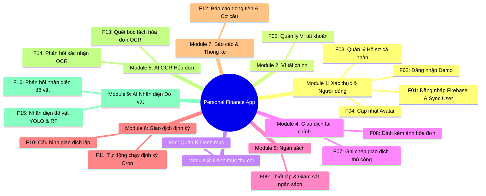

# TỔNG QUAN HỆ THỐNG VÀ KIẾN TRÚC TỔNG THỂ

**Hệ thống:** Ứng dụng Quản lý Tài chính Cá nhân Tích hợp Computer Vision và AI  
**Cơ sở dữ liệu:** `personal_finance_app` (MySQL 8.0)  
**Mã dự án:** DATN_KHMT_2026  

---

## 1. Bối cảnh và Mục tiêu hệ thống

Ứng dụng hướng tới giải quyết bài toán quản lý tài chính cá nhân toàn diện trên thiết bị di động, tự động hóa quy trình ghi nhận chi tiêu thủ công bằng hai công nghệ đột phá:
1. **Thị giác máy tính nhận diện hóa đơn (Invoice OCR Flow):** Ứng dụng Google ML Kit OCR on-device kết hợp biểu thức chính quy (Regex) và cơ chế thông minh Fallback sang Google Gemini 2.5 Flash API để bóc tách Tên cửa hàng, Số tiền, Ngày thanh toán và Danh mục.
2. **Thị giác máy tính nhận diện vật phẩm (Object Detection Flow):** Ứng dụng mô hình YOLOv8n TFLite (18 lớp vật phẩm tài chính) phát hiện đồ vật qua Camera thời gian thực, kết hợp mô hình Random Forest (200 cây quyết định trên 27 đặc trưng qua ONNX Runtime Java) để phân loại danh mục chi tiêu tự động.

---

## 2. Kiến trúc 3 tầng (Three-Tier Architecture)

```mermaid
flowchart TD
    subgraph PresentationTier["1. TẦNG TRÌNH DIỄN (Mobile Client - Android Kotlin)"]
        UI["Android UI Views (Activities / Fragments)<br/>Obsidian Dark Theme Material 3"]
        VM["Android ViewModels (StateFlow / LiveData)<br/>Jetpack Lifecycle"]
        REPO_FE["Mobile Repositories<br/>Retrofit 2 & OkHttp3"]
        CV_LOCAL["On-Device AI Engines<br/>• Google ML Kit OCR<br/>• YOLOv8n TFLite (640x640)"]
    end

    subgraph LogicTier["2. TẦNG XỬ LÝ NGHIỆP VỤ (Backend - Spring Boot 3.3.4)"]
        SEC["Security & Interceptors<br/>• FirebaseAuthFilter<br/>• SecurityConfig (Stateless JWT)"]
        CTRL["REST Controllers (11 Controllers)<br/>• AuthController, UserController, AccountController<br/>• TransactionController, BudgetController, RecurringController<br/>• ReportController, AiScanController, AiProductController..."]
        SVC["Business Services (12 Services)<br/>• TransactionService, BudgetService, AccountService<br/>• RecurringTransactionService (@Scheduled Daily Cron)<br/>• AiScanService, AiProductService, GeminiService"]
        AI_ENGINE["Embedded AI Engine<br/>• ONNX Runtime Java (Random Forest 27 features)<br/>• Vietnamese Invoice Regex Parser"]
        REPO_BE["Spring Data JPA Repositories (Hibernate)"]
    end

    subgraph DataTier["3. TẦNG DỮ LIỆU & DỊCH VỤ NGOÀI (Data & External Services)"]
        MYSQL[("MySQL 8.0 Database<br/>personal_finance_app (9 Bảng)<br/>InnoDB, utf8mb4_unicode_ci")]
        FIREBASE["🔥 Firebase Authentication<br/>Google OAuth2, Email/Password"]
        GEMINI["✨ Google Gemini 2.5 Flash API<br/>Structured JSON Parsing Fallback"]
        UPLOADS["📁 Local File System Storage<br/>uploads/ (Avatar & Bill Images)"]
    end

    UI --> VM
    VM --> REPO_FE
    VM --> CV_LOCAL
    REPO_FE -->|HTTP / JSON (Bearer Token)| SEC
    SEC --> CTRL
    CTRL --> SVC
    SVC --> AI_ENGINE
    SVC --> REPO_BE
    REPO_BE --> MYSQL
    SEC -.->|Verify ID Token| FIREBASE
    SVC -.->|Call REST API| GEMINI
    SVC -->|Store files| UPLOADS
```

---

## 3. Các tác nhân hệ thống (Actors)

| Mã Actor | Tên Tác nhân | Phân loại | Vai trò và Quyền hạn |
| :---: | :--- | :--- | :--- |
| **ACT-01** | **End User (Người dùng cá nhân)** | Con người (Primary Actor) | Người dùng cuối sử dụng ứng dụng di động Android. Sở hữu tài khoản cá nhân, quản lý ví tiền, ghi chép giao dịch, quét ảnh AI, đặt ngân sách và xem báo cáo tài chính. |
| **ACT-02** | **Firebase Auth Service** | Dịch vụ ngoài (External Actor) | Nền tảng Identity Provider của Google. Xác thực định danh người dùng (Google OAuth2 / Email-Password) và cấp Firebase ID Token (JWT). |
| **ACT-03** | **Google Gemini AI Service** | Dịch vụ ngoài (External Actor) | Dịch vụ LLM đám mây (Gemini 2.5 Flash). Đóng vai trò Fallback Engine bóc tách thông tin hóa đơn có cấu trúc JSON khi Regex on-device không tìm thấy trường dữ liệu. |
| **ACT-04** | **System Scheduler** | Hệ thống nội bộ (Background Actor) | Bộ lập lịch Spring Boot Task Scheduling (`@Scheduled`). Tự động quét và thực thi các giao dịch định kỳ đến hạn vào lúc 00:05 AM hằng ngày. |

---

## 4. Danh mục 9 Module và 16 Chức năng


