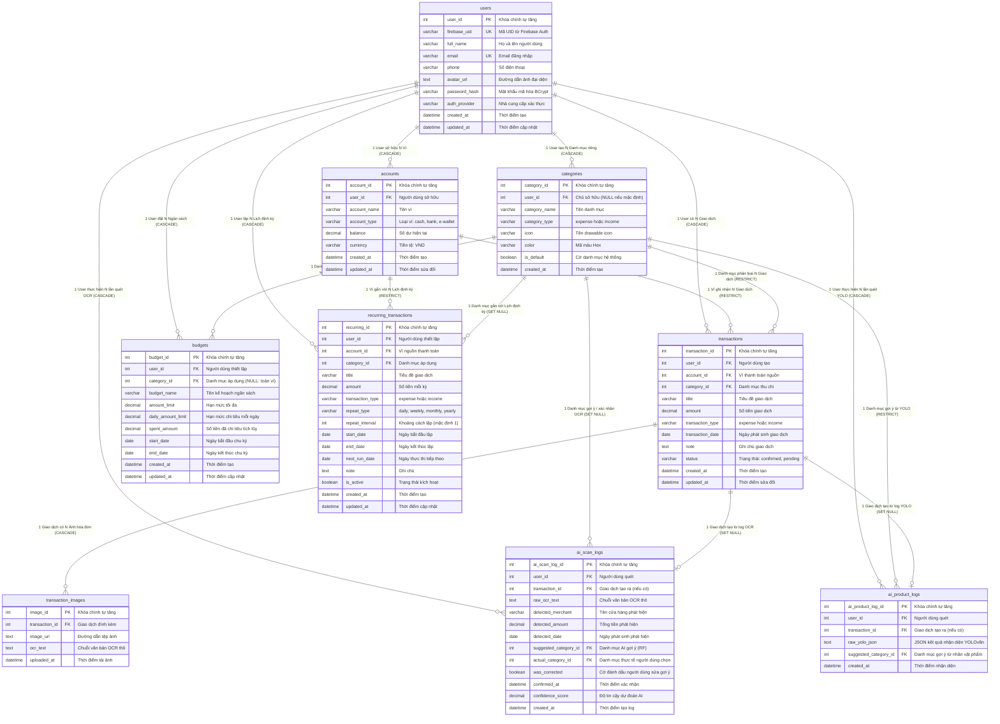

# SƠ ĐỒ THỰC THỂ QUAN HỆ (ERD TOÀN HỆ THỐNG)

**Hệ thống:** Personal Finance App  
**Cơ sở dữ liệu:** `personal_finance_app` (MySQL 8.0)  
**Nguồn sự thật:** `database/schema.sql:10-213`  

---

## 1. Sơ đồ Mermaid erDiagram (9 Bảng dữ liệu)

---

## 2. Ma trận Cardinality và Ràng buộc toàn vẹn tham chiếu

| Bảng cha | Bản số | Bảng con | Khóa ngoại (FK) | Ràng buộc ON DELETE | Giải thích nghiệp vụ |
| :--- | :---: | :--- | :--- | :--- | :--- |
| `users` | 1 : N | `accounts` | `accounts.user_id` | **CASCADE** | Xóa User sẽ xóa sạch toàn bộ ví tài sản của họ |
| `users` | 1 : N | `categories` | `categories.user_id` | **CASCADE** | Xóa User sẽ xóa các danh mục cá nhân của họ |
| `users` | 1 : N | `transactions` | `transactions.user_id` | **CASCADE** | Xóa User sẽ xóa sạch lịch sử giao dịch phát sinh |
| `users` | 1 : N | `budgets` | `budgets.user_id` | **CASCADE** | Xóa User sẽ xóa các kế hoạch ngân sách |
| `users` | 1 : N | `recurring_transactions` | `recurring_transactions.user_id` | **CASCADE** | Xóa User sẽ hủy các lịch chạy định kỳ |
| `users` | 1 : N | `ai_scan_logs` | `ai_scan_logs.user_id` | **CASCADE** | Xóa User sẽ xóa log quét hóa đơn cá nhân |
| `users` | 1 : N | `ai_product_logs` | `ai_product_logs.user_id` | **CASCADE** | Xóa User sẽ xóa log quét vật phẩm cá nhân |
| `accounts` | 1 : N | `transactions` | `transactions.account_id` | **RESTRICT** | Không cho phép xóa ví khi còn giao dịch liên kết |
| `accounts` | 1 : N | `recurring_transactions` | `recurring_transactions.account_id` | **RESTRICT** | Không cho phép xóa ví khi còn lịch định kỳ gắn với ví |
| `categories` | 1 : N | `transactions` | `transactions.category_id` | **RESTRICT** | Không cho phép xóa danh mục khi còn giao dịch phát sinh |
| `categories` | 1 : N | `budgets` | `budgets.category_id` | **SET NULL** | Xóa danh mục thì ngân sách chuyển thành ngân sách chung |
| `categories` | 1 : N | `recurring_transactions` | `recurring_transactions.category_id` | **SET NULL** | Xóa danh mục thì lịch định kỳ giữ nguyên số tiền, category_id = NULL |
| `categories` | 1 : N | `ai_scan_logs` | `ai_scan_logs.suggested_category_id` | **SET NULL** | Xóa danh mục thì log gợi ý OCR chuyển category_id = NULL |
| `categories` | 1 : N | `ai_product_logs` | `ai_product_logs.suggested_category_id` | **RESTRICT** | Nhãn vật phẩm YOLO bắt buộc phải thuộc một danh mục hợp lệ |
| `transactions` | 1 : 1..N | `transaction_images` | `transaction_images.transaction_id` | **CASCADE** | Xóa giao dịch sẽ tự động xóa các ảnh chứng từ đính kèm |
| `transactions` | 1 : 1 | `ai_scan_logs` | `ai_scan_logs.transaction_id` | **SET NULL** | Xóa giao dịch thì log OCR vẫn giữ lại dataset huấn luyện AI |
| `transactions` | 1 : 1 | `ai_product_logs` | `ai_product_logs.transaction_id` | **SET NULL** | Xóa giao dịch thì log YOLO vẫn giữ lại dữ liệu thống kê |
