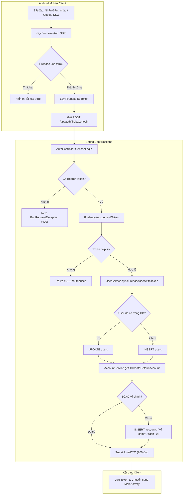
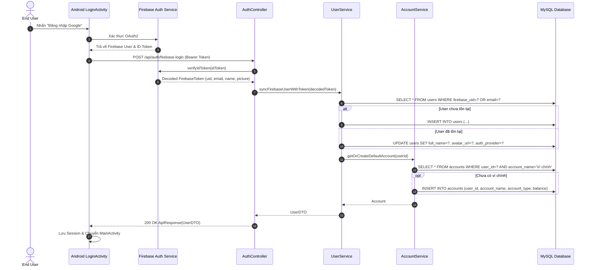
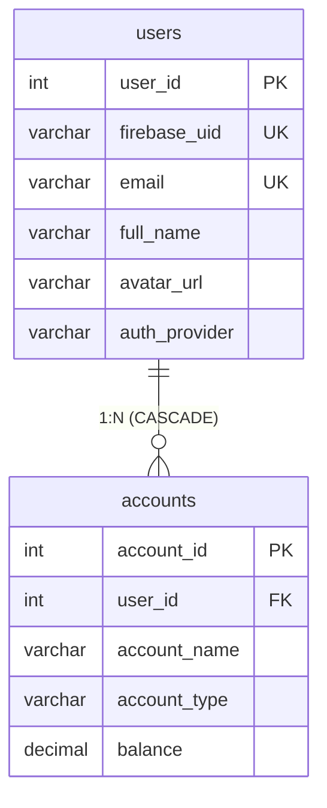

# F01 - ĐĂNG NHẬP FIREBASE VÀ ĐỒNG BỘ NGƯỜI DÙNG

## 1. Thông tin chung
| Trường | Giá trị |
| :--- | :--- |
| **ID** | F01 |
| **Tên chức năng** | Đăng nhập Firebase và Đồng bộ thông tin người dùng |
| **Module** | Module 1: Xác thực & Người dùng |
| **Actor** | End User, Firebase Auth Service |
| **Mô tả ngắn** | Xác thực người dùng qua Firebase Authentication (Email/Password hoặc Google Sign-In), gửi ID Token lên Backend để giải mã và đồng bộ/tạo mới tài khoản trong MySQL, đồng thời tự động khởi tạo "Ví chính" nếu người dùng mới. |
| **Trigger** | Người dùng nhấn nút "Đăng nhập" hoặc "Đăng nhập bằng Google" tại màn hình `LoginActivity` trên Android. |
| **Tiền điều kiện** | Ứng dụng đã kết nối mạng Internet; người dùng đã có tài khoản Firebase hoặc tài khoản Google hợp lệ. |
| **Hậu điều kiện** | Người dùng nhận được JWT Token phiên làm việc; thông tin hồ sơ được lưu/cập nhật trong bảng `users`; người dùng sở hữu ít nhất 1 ví trong bảng `accounts`; ứng dụng chuyển sang `MainActivity` (Dashboard). |

## 2. Use case
### Main flow
1. Người dùng chọn đăng nhập bằng Google hoặc nhập Email/Mật khẩu trên màn hình Android `LoginActivity`.
2. Android gọi Firebase Auth SDK để xác thực thông tin đăng nhập.
3. Firebase Auth trả về Firebase User cùng mã ID Token (JWT).
4. Android gửi request `POST /api/auth/firebase-login` với Header `Authorization: Bearer <idToken>`.
5. Backend trích xuất Bearer Token và gọi `FirebaseAuth.getInstance().verifyIdToken(idToken)`.
6. Firebase Admin SDK giải mã token thành công và trả về `FirebaseToken` chứa `uid`, `email`, `name`, `picture`, `sign_in_provider`.
7. Backend kiểm tra sự tồn tại của User trong CSDL MySQL theo `firebase_uid` hoặc `email`.
8. Nếu chưa tồn tại: Backend tạo mới bản ghi `User` và lưu vào bảng `users`.
9. Nếu đã tồn tại: Backend cập nhật lại thông tin mới nhất (`fullName`, `avatarUrl`, `email`, `authProvider`).
10. Backend kiểm tra xem người dùng đã có ví nào chưa; nếu chưa có, tự động tạo "Ví chính" (loại `'cash'`, số dư 0 VND) trong bảng `accounts`.
11. Backend trả về thông tin `UserDTO` bọc trong `ApiResponse.success`.
12. Android lưu ID Token vào `EncryptedSharedPreferences` và chuyển sang `MainActivity`.

### Alternative flow
- **Người dùng đã tồn tại từ trước:** Tại bước 8, hệ thống không tạo mới mà thực hiện câu lệnh UPDATE thông tin mới nhất từ Firebase Token và giữ nguyên `user_id`.

### Exception flow
- **E1 - Thiếu Bearer Token:** Client không truyền Header `Authorization` hoặc không có tiền tố `Bearer `. Backend ném `BadRequestException("Missing Firebase ID Token in Authorization header")`, trả về HTTP 400.
- **E2 - Token không hợp lệ / Hết hạn:** `FirebaseAuth.getInstance().verifyIdToken()` ném `FirebaseAuthException`. `FirebaseAuthFilter` chặn lại, trả về HTTP 401 với JSON `{"success":false,"message":"Invalid or expired token","data":null}`.
- **E3 - Mất kết nối Internet:** Android bắt lỗi `IOException` từ Retrofit, hiển thị Toast cảnh báo mạng cho người dùng.

## 3. Entry points
| Method | URL / Route | Auth | Request | Response | Status code | Nơi xử lý (file:dòng) |
| :---: | :--- | :---: | :--- | :--- | :---: | :--- |
| `POST` | `/api/auth/firebase-login` | Public (Header Bearer) | Header: `Authorization: Bearer <idToken>` Body: Rỗng hoặc `LoginRequest` (optional) | `ApiResponse<UserDTO>` | 200 OK 400 Bad Request 401 Unauthorized | `backend/src/main/java/com/example/financebackend/controller/AuthController.java:24-42` |
| Screen | `LoginActivity` | None | Nhập Email/Password hoặc Click Button Google Sign-In | Chuyển `MainActivity` | - | `android-app/app/src/main/java/com/example/personalfinance/activities/LoginActivity.kt:40-120` |

## 4. Luồng xử lý chi tiết
1. **Tiếp nhận Request:** `AuthController.firebaseLogin` (`AuthController.java:24-42`) nhận `authHeader`.
2. **Kiểm tra Token thô:** Trích xuất `idToken = authHeader.substring(7)`. Nếu `idToken == null`, ném `BadRequestException` (`AuthController.java:34`).
3. **Giải mã Token qua Firebase Admin SDK:** Gọi `FirebaseAuth.getInstance().verifyIdToken(idToken)` (`AuthController.java:38`).
4. **Đồng bộ thực thể User:** Gọi `UserService.syncFirebaseUserWithToken(decodedToken)` (`UserService.java:25-76`):
   - Lấy `firebaseUid = decodedToken.getUid()`, `email = decodedToken.getEmail()`, `fullName = claims.get("name")`, `avatarUrl = claims.get("picture")` (`UserService.java:26-30`).
   - Phân tích `sign_in_provider` từ `firebaseClaim`: nếu `'google.com'` đặt `'google'`, nếu `'password'` đặt `'firebase'` (`UserService.java:38-51`).
   - Tìm kiếm: `findExistingFirebaseUser(firebaseUid, email)` (`UserService.java:53,97-108`).
   - Lưu trữ: `userRepository.save(user)` (`UserService.java:64,71`).
5. **Khởi tạo ví mặc định:** Gọi `accountService.getOrCreateDefaultAccount(user.getUserId())` (`UserService.java:73`):
   - Tìm trong `accounts` xem có ví nào tên là `"Ví chính"` chưa (`AccountService.java:94-96`).
   - Nếu chưa: `accountRepository.save(defaultAccount)` với `accountName = "Ví chính"`, `accountType = "cash"`, `balance = 0` (`AccountService.java:101-109`).
6. **Trả về kết quả:** Đóng gói `UserDTO` bằng `toDTO(user)` và phản hồi `ResponseEntity.ok(ApiResponse.success(syncedUser))` (`AuthController.java:41`).

## 5. Biểu đồ

### 5.1. Activity Diagram

### 5.2. Sequence Diagram

### 5.3. State Diagram
Không áp dụng (Thực thể User không có vòng đời trạng thái phức tạp, luôn ở trạng thái active khi đăng nhập).

## 6. Danh sách hàm / class
| Layer | Class.method | Signature | Input | Output | Mô tả | Exception | File:dòng |
| :--- | :--- | :--- | :--- | :--- | :--- | :--- | :--- |
| Controller | `AuthController.firebaseLogin` | `ResponseEntity<ApiResponse<UserDTO>> firebaseLogin(String, LoginRequest)` | `authHeader`, `loginRequest` | `ApiResponse<UserDTO>` | Tiếp nhận request đồng bộ người dùng | `BadRequestException`, `Exception` | `AuthController.java:24-42` |
| Service | `UserService.syncFirebaseUserWithToken` | `UserDTO syncFirebaseUserWithToken(FirebaseToken)` | `decodedToken` | `UserDTO` | Tạo mới hoặc cập nhật thông tin User từ token | Không có | `UserService.java:25-76` |
| Service | `UserService.findExistingFirebaseUser` | `Optional<User> findExistingFirebaseUser(String, String)` | `firebaseUid`, `email` | `Optional<User>` | Tìm kiếm theo UID trước, sau đó tìm theo Email | Không có | `UserService.java:97-108` |
| Service | `AccountService.getOrCreateDefaultAccount` | `Account getOrCreateDefaultAccount(Integer)` | `userId` | `Account` | Khởi tạo "Ví chính" số dư 0 nếu user chưa có | `ResourceNotFoundException` | `AccountService.java:88-111` |
| Repository | `UserRepository.findByFirebaseUid` | `Optional<User> findByFirebaseUid(String)` | `firebaseUid` | `Optional<User>` | Tìm kiếm User theo UID Firebase | Không có | `UserRepository.java:12` |
| Repository | `UserRepository.findByEmail` | `Optional<User> findByEmail(String)` | `email` | `Optional<User>` | Tìm kiếm User theo Email | Không có | `UserRepository.java:14` |

## 7. Cơ sở dữ liệu
- **Bảng liên quan:**
  - `users`: **C/R/U** (Đọc kiểm tra theo UID/Email, Insert khi mới, Update khi có thay đổi). Cột sử dụng: `user_id`, `firebase_uid`, `full_name`, `email`, `avatar_url`, `auth_provider`, `updated_at`. Xem chi tiết tại [01-database/tables.md#1-bảng-users-thông-tin-người-dùng](../01-database/tables.md#1-bảng-users-thông-tin-người-dùng).
  - `accounts`: **C/R** (Đọc kiểm tra ví `'Ví chính'`, Insert ví mặc định ban đầu). Cột sử dụng: `account_id`, `user_id`, `account_name`, `account_type`, `balance`, `currency`. Xem chi tiết tại [01-database/tables.md#2-bảng-accounts-ví--tài-khoản-tài-chính](../01-database/tables.md#2-bảng-accounts-ví--tài-khoản-tài-chính).
- **Ràng buộc:** `accounts.user_id` tham chiếu `users.user_id` (`ON DELETE CASCADE`). `firebase_uid` và `email` có ràng buộc UNIQUE.
- **Transaction:** `@Transactional` bao bọc tại `UserService.syncFirebaseUserWithToken` và `AccountService.getOrCreateDefaultAccount`. Nếu tạo ví chính lỗi, thao tác tạo/sửa User bị rollback.
- **ERD con:**

## 8. Business rules và validation
| Mã quy tắc | Nội dung quy tắc | Nơi kiểm tra | File:dòng |
| :---: | :--- | :---: | :--- |
| **BR-01.1** | Request bắt buộc phải có Header `Authorization` bắt đầu bằng `Bearer ` | BE Controller | `AuthController.java:27-35` |
| **BR-01.2** | Mã Firebase ID Token phải còn hiệu lực và được ký bởi đúng Firebase Project ID | BE Firebase SDK | `AuthController.java:38`, `FirebaseAuthFilter.java:42` |
| **BR-01.3** | Nếu User đăng nhập lần đầu bằng Google, hệ thống lấy tên từ Google Account; nếu không có tên thì lấy tiền tố của Email | BE Service | `UserService.java:67` |
| **BR-01.4** | Mọi User mới bắt buộc phải tự động được cấp 1 ví mặc định mang tên `"Ví chính"` loại tiền mặt | BE Service | `UserService.java:73`, `AccountService.java:101-109` |

## 9. Phân quyền
- Endpoint `/api/auth/firebase-login` được cấu hình `permitAll()` tại `SecurityConfig.java:26`, không yêu cầu Token phiên trước đó, nhưng yêu cầu Header Bearer Token Firebase hợp lệ để xử lý trong thân hàm.

## 10. Xử lý lỗi
| Tình huống | Exception / Mã lỗi | HTTP status | Thông báo trả về | Hành vi rollback |
| :--- | :--- | :---: | :--- | :--- |
| Thiếu Header Authorization | `BadRequestException` | 400 | `"Missing Firebase ID Token in Authorization header"` | Không ghi nhận DB |
| Token giả mạo hoặc hết hạn | `FirebaseAuthException` | 401 | `{"success":false,"message":"Invalid or expired token"}` | Không ghi nhận DB |
| Không tìm thấy User theo ID khi tạo ví | `ResourceNotFoundException` | 404 | `"User not found with id: ..."` | Rollback Transaction tạo User |
| Lỗi CSDL MySQL đứt kết nối | `CannotCreateTransactionException` | 500 | Thông báo lỗi hệ thống | Rollback toàn bộ |

## 11. Phụ thuộc và tích hợp
- **Dịch vụ ngoài:** Firebase Authentication (Firebase Admin SDK Java 9.x).
- **Lưu trữ:** CSDL MySQL 8.0 bảng `users`, `accounts`.
- **Chức năng liên quan:** [F05 - Quản lý ví tài chính](F05-quan-ly-vi-tai-chinh.md) (kế thừa ví mặc định được tạo từ F01).

## 12. Edge case, giới hạn, điểm chưa rõ
- **Edge case:** Cùng 1 địa chỉ email nhưng đăng nhập qua Email/Password trước, sau đó lại đăng nhập qua Google Sign-In. Hệ thống xử lý thông minh qua hàm `findExistingFirebaseUser` (`UserService.java:97-108`): tìm thấy email cũ và tiến hành liên kết cập nhật `firebase_uid` và chuyển `auth_provider` sang `'google'`.
- **Giới hạn:** Nếu Firebase Admin SDK không khởi tạo được (do thiếu `firebase-service-account.json`), ứng dụng backend sẽ không thể verify token thật.

## 13. Gợi ý test case
| Mã TC | Kịch bản kiểm thử | Dữ liệu đầu vào | Kết quả mong đợi |
| :---: | :--- | :--- | :--- |
| **TC-F01-01** | Đăng nhập Google tài khoản mới | Token Google hợp lệ chưa có trong MySQL | Tạo bản ghi User mới, tạo "Ví chính", trả về 200 OK |
| **TC-F01-02** | Đăng nhập Google tài khoản cũ | Token Google đã có trong MySQL | Update thông tin User, không tạo ví trùng, trả về 200 OK |
| **TC-F01-03** | Đăng nhập thiếu Header Auth | Header không có `Authorization` | Trả về 400 Bad Request, báo lỗi thiếu Token |
| **TC-F01-04** | Đăng nhập với Token sai/hết hạn | Header: `Bearer invalid_token_xyz` | Trả về 401 Unauthorized |
