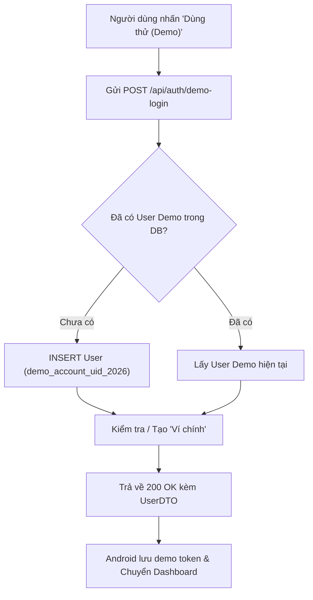
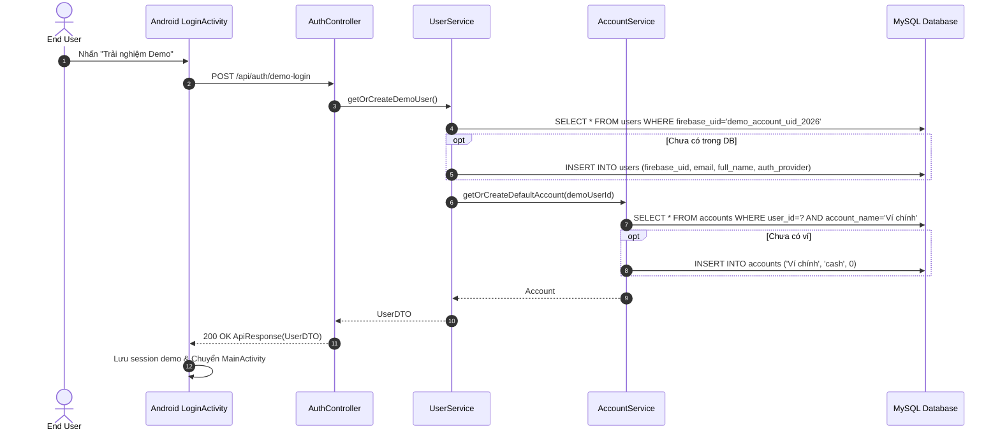

# F02 - ĐĂNG NHẬP DÙNG THỬ (DEMO LOGIN)

## 1. Thông tin chung
| Trường | Giá trị |
| :--- | :--- |
| **ID** | F02 |
| **Tên chức năng** | Đăng nhập tài khoản dùng thử (Demo Login) |
| **Module** | Module 1: Xác thực & Người dùng |
| **Actor** | End User |
| **Mô tả ngắn** | Cho phép người dùng hoặc hội đồng đánh giá trải nghiệm ngay ứng dụng mà không cần cấu hình tài khoản Google hay Firebase thực tế, thông qua cơ chế tài khoản demo cố định nội bộ. |
| **Trigger** | Người dùng nhấn nút "Dùng thử ngay (Demo)" tại màn hình `LoginActivity`. |
| **Tiền điều kiện** | Ứng dụng đã khởi động và kết nối được tới Backend API. |
| **Hậu điều kiện** | Hệ thống nạp hoặc tự động tạo tài khoản `demo@financeapp.com`; tạo "Ví chính"; cấp quyền truy cập đầy đủ các chức năng. |

## 2. Use case
### Main flow
1. Người dùng mở `LoginActivity` và nhấn nút "Trải nghiệm Demo".
2. Android gửi request `POST /api/auth/demo-login`.
3. Backend tiếp nhận yêu cầu và gọi `UserService.getOrCreateDemoUser()`.
4. Backend kiểm tra trong bảng `users` xem có tài khoản với `firebase_uid = 'demo_account_uid_2026'` chưa.
5. Nếu chưa có: Tạo mới User với email `demo@financeapp.com`, họ tên `"Người Dùng Demo"`, `auth_provider = 'demo'`.
6. Backend gọi `AccountService.getOrCreateDefaultAccount` để đảm bảo tài khoản demo có ít nhất 1 "Ví chính".
7. Backend trả về thông tin `UserDTO` bọc trong `ApiResponse.success`.
8. Android lưu token giả lập `"demo-token-session"` và chuyển hướng vào `MainActivity`.

### Alternative flow
- Không có.

### Exception flow
- **E1 - Mất kết nối CSDL Backend:** Backend ném Exception, `GlobalExceptionHandler` trả về 500 kèm thông báo lỗi.

## 3. Entry points
| Method | URL / Route | Auth | Request | Response | Status code | Nơi xử lý (file:dòng) |
| :---: | :--- | :---: | :--- | :--- | :---: | :--- |
| `POST` | `/api/auth/demo-login` | Public | Body: Không yêu cầu | `ApiResponse<UserDTO>` | 200 OK 500 Error | `backend/src/main/java/com/example/financebackend/controller/AuthController.java:45-49` |
| Screen | `LoginActivity` | None | Click nút "Dùng thử (Demo)" | Chuyển `MainActivity` | - | `android-app/app/src/main/java/com/example/personalfinance/activities/LoginActivity.kt:125-145` |

## 4. Luồng xử lý chi tiết
1. **Tiếp nhận Request:** `AuthController.demoLogin` (`AuthController.java:45-49`).
2. **Khởi tạo hoặc lấy User Demo:** `UserService.getOrCreateDemoUser` (`UserService.java:78-95`):
   - Đặt `demoUid = "demo_account_uid_2026"`, `demoEmail = "demo@financeapp.com"`.
   - Tìm kiếm: `userRepository.findByFirebaseUid(demoUid)` (`UserService.java:81`).
   - Nếu chưa có: `User.builder().firebaseUid(demoUid).email(demoEmail).fullName("Người Dùng Demo").authProvider("demo").build()` và lưu vào DB (`UserService.java:85-92`).
3. **Đảm bảo Ví mặc định:** `accountService.getOrCreateDefaultAccount(user.getUserId())` (`UserService.java:93`).
4. **Phản hồi:** Trả về `ResponseEntity.ok(ApiResponse.success("Demo user login successful", demoUser))` (`AuthController.java:48`).

## 5. Biểu đồ

### 5.1. Activity Diagram

### 5.2. Sequence Diagram

### 5.3. State Diagram
Không áp dụng.

## 6. Danh sách hàm / class
| Layer | Class.method | Signature | Input | Output | Mô tả | Exception | File:dòng |
| :--- | :--- | :--- | :--- | :--- | :--- | :--- | :--- |
| Controller | `AuthController.demoLogin` | `ResponseEntity<ApiResponse<UserDTO>> demoLogin()` | Không | `ApiResponse<UserDTO>` | Endpoint kích hoạt đăng nhập demo | Không có | `AuthController.java:45-49` |
| Service | `UserService.getOrCreateDemoUser` | `UserDTO getOrCreateDemoUser()` | Không | `UserDTO` | Lấy hoặc khởi tạo tài khoản demo cố định | Không có | `UserService.java:78-95` |
| Filter | `FirebaseAuthFilter.doFilterInternal` | `void doFilterInternal(...)` | `authHeader` | - | Bỏ qua xác thực Firebase đối với token bắt đầu bằng `demo-` | Không có | `FirebaseAuthFilter.java:34-40` |

## 7. Cơ sở dữ liệu
- **Bảng liên quan:** `users` (C/R), `accounts` (C/R). Xem chi tiết tại [01-database/tables.md](../01-database/tables.md).
- **Ràng buộc:** `demo_account_uid_2026` là duy nhất trong `users(firebase_uid)`.
- **Transaction:** `@Transactional` tại `UserService.getOrCreateDemoUser`.
- **ERD con:** Tương tự F01 (`users` 1:N `accounts`).

## 8. Business rules và validation
| Mã quy tắc | Nội dung quy tắc | Nơi kiểm tra | File:dòng |
| :---: | :--- | :---: | :--- |
| **BR-02.1** | Tài khoản Demo luôn mang UID cố định `demo_account_uid_2026` và email `demo@financeapp.com` | BE Service | `UserService.java:79-80` |
| **BR-02.2** | Các request tiếp theo có Header `Authorization: Bearer demo-...` được `FirebaseAuthFilter` tự động cho phép qua | BE Security | `FirebaseAuthFilter.java:34-40` |

## 9. Phân quyền
- Endpoint `/api/auth/demo-login` là public (`permitAll()`).

## 10. Xử lý lỗi
| Tình huống | Exception / Mã lỗi | HTTP status | Thông báo | Hành vi rollback |
| :--- | :--- | :---: | :--- | :--- |
| Lỗi ghi DB khi tạo demo user | `DataAccessException` | 500 | Lỗi hệ thống | Rollback transaction |

## 11. Phụ thuộc và tích hợp
- Độc lập với Firebase Cloud, có thể hoạt động offline nếu chạy local backend.

## 12. Edge case, giới hạn, điểm chưa rõ
- Nếu nhiều người cùng dùng tài khoản demo trên nhiều máy, dữ liệu sẽ được dùng chung trên cùng bản ghi `demo_account_uid_2026`.

## 13. Gợi ý test case
| Mã TC | Kịch bản kiểm thử | Dữ liệu đầu vào | Kết quả mong đợi |
| :---: | :--- | :--- | :--- |
| **TC-F02-01** | Bấm đăng nhập Demo lần đầu | DB chưa có user demo | Tạo mới user demo, tạo ví chính, trả về 200 OK |
| **TC-F02-02** | Bấm đăng nhập Demo các lần sau | DB đã có user demo | Lấy lại user demo cũ, không nhân bản dữ liệu |
