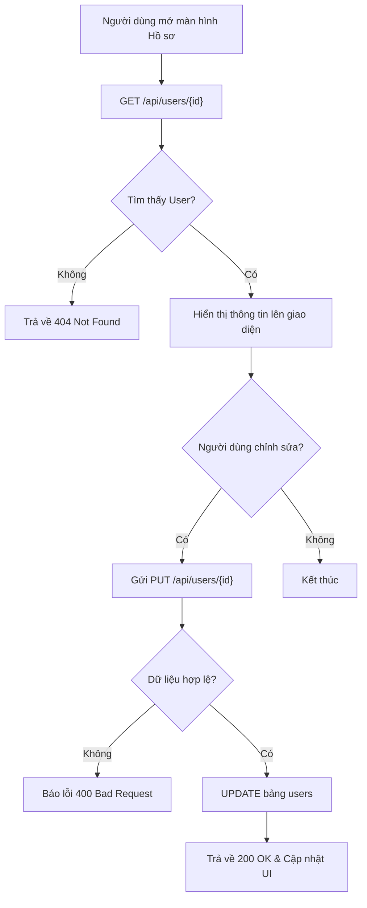
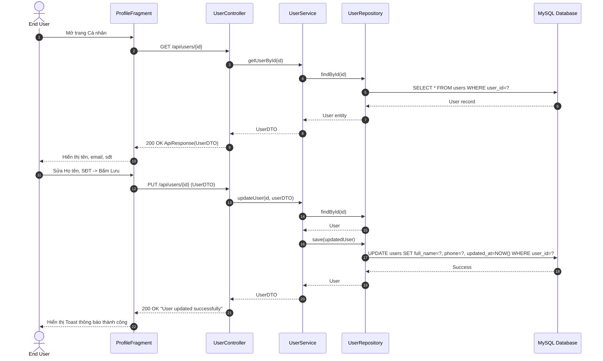
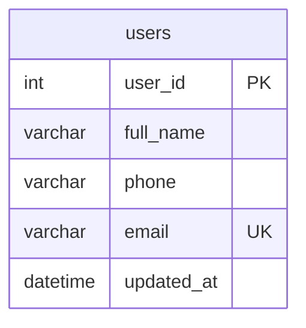

# F03 - QUẢN LÝ HỒ SƠ CÁ NHÂN (USER PROFILE)

## 1. Thông tin chung
| Trường | Giá trị |
| :--- | :--- |
| **ID** | F03 |
| **Tên chức năng** | Quản lý Hồ sơ cá nhân (Xem & Cập nhật thông tin) |
| **Module** | Module 1: Xác thực & Người dùng |
| **Actor** | End User |
| **Mô tả ngắn** | Cho phép người dùng xem thông tin chi tiết hồ sơ tài khoản (Email, Họ tên, Số điện thoại, Phương thức xác thực) và cập nhật họ tên, số điện thoại liên hệ. |
| **Trigger** | Người dùng mở tab "Cá nhân" (`ProfileFragment`) trên thanh điều hướng Bottom Navigation. |
| **Tiền điều kiện** | Người dùng đã đăng nhập và có `userId` hợp lệ. |
| **Hậu điều kiện** | Thông tin mới được lưu vào bảng `users`; giao diện Profile cập nhật dữ liệu mới. |

## 2. Use case
### Main flow
1. Người dùng truy cập màn hình Profile cá nhân.
2. Android gửi request `GET /api/users/{id}` kèm Bearer Token.
3. Backend kiểm tra token, truy vấn CSDL và trả về thông tin `UserDTO`.
4. Người dùng nhấn nút chỉnh sửa thông tin (Đổi họ tên hoặc số điện thoại).
5. Người dùng nhập dữ liệu mới và nhấn "Lưu thay đổi".
6. Android gửi request `PUT /api/users/{id}` kèm body `UserDTO`.
7. Backend kiểm tra dữ liệu, cập nhật bản ghi trong bảng `users` và phản hồi 200 OK kèm thông tin sau cập nhật.
8. Android cập nhật giao diện người dùng và thông báo thành công.

### Alternative flow
- Không có.

### Exception flow
- **E1 - Không tìm thấy User:** Người dùng truyền `id` không tồn tại trong CSDL. Backend ném `ResourceNotFoundException("User not found with id: ...")`, trả về HTTP 404.
- **E2 - Dữ liệu không hợp lệ:** Họ tên hoặc số điện thoại vượt quá độ dài quy định. Validation kích hoạt, trả về HTTP 400 Bad Request.

## 3. Entry points
| Method | URL / Route | Auth | Request | Response | Status code | Nơi xử lý (file:dòng) |
| :---: | :--- | :---: | :--- | :--- | :---: | :--- |
| `GET` | `/api/users/{id}` | Bearer Token | Path: `id` (Integer) | `ApiResponse<UserDTO>` | 200 OK 404 Not Found | `UserController.java:28-32` |
| `PUT` | `/api/users/{id}` | Bearer Token | Path: `id` Body: `UserDTO` (`fullName`, `phone`) | `ApiResponse<UserDTO>` | 200 OK 400 Bad Request 404 Not Found | `UserController.java:34-38` |
| Screen | `ProfileFragment` | Logged In | Xem và chỉnh sửa thông tin | - | - | `ProfileFragment.kt:35-110` |

## 4. Luồng xử lý chi tiết
1. **Lấy thông tin User:**
   - Client gửi `GET /api/users/{id}` -> `UserController.getUserById` (`UserController.java:28-32`).
   - Gọi `UserService.getUserById(id)` (`UserService.java:112-117`).
   - `userRepository.findById(userId)` -> nếu rỗng ném `ResourceNotFoundException` (`UserService.java:114`).
   - Chuyển đổi sang `UserDTO` bằng `toDTO(user)` và trả về.
2. **Cập nhật thông tin User:**
   - Client gửi `PUT /api/users/{id}` -> `UserController.updateUser` (`UserController.java:34-38`).
   - Gọi `UserService.updateUser(id, userDTO)` (`UserService.java:119-129`).
   - Kiểm tra: nếu `userDTO.getFullName() != null` cập nhật `fullName`; nếu `userDTO.getPhone() != null` cập nhật `phone` (`UserService.java:123-125`).
   - Lưu: `userRepository.save(user)` (`UserService.java:127`).
   - Trả về `ApiResponse.success("User updated successfully", updated)`.

## 5. Biểu đồ

### 5.1. Activity Diagram

### 5.2. Sequence Diagram

### 5.3. State Diagram
Không áp dụng.

## 6. Danh sách hàm / class
| Layer | Class.method | Signature | Input | Output | Mô tả | Exception | File:dòng |
| :--- | :--- | :--- | :--- | :--- | :--- | :--- | :--- |
| Controller | `UserController.getUserById` | `ResponseEntity<ApiResponse<UserDTO>> getUserById(Integer)` | `id` | `ApiResponse<UserDTO>` | Lấy thông tin user | `ResourceNotFoundException` | `UserController.java:28-32` |
| Controller | `UserController.updateUser` | `ResponseEntity<ApiResponse<UserDTO>> updateUser(Integer, UserDTO)` | `id`, `userDTO` | `ApiResponse<UserDTO>` | Cập nhật thông tin | `ResourceNotFoundException` | `UserController.java:34-38` |
| Service | `UserService.getUserById` | `UserDTO getUserById(Integer)` | `userId` | `UserDTO` | Lấy chi tiết user | `ResourceNotFoundException` | `UserService.java:112-117` |
| Service | `UserService.updateUser` | `UserDTO updateUser(Integer, UserDTO)` | `userId`, `userDTO` | `UserDTO` | Ghi đè thông tin họ tên, sđt | `ResourceNotFoundException` | `UserService.java:119-129` |

## 7. Cơ sở dữ liệu
- **Bảng liên quan:** `users` (**R/U**). Cột: `user_id`, `full_name`, `phone`, `email`, `updated_at`. Xem chi tiết tại [01-database/tables.md#1-bảng-users-thông-tin-người-dùng](../01-database/tables.md#1-bảng-users-thông-tin-người-dùng).
- **Ràng buộc:** Không cho phép thay đổi `email` hoặc `firebase_uid` qua API này để bảo mật danh tính.
- **Transaction:** `@Transactional` tại `UserService.updateUser`.
- **ERD con:**

## 8. Business rules và validation
| Mã quy tắc | Nội dung quy tắc | Nơi kiểm tra | File:dòng |
| :---: | :--- | :---: | :--- |
| **BR-03.1** | Không được phép sửa trực tiếp `email` qua API update này | BE Service | `UserService.java:123-126` |
| **BR-03.2** | `phone` nếu có tối đa 20 ký tự; `fullName` tối đa 100 ký tự | BE Validation | `UserDTO.java`, `schema.sql:13,15` |

## 9. Phân quyền
- Yêu cầu xác thực Bearer Token hợp lệ qua `FirebaseAuthFilter`.

## 10. Xử lý lỗi
| Tình huống | Exception / Mã lỗi | HTTP status | Thông báo | Hành vi rollback |
| :--- | :--- | :---: | :--- | :--- |
| `id` không tồn tại | `ResourceNotFoundException` | 404 | `"User not found with id: ..."` | Không thay đổi DB |
| Dữ liệu sai định dạng | `MethodArgumentNotValidException` | 400 | `"Dữ liệu đầu vào không hợp lệ"` | Không lưu DB |

## 11. Phụ thuộc và tích hợp
- Phụ thuộc bảng `users` trong MySQL. Không gọi dịch vụ ngoài.

## 12. Edge case, giới hạn, điểm chưa rõ
- Nếu người dùng nhập khoảng trắng cho họ tên, hệ thống hiện vẫn lưu chuỗi khoảng trắng. Nên bổ sung validate `@NotBlank` trong DTO.

## 13. Gợi ý test case
| Mã TC | Kịch bản kiểm thử | Dữ liệu đầu vào | Kết quả mong đợi |
| :---: | :--- | :--- | :--- |
| **TC-F03-01** | Lấy thông tin user hợp lệ | `id = 1` tồn tại | Trả về 200 OK và đúng thông tin user |
| **TC-F03-02** | Lấy thông tin user không tồn tại | `id = 99999` | Trả về 404 Not Found |
| **TC-F03-03** | Cập nhật họ tên và số điện thoại | `fullName = "Nguyễn Văn A"`, `phone = "0987654321"` | DB cập nhật, trả về 200 OK |
