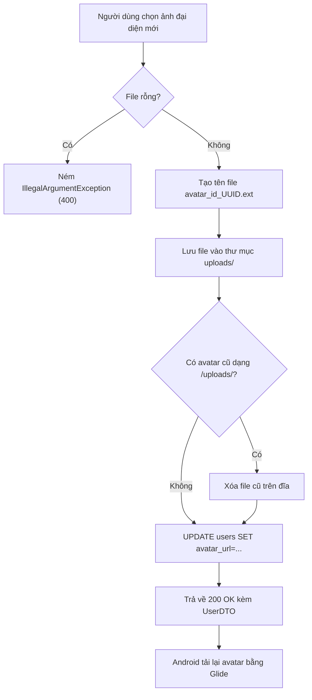
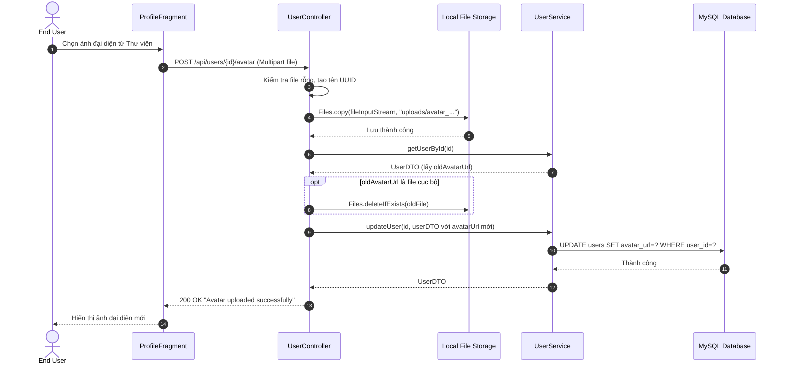

# F04 - CẬP NHẬT ẢNH ĐẠI DIỆN NGƯỜI DÙNG (AVATAR UPLOAD)

## 1. Thông tin chung
| Trường | Giá trị |
| :--- | :--- |
| **ID** | F04 |
| **Tên chức năng** | Cập nhật ảnh đại diện người dùng (Avatar Upload) |
| **Module** | Module 1: Xác thực & Người dùng |
| **Actor** | End User |
| **Mô tả ngắn** | Cho phép người dùng tải lên hình ảnh từ thiết bị để đổi ảnh đại diện. Hệ thống lưu tệp vào thư mục `uploads/` trên server, dọn dẹp ảnh cũ nếu có và cập nhật đường dẫn `avatar_url` trong CSDL. |
| **Trigger** | Người dùng nhấn vào ảnh đại diện hoặc biểu tượng máy ảnh trên màn hình `ProfileFragment`. |
| **Tiền điều kiện** | Người dùng đã đăng nhập; đã cấp quyền đọc bộ nhớ thiết bị Android; tệp ảnh không rỗng. |
| **Hậu điều kiện** | Tệp ảnh được lưu trên máy chủ; đường dẫn `/uploads/...` được cập nhật vào bảng `users`; ảnh cũ được xóa khỏi đĩa. |

## 2. Use case
### Main flow
1. Người dùng chọn ảnh mới từ thư viện ảnh trên thiết bị Android.
2. Android nén ảnh và đóng gói thành `MultipartBody.Part`.
3. Android gửi request `POST /api/users/{id}/avatar` kèm tệp tin.
4. Backend kiểm tra tính hợp lệ của tệp (không được rỗng).
5. Backend tự động tạo thư mục `uploads/` nếu chưa tồn tại.
6. Backend tạo tên tệp ngẫu nhiên duy nhất dạng: `avatar_<id>_<UUID>.<extension>`.
7. Backend lưu tệp vào đĩa vật lý tại thư mục `uploads/`.
8. Backend đọc thông tin `avatar_url` cũ của người dùng; nếu là tệp cục bộ thì xóa tệp cũ đi để tránh rác ổ đĩa.
9. Backend cập nhật `avatar_url = "/uploads/" + filename` vào bảng `users`.
10. Backend trả về thông tin `UserDTO` đã cập nhật.
11. Android tải ảnh mới hiển thị lên giao diện qua thư viện Glide/Coil.

### Alternative flow
- Không có.

### Exception flow
- **E1 - Tệp rỗng:** Client gửi file rỗng (`file.isEmpty()`). Backend ném `IllegalArgumentException("File is empty")`, trả về 400 Bad Request.
- **E2 - Lỗi ghi file đĩa:** Lỗi phân quyền hoặc hết dung lượng đĩa. Ném `IOException`, trả về 500 Server Error.

## 3. Entry points
| Method | URL / Route | Auth | Request | Response | Status code | Nơi xử lý (file:dòng) |
| :---: | :--- | :---: | :--- | :--- | :---: | :--- |
| `POST` | `/api/users/{id}/avatar` | Bearer Token | Path: `id` (Integer) Multipart: `file` (`MultipartFile`) | `ApiResponse<UserDTO>` | 200 OK 400 Bad Request 500 Server Error | `UserController.java:40-84` |
| Screen | `ProfileFragment` | Logged In | Chọn ảnh từ Gallery | - | - | `ProfileFragment.kt:120-160` |

## 4. Luồng xử lý chi tiết
1. **Tiếp nhận Multipart:** `UserController.uploadAvatar` (`UserController.java:40-84`).
2. **Kiểm tra rỗng:** `if (file.isEmpty()) throw new IllegalArgumentException("File is empty")` (`UserController.java:44-46`).
3. **Chuẩn bị thư mục:** `File uploadDir = new File("uploads"); if (!uploadDir.exists()) uploadDir.mkdirs();` (`UserController.java:48-51`).
4. **Tạo tên file duy nhất:**
   - Lấy đuôi file từ `originalFilename` (mặc định `.jpg`) (`UserController.java:54-58`).
   - Tên file: `"avatar_" + id + "_" + UUID.randomUUID().toString() + extension` (`UserController.java:59`).
5. **Ghi xuống đĩa:** `Files.copy(file.getInputStream(), Paths.get("uploads", filename))` (`UserController.java:62-63`).
6. **Xóa ảnh cũ:**
   - Lấy `oldAvatarUrl = userDTO.getAvatarUrl()` (`UserController.java:69`).
   - Nếu `oldAvatarUrl.startsWith("/uploads/")`, thực hiện `Files.deleteIfExists` (`UserController.java:74-79`).
7. **Cập nhật Database:** `userDTO.setAvatarUrl("/uploads/" + filename); userService.updateUser(id, userDTO)` (`UserController.java:70-71`).
8. **Phản hồi:** Trả về `ApiResponse.success("Avatar uploaded successfully", updated)` (`UserController.java:82`).

## 5. Biểu đồ

### 5.1. Activity Diagram

### 5.2. Sequence Diagram

### 5.3. State Diagram
Không áp dụng.

## 6. Danh sách hàm / class
| Layer | Class.method | Signature | Input | Output | Mô tả | Exception | File:dòng |
| :--- | :--- | :--- | :--- | :--- | :--- | :--- | :--- |
| Controller | `UserController.uploadAvatar` | `ResponseEntity<ApiResponse<UserDTO>> uploadAvatar(Integer, MultipartFile)` | `id`, `file` | `ApiResponse<UserDTO>` | Xử lý tải lên và đổi avatar | `IllegalArgumentException`, `IOException` | `UserController.java:40-84` |
| Service | `UserService.updateUser` | `UserDTO updateUser(Integer, UserDTO)` | `userId`, `userDTO` | `UserDTO` | Ghi nhận đường dẫn mới vào DB | `ResourceNotFoundException` | `UserService.java:119-129` |

## 7. Cơ sở dữ liệu
- **Bảng liên quan:** `users` (**U**). Cột: `user_id`, `avatar_url`, `updated_at`. Xem chi tiết tại [01-database/tables.md#1-bảng-users-thông-tin-người-dùng](../01-database/tables.md#1-bảng-users-thông-tin-người-dùng).
- **Ràng buộc:** Không có khóa ngoại bị ảnh hưởng.
- **Transaction:** Ghi file đĩa trước, cập nhật DB qua `@Transactional` của `updateUser`.
- **ERD con:** Bảng đơn `users`.

## 8. Business rules và validation
| Mã quy tắc | Nội dung quy tắc | Nơi kiểm tra | File:dòng |
| :---: | :--- | :---: | :--- |
| **BR-04.1** | Tệp tải lên không được rỗng | BE Controller | `UserController.java:44-46` |
| **BR-04.2** | Tên tệp sinh ra phải là duy nhất dựa trên UUID để tránh ghi đè dữ liệu của người khác | BE Controller | `UserController.java:59` |
| **BR-04.3** | Phải tự động dọn dẹp ảnh cũ trên đĩa nếu đó là ảnh cục bộ được lưu trong `/uploads/` | BE Controller | `UserController.java:74-79` |

## 9. Phân quyền
- Yêu cầu người dùng đăng nhập có Bearer Token.

## 10. Xử lý lỗi
| Tình huống | Exception / Mã lỗi | HTTP status | Thông báo | Hành vi rollback |
| :--- | :--- | :---: | :--- | :--- |
| File rỗng | `IllegalArgumentException` | 400 | `"File is empty"` | Không lưu đĩa, không sửa DB |
| Lỗi đọc/ghi I/O | `IOException` | 500 | Lỗi hệ thống | Tệp có thể dở dang |

## 11. Phụ thuộc và tích hợp
- Lưu trữ tệp tin cục bộ trong thư mục `uploads/` trên máy chủ (được mở quyền truy cập tĩnh tại `SecurityConfig.java:27`).

## 12. Edge case, giới hạn, điểm chưa rõ
- **Giới hạn:** Chưa giới hạn kích thước tối đa của tệp ảnh tải lên ở mức Controller (phụ thuộc vào cấu hình Spring `spring.servlet.multipart.max-file-size` trong `application.properties`).
- **Edge case:** Nếu ảnh cũ đang bị khóa bởi tiến trình khác, lệnh `Files.deleteIfExists` có thể bị bỏ qua âm thầm trong khối catch.

## 13. Gợi ý test case
| Mã TC | Kịch bản kiểm thử | Dữ liệu đầu vào | Kết quả mong đợi |
| :---: | :--- | :--- | :--- |
| **TC-F04-01** | Upload avatar hợp lệ | File `.jpg` 500KB | Lưu file vào `uploads/`, cập nhật `users.avatar_url`, trả về 200 OK |
| **TC-F04-02** | Upload file rỗng | File dung lượng 0 byte | Trả về 400 Bad Request ("File is empty") |
| **TC-F04-03** | Upload avatar mới thay thế avatar cũ | File mới tải lên | File cũ trong `uploads/` bị xóa, file mới được lưu |
