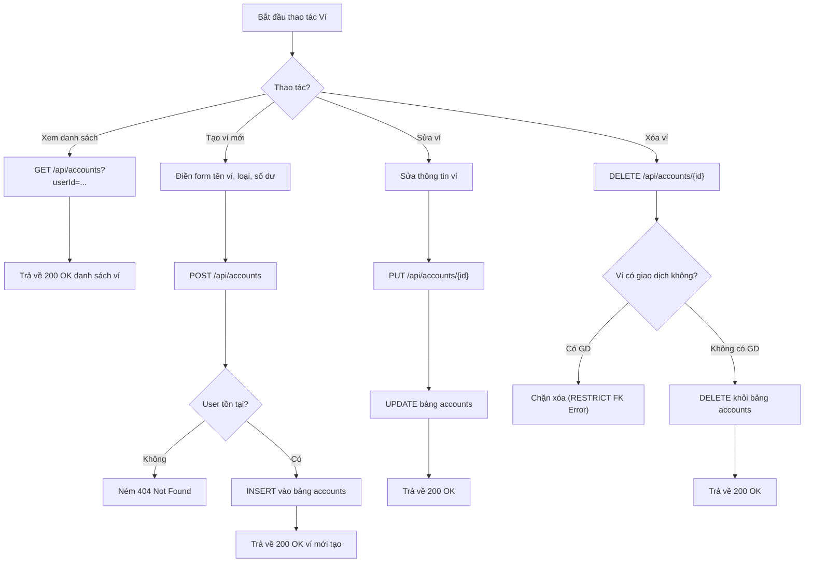
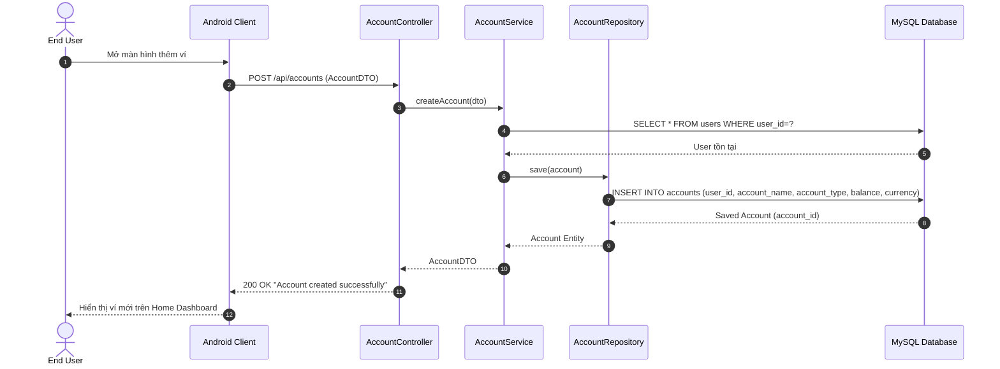
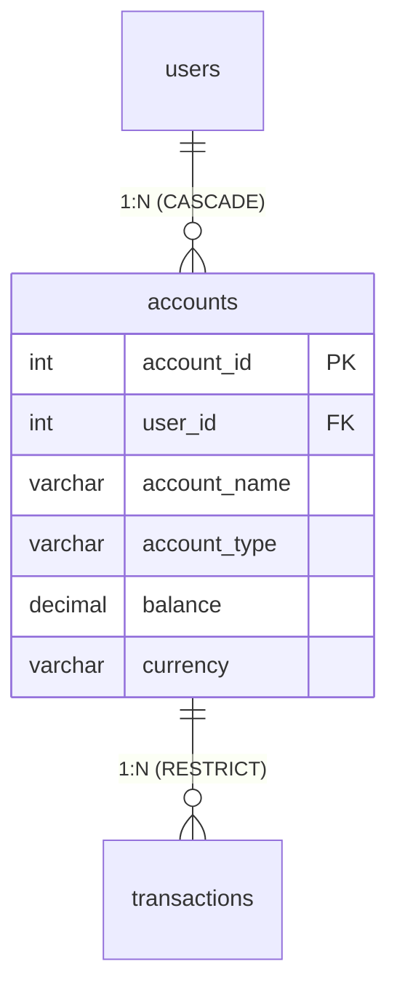

# F05 - QUẢN LÝ VÍ TÀI CHÍNH (WALLET & ACCOUNT MANAGEMENT)

## 1. Thông tin chung
| Trường | Giá trị |
| :--- | :--- |
| **ID** | F05 |
| **Tên chức năng** | Quản lý Ví tài chính (Xem, Thêm mới, Chỉnh sửa, Xóa ví & Cập nhật số dư) |
| **Module** | Module 2: Quản lý Ví tài chính |
| **Actor** | End User |
| **Mô tả ngắn** | Cho phép người dùng theo dõi danh sách tất cả các nguồn tiền (Tiền mặt, Ngân hàng, Ví điện tử), tạo mới ví, sửa tên ví/loại ví, xóa ví và theo dõi biến động số dư theo thời gian thực. |
| **Trigger** | Người dùng xem màn hình Home (`HomeFragment`), bấm thêm ví (`AddAccountFragment`) hoặc chỉnh sửa ví (`AccountDetailsFragment`). |
| **Tiền điều kiện** | Người dùng đã đăng nhập; có `userId` hợp lệ. |
| **Hậu điều kiện** | Dữ liệu ví được thêm/sửa/xóa trong bảng `accounts`; tổng tài sản hiển thị trên Dashboard được tính toán lại. |

## 2. Use case
### Main flow
1. Người dùng mở màn hình Home, xem danh sách các ví nằm ở thanh lướt ngang (Horizontal Account List).
2. Android gửi request `GET /api/accounts?userId={userId}`.
3. Backend truy vấn CSDL và trả về danh sách `AccountDTO`.
4. Người dùng bấm nút "+" để tạo thêm ví mới (ví dụ: tạo ví "Techcombank", loại "bank", số dư ban đầu 2,000,000 VND).
5. Android gửi request `POST /api/accounts` kèm body `AccountDTO`.
6. Backend kiểm tra tính hợp lệ của dữ liệu, lưu ví mới vào bảng `accounts` và trả về thông tin ví vừa tạo.
7. Người dùng chọn một ví để xem chi tiết và sửa thông tin (Đổi tên ví, loại ví).
8. Android gửi request `PUT /api/accounts/{id}` kèm body `AccountDTO`.
9. Backend cập nhật bản ghi trong CSDL và phản hồi 200 OK.
10. Nếu người dùng chọn xóa ví, Android gửi request `DELETE /api/accounts/{id}`.
11. Backend kiểm tra và xóa ví khỏi bảng `accounts`, trả về thông báo thành công.

### Alternative flow
- **Tạo ví không nhập số dư ban đầu:** Nếu `dto.getBalance() == null`, hệ thống tự động gán mặc định `balance = BigDecimal.ZERO`.

### Exception flow
- **E1 - Không tìm thấy User:** Khi tạo ví, `user_id` không tồn tại trong CSDL. Backend ném `ResourceNotFoundException("User not found with id: ...")`, trả về HTTP 404.
- **E2 - Xóa ví khi còn giao dịch liên kết:** Ví đã phát sinh giao dịch trong bảng `transactions`. CSDL kích hoạt ràng buộc khóa ngoại `ON DELETE RESTRICT`, backend ném ngoại lệ vi phạm toàn vẹn dữ liệu, trả về HTTP 400/500 ngăn xóa ví.
- **E3 - Không tìm thấy Ví theo ID:** Khi sửa hoặc xóa ví, `id` không tồn tại. Ném `ResourceNotFoundException("Account not found with id: ...")`, trả về HTTP 404.

## 3. Entry points
| Method | URL / Route | Auth | Request | Response | Status code | Nơi xử lý (file:dòng) |
| :---: | :--- | :---: | :--- | :--- | :---: | :--- |
| `GET` | `/api/accounts` | Bearer Token | Query: `userId` (Integer, bắt buộc) | `ApiResponse<List<AccountDTO>>` | 200 OK | `AccountController.java:22-26` |
| `POST` | `/api/accounts` | Bearer Token | Body: `AccountDTO` (`userId`, `accountName`, `accountType`, `balance`, `currency`) | `ApiResponse<AccountDTO>` | 200 OK 400 Bad Request 404 Not Found | `AccountController.java:28-32` |
| `PUT` | `/api/accounts/{id}` | Bearer Token | Path: `id` Body: `AccountDTO` | `ApiResponse<AccountDTO>` | 200 OK 404 Not Found | `AccountController.java:34-38` |
| `DELETE` | `/api/accounts/{id}` | Bearer Token | Path: `id` | `ApiResponse<Void>` | 200 OK 404 Not Found 400/500 (FK Restrict) | `AccountController.java:40-44` |
| Screen | `AddAccountFragment` | Logged In | Nhập tên ví, loại ví, số dư ban đầu | Tạo ví mới | - | `AddAccountFragment.kt:30-80` |

## 4. Luồng xử lý chi tiết
1. **Lấy danh sách ví:**
   - `AccountController.getAccountsByUserId` (`AccountController.java:22-26`) gọi `AccountService.getAccountsByUserId(userId)` (`AccountService.java:27-32`).
   - Repository: `accountRepository.findByUserUserId(userId)` (`AccountService.java:28`).
   - Chuyển đổi List sang `AccountDTO` bằng `toDTO(account)` và trả về.
2. **Tạo mới ví:**
   - `AccountController.createAccount` (`AccountController.java:28-32`) gọi `AccountService.createAccount(dto)` (`AccountService.java:35-50`).
   - Tìm User: `userRepository.findById(dto.getUserId())` -> nếu rỗng ném 404 (`AccountService.java:36-37`).
   - Khởi tạo Entity `Account` với `balance = dto.getBalance() != null ? dto.getBalance() : BigDecimal.ZERO` và `currency = "VND"` (`AccountService.java:39-46`).
   - Lưu trữ: `accountRepository.save(account)` (`AccountService.java:48`).
3. **Cập nhật ví:**
   - `AccountController.updateAccount` (`AccountController.java:34-38`) gọi `AccountService.updateAccount(id, dto)` (`AccountService.java:52-64`).
   - Tìm ví: `accountRepository.findById(accountId)` -> nếu không thấy ném 404 (`AccountService.java:53-54`).
   - Cập nhật các trường không null (`accountName`, `accountType`, `currency`, `balance`) (`AccountService.java:56-59`).
   - Lưu: `accountRepository.save(account)`.
4. **Xóa ví:**
   - `AccountController.deleteAccount` (`AccountController.java:40-44`) gọi `AccountService.deleteAccount(id)` (`AccountService.java:66-72`).
   - Kiểm tra tồn tại: `accountRepository.existsById(accountId)` (`AccountService.java:67`).
   - Xóa: `accountRepository.deleteById(accountId)` (`AccountService.java:70`).

## 5. Biểu đồ

### 5.1. Activity Diagram

### 5.2. Sequence Diagram

### 5.3. State Diagram
Không áp dụng.

## 6. Danh sách hàm / class
| Layer | Class.method | Signature | Input | Output | Mô tả | Exception | File:dòng |
| :--- | :--- | :--- | :--- | :--- | :--- | :--- | :--- |
| Controller | `AccountController.getAccountsByUserId` | `ResponseEntity<ApiResponse<List<AccountDTO>>> getAccountsByUserId(Integer)` | `userId` | `ApiResponse<List<AccountDTO>>` | Lấy danh sách ví | Không có | `AccountController.java:22-26` |
| Controller | `AccountController.createAccount` | `ResponseEntity<ApiResponse<AccountDTO>> createAccount(AccountDTO)` | `accountDTO` | `ApiResponse<AccountDTO>` | Tạo ví mới | `ResourceNotFoundException` | `AccountController.java:28-32` |
| Controller | `AccountController.updateAccount` | `ResponseEntity<ApiResponse<AccountDTO>> updateAccount(Integer, AccountDTO)` | `id`, `accountDTO` | `ApiResponse<AccountDTO>` | Sửa ví | `ResourceNotFoundException` | `AccountController.java:34-38` |
| Controller | `AccountController.deleteAccount` | `ResponseEntity<ApiResponse<Void>> deleteAccount(Integer)` | `id` | `ApiResponse<Void>` | Xóa ví | `ResourceNotFoundException`, DataIntegrity | `AccountController.java:40-44` |
| Service | `AccountService.updateBalance` | `void updateBalance(Integer, BigDecimal, String)` | `accountId`, `amount`, `transactionType` | `void` | Cộng/Trừ số dư khi có giao dịch | `ResourceNotFoundException` | `AccountService.java:74-86` |

## 7. Cơ sở dữ liệu
- **Bảng liên quan:**
  - `accounts`: **C/R/U/D**. Cột sử dụng: `account_id`, `user_id`, `account_name`, `account_type`, `balance`, `currency`, `created_at`, `updated_at`. Xem chi tiết tại [01-database/tables.md#2-bảng-accounts-ví--tài-khoản-tài-chính](../01-database/tables.md#2-bảng-accounts-ví--tài-khoản-tài-chính).
  - `users`: **R** (Kiểm tra người dùng sở hữu).
  - `transactions`: **R** (Bảo vệ tham chiếu qua khóa ngoại RESTRICT).
- **Ràng buộc:** `accounts.user_id` tham chiếu `users(user_id)` ON DELETE CASCADE. `transactions.account_id` tham chiếu `accounts(account_id)` ON DELETE RESTRICT.
- **Transaction:** `@Transactional` bao bọc tại các phương thức `createAccount`, `updateAccount`, `deleteAccount`, `updateBalance`.
- **ERD con:**

## 8. Business rules và validation
| Mã quy tắc | Nội dung quy tắc | Nơi kiểm tra | File:dòng |
| :---: | :--- | :---: | :--- |
| **BR-05.1** | Tên ví không được để trống (`account_name NOT NULL`) | BE / DB | `AccountDTO.java`, `schema.sql:26` |
| **BR-05.2** | Không cho phép xóa ví nếu ví đó đang chứa các giao dịch thu chi trong lịch sử | DB Constraint | `schema.sql:70-72` |
| **BR-05.3** | Khi phát sinh giao dịch, số dư ví tự động điều chỉnh: `income` -> cộng dồn, `expense` -> trừ đi | BE Service | `AccountService.java:79-83` |

## 9. Phân quyền
- Yêu cầu xác thực Bearer Token hợp lệ.

## 10. Xử lý lỗi
| Tình huống | Exception / Mã lỗi | HTTP status | Thông báo | Hành vi rollback |
| :--- | :--- | :---: | :--- | :--- |
| `userId` hoặc `accountId` không tồn tại | `ResourceNotFoundException` | 404 | `"Account not found with id: ..."` | Không lưu DB |
| Xóa ví có giao dịch liên kết | `DataIntegrityViolationException` | 500 / 400 | Lỗi ràng buộc khóa ngoại | Rollback câu lệnh xóa |

## 11. Phụ thuộc và tích hợp
- Tích hợp chặt chẽ với [F07 - Giao dịch thu chi](F07-ghi-chep-quan-ly-giao-dich.md) và [F10 - Giao dịch định kỳ](F10-quan-ly-giao-dich-dinh-ky.md).

## 12. Edge case, giới hạn, điểm chưa rõ
- **Edge case:** Số dư ví có thể bị âm nếu các khoản chi tiêu vượt quá số dư hiện có. Hệ thống hiện không chặn số dư âm để cho phép người dùng ghi nhận thực tế các khoản chi thấu chi hoặc nợ ví.

## 13. Gợi ý test case
| Mã TC | Kịch bản kiểm thử | Dữ liệu đầu vào | Kết quả mong đợi |
| :---: | :--- | :--- | :--- |
| **TC-F05-01** | Lấy danh sách ví của User | `userId = 1` | Trả về 200 OK kèm danh sách các ví |
| **TC-F05-02** | Tạo ví mới hợp lệ | `accountName = "Ví MoMo"`, `balance = 500000` | Tạo thành công bản ghi trong `accounts`, trả về 200 OK |
| **TC-F05-03** | Xóa ví chưa có giao dịch nào | `accountId = 5` (chưa có transaction) | Xóa thành công, trả về 200 OK |
| **TC-F05-04** | Xóa ví đã có giao dịch | `accountId = 1` (đã có transaction) | Báo lỗi vi phạm toàn vẹn, không cho xóa |
