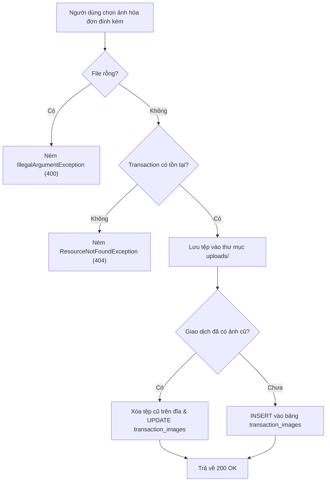
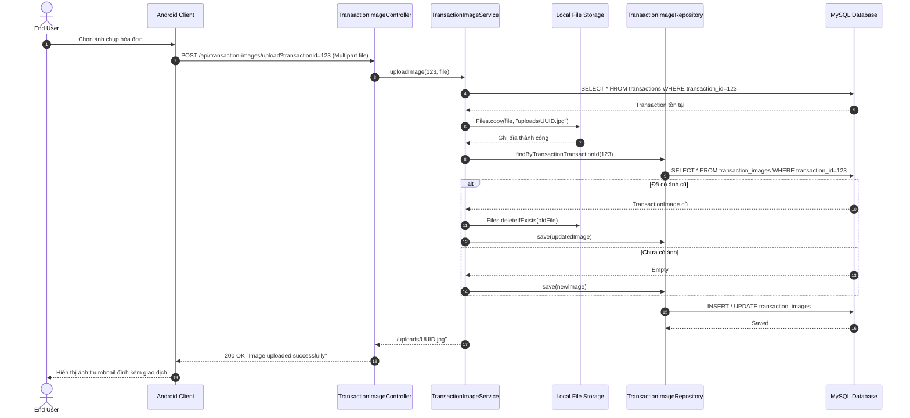
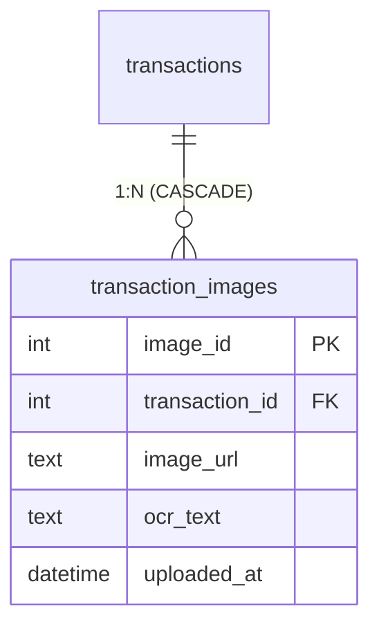

# F08 - ĐÍNH KÈM ẢNH HÓA ĐƠN GIAO DỊCH (TRANSACTION IMAGE ATTACHMENT)

## 1. Thông tin chung
| Trường | Giá trị |
| :--- | :--- |
| **ID** | F08 |
| **Tên chức năng** | Đính kèm và Quản lý ảnh chứng từ hóa đơn giao dịch |
| **Module** | Module 4: Quản lý Giao dịch |
| **Actor** | End User |
| **Mô tả ngắn** | Cho phép người dùng chụp ảnh hóa đơn hoặc chọn ảnh từ thư viện để đính kèm vào giao dịch thu chi. Tệp ảnh được lưu trữ trên server tại thư mục `uploads/` và liên kết với giao dịch qua bảng `transaction_images`. |
| **Trigger** | Người dùng bấm biểu tượng đính kèm ảnh khi tạo giao dịch hoặc xem chi tiết ảnh giao dịch (`TransactionPhotoDetailDialog`). |
| **Tiền điều kiện** | Giao dịch đã được tạo thành công trong bảng `transactions` (`transactionId` hợp lệ); tệp ảnh không rỗng. |
| **Hậu điều kiện** | Tệp ảnh được lưu trên đĩa máy chủ; bản ghi trong bảng `transaction_images` được tạo hoặc cập nhật đường dẫn mới. |

## 2. Use case
### Main flow
1. Sau khi giao dịch được tạo hoặc khi xem chi tiết giao dịch, người dùng nhấn "Thêm ảnh hóa đơn".
2. Người dùng chụp ảnh hoặc chọn ảnh từ thư viện thiết bị.
3. Android gửi request `POST /api/transaction-images/upload?transactionId={id}` kèm tệp tin Multipart.
4. Backend kiểm tra tệp tin không rỗng và kiểm tra `transactionId` có tồn tại trong bảng `transactions` không.
5. Backend tạo thư mục `uploads/` nếu chưa có.
6. Backend tạo tên tệp ngẫu nhiên theo UUID và lưu tệp vào thư mục `uploads/`.
7. Backend kiểm tra xem giao dịch này đã có ảnh cũ trong bảng `transaction_images` chưa:
   - Nếu đã có: Xóa tệp cũ trên đĩa và cập nhật đường dẫn `image_url` mới, cập nhật `uploaded_at = NOW()`.
   - Nếu chưa có: Tạo mới bản ghi `TransactionImage` với `ocr_text = ""` và lưu vào CSDL.
8. Backend trả về 200 OK thông báo thành công.
9. Android hiển thị ảnh hóa đơn đính kèm ngay trên chi tiết giao dịch.

### Alternative flow
- Không có.

### Exception flow
- **E1 - File rỗng:** Client gửi file rỗng. Backend ném `IllegalArgumentException("File is empty")`, trả về HTTP 400.
- **E2 - Giao dịch không tồn tại:** `transactionId` không có trong CSDL. Ném `ResourceNotFoundException("Transaction not found with id: ...")`, trả về HTTP 404.

## 3. Entry points
| Method | URL / Route | Auth | Request | Response | Status code | Nơi xử lý (file:dòng) |
| :---: | :--- | :---: | :--- | :--- | :---: | :--- |
| `POST` | `/api/transaction-images/upload` | Bearer Token | Query: `transactionId` (Integer) Multipart: `file` (`MultipartFile`) | `ApiResponse<Void>` | 200 OK 400 Bad Request 404 Not Found | `TransactionImageController.java:21-25` |
| Dialog | `TransactionPhotoDetailDialog` | Logged In | Xem phóng to ảnh hóa đơn | - | - | `dialog_transaction_photo_detail.xml` |

## 4. Luồng xử lý chi tiết
1. **Tiếp nhận Upload:** `TransactionImageController.uploadImage` (`TransactionImageController.java:21-25`) gọi `TransactionImageService.uploadImage(transactionId, file)` (`TransactionImageService.java:32-65`).
2. **Kiểm tra hợp lệ:**
   - Nếu `file.isEmpty()`, ném `IllegalArgumentException("File is empty")` (`TransactionImageService.java:33-35`).
   - Tìm giao dịch: `transactionRepository.findById(transactionId)` -> nếu không thấy ném 404 (`TransactionImageService.java:37-38`).
3. **Lưu tệp đĩa:**
   - Tạo thư mục `uploads/` nếu chưa có (`TransactionImageService.java:41-44`).
   - Sinh tên file UUID: `UUID.randomUUID().toString() + extension` (`TransactionImageService.java:47-51`).
   - Lưu: `Files.copy(file.getInputStream(), Paths.get("uploads", filename))` (`TransactionImageService.java:54-55`).
4. **Cập nhật CSDL:**
   - Tìm ảnh cũ: `transactionImageRepository.findByTransactionTransactionId(transactionId)` (`TransactionImageService.java:60`).
   - Nếu đã có: Xóa file cũ trên đĩa vật lý (`TransactionImageService.java:66-72`), cập nhật `imageUrl = "/uploads/" + filename`.
   - Nếu chưa: Khởi tạo `TransactionImage.builder().transaction(transaction).imageUrl(imageUrl).ocrText("").build()` (`TransactionImageService.java:76-80`).
   - Lưu: `transactionImageRepository.save(transactionImage)` (`TransactionImageService.java:83`).
5. **Phản hồi:** Trả về `ApiResponse.success("Image uploaded successfully", null)`.

## 5. Biểu đồ

### 5.1. Activity Diagram

### 5.2. Sequence Diagram

### 5.3. State Diagram
Không áp dụng.

## 6. Danh sách hàm / class
| Layer | Class.method | Signature | Input | Output | Mô tả | Exception | File:dòng |
| :--- | :--- | :--- | :--- | :--- | :--- | :--- | :--- |
| Controller | `TransactionImageController.uploadImage` | `ResponseEntity<ApiResponse<Void>> uploadImage(Integer, MultipartFile)` | `transactionId`, `file` | `ApiResponse<Void>` | Endpoint upload ảnh | `IOException` | `TransactionImageController.java:21-25` |
| Service | `TransactionImageService.uploadImage` | `String uploadImage(Integer, MultipartFile)` | `transactionId`, `file` | `String` (imageUrl) | Lưu file đĩa và cập nhật CSDL | `IllegalArgumentException`, `ResourceNotFoundException`, `IOException` | `TransactionImageService.java:32-65` |

## 7. Cơ sở dữ liệu
- **Bảng liên quan:** `transaction_images` (**C/R/U**). Cột: `image_id`, `transaction_id`, `image_url`, `ocr_text`, `uploaded_at`. Xem chi tiết tại [01-database/tables.md#7-bảng-transaction_images-hình-ảnh-giao-dịch](../01-database/tables.md#7-bảng-transaction_images-hình-ảnh-giao-dịch).
- **Ràng buộc:** `transaction_images.transaction_id` tham chiếu `transactions(transaction_id)` ON DELETE CASCADE.
- **Transaction:** Ghi file đĩa trước, lưu DB sau.
- **ERD con:**

## 8. Business rules và validation
| Mã quy tắc | Nội dung quy tắc | Nơi kiểm tra | File:dòng |
| :---: | :--- | :---: | :--- |
| **BR-08.1** | Tệp ảnh tải lên không được rỗng | BE Service | `TransactionImageService.java:33-35` |
| **BR-08.2** | Mỗi giao dịch khi cập nhật lại ảnh thì tự động ghi đè ảnh cũ và dọn dẹp file cũ trên đĩa | BE Service | `TransactionImageService.java:66-72` |
| **BR-08.3** | Khi xóa một giao dịch, toàn bộ file ảnh vật lý trên đĩa liên quan đến giao dịch đó được dọn dẹp tự động | BE Service | `TransactionService.java:155-167` |

## 9. Phân quyền
- Yêu cầu xác thực Bearer Token hợp lệ.

## 10. Xử lý lỗi
| Tình huống | Exception / Mã lỗi | HTTP status | Thông báo | Hành vi rollback |
| :--- | :--- | :---: | :--- | :--- |
| File rỗng | `IllegalArgumentException` | 400 | `"File is empty"` | Không lưu đĩa |
| `transactionId` không tồn tại | `ResourceNotFoundException` | 404 | `"Transaction not found with id: ..."` | Không lưu đĩa |

## 11. Phụ thuộc và tích hợp
- Lưu trữ file tĩnh tại thư mục `uploads/` trên máy chủ.
- Khi người dùng gọi API `GET /api/transactions`, trường `imageUrl` tự động được nạp từ bảng `transaction_images` (`TransactionService.java:189-191`).

## 12. Edge case, giới hạn, điểm chưa rõ
- **Dọn dẹp ảnh vật lý khi xóa giao dịch:** Đã bổ sung cơ chế dọn dẹp chủ động tại `TransactionService.deleteTransaction` (`TransactionService.java:155-167`). Khi xóa một giao dịch, hệ thống tự động tìm tất cả ảnh đính kèm có tiền tố `/uploads/` và xóa file vật lý tương ứng trên đĩa bằng `Files.deleteIfExists`, ngăn ngừa triệt để tình trạng file rác (orphan files).

## 13. Gợi ý test case
| Mã TC | Kịch bản kiểm thử | Dữ liệu đầu vào | Kết quả mong đợi |
| :---: | :--- | :--- | :--- |
| **TC-F08-01** | Upload ảnh hợp lệ cho giao dịch | `transactionId = 1`, file `.jpg` 1MB | Tệp lưu vào `uploads/`, bản ghi tạo trong `transaction_images`, trả về 200 OK |
| **TC-F08-02** | Upload ảnh cho transaction không tồn tại | `transactionId = 99999` | Trả về 404 Not Found |
| **TC-F08-03** | Upload ảnh mới ghi đè ảnh cũ | Tải ảnh thứ 2 cho cùng 1 transaction | Ảnh cũ trên đĩa bị xóa, ảnh mới được cập nhật |
