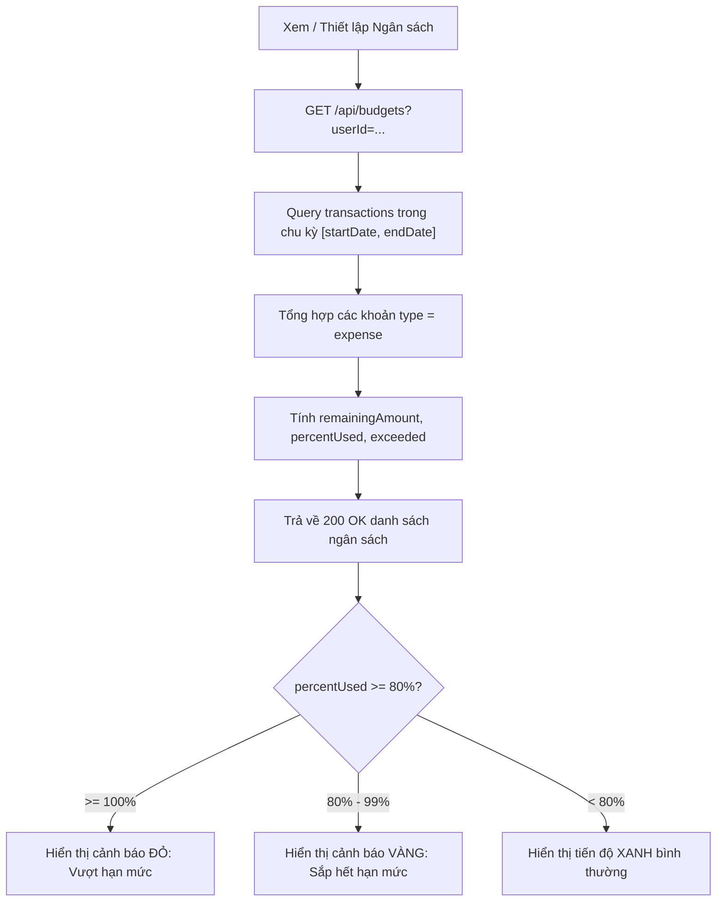
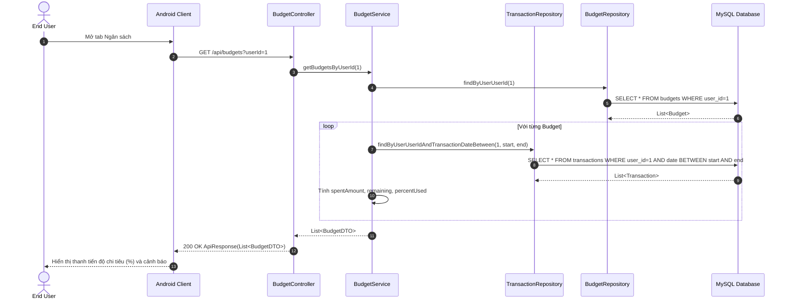
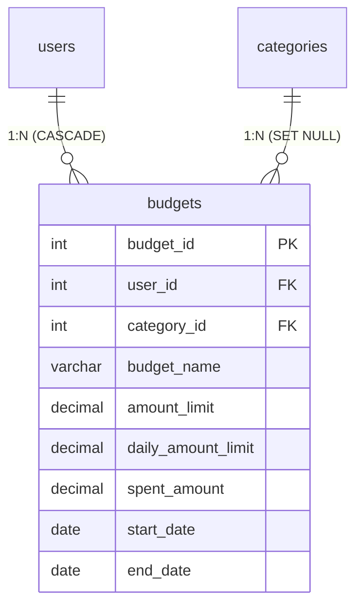

# F09 - THIẾT LẬP VÀ GIÁM SÁT HẠN MỨC NGÂN SÁCH (BUDGET MANAGEMENT)

## 1. Thông tin chung
| Trường | Giá trị |
| :--- | :--- |
| **ID** | F09 |
| **Tên chức năng** | Thiết lập & Giám sát hạn mức Ngân sách chi tiêu |
| **Module** | Module 5: Quản lý Ngân sách |
| **Actor** | End User |
| **Mô tả ngắn** | Cho phép người dùng thiết lập hạn mức chi tiêu trong chu kỳ tháng (toàn bộ ví hoặc theo từng danh mục cụ thể), cài đặt hạn mức chi tiêu mỗi ngày. Hệ thống tự động tính toán tổng chi tiêu thực tế, phần trăm đã sử dụng, số tiền còn lại và cảnh báo khi chi tiêu vượt ngưỡng. |
| **Trigger** | Người dùng xem danh sách ngân sách, thêm mới ngân sách (`AddBudgetFragment`) hoặc theo dõi tiến độ chi tiêu (`CategoryLimitFragment`). |
| **Tiền điều kiện** | Người dùng đã đăng nhập; có `userId` hợp lệ. |
| **Hậu điều kiện** | Bản ghi ngân sách được lưu vào bảng `budgets`; hệ thống tự động tổng hợp số tiền chi tiêu thực tế từ bảng `transactions`. |

## 2. Use case
### Main flow
1. Người dùng mở màn hình Quản lý Ngân sách.
2. Android gửi request `GET /api/budgets?userId={userId}&activeDate={today}`.
3. Backend truy vấn CSDL, tính toán số tiền đã chi (`calculateSpentAmount`) từ các giao dịch `expense` trong chu kỳ và trả về danh sách `BudgetDTO` (kèm `percentUsed`, `remainingAmount`, `exceeded`).
4. Người dùng bấm "+" để tạo ngân sách mới (ví dụ: "Ăn uống tháng 11", hạn mức 3,000,000 VND, hạn mức ngày 100,000 VND, từ 01/11/2026 đến 30/11/2026).
5. Android gửi request `POST /api/budgets` kèm body `BudgetDTO`.
6. Backend kiểm tra tính hợp lệ và lưu vào bảng `budgets`.
7. Người dùng có thể chỉnh sửa hạn mức hoặc chu kỳ qua `PUT /api/budgets/{id}`.
8. Người dùng có thể xóa ngân sách bằng request `DELETE /api/budgets/{id}`.

### Alternative flow
- **Ngân sách áp dụng cho toàn bộ danh mục:** Nếu `categoryId` để trống (null), ngân sách sẽ giám sát tổng chi tiêu của tất cả các danh mục trong chu kỳ.

### Exception flow
- **E1 - Không tìm thấy User hoặc Category:** Ném `ResourceNotFoundException`, trả về HTTP 404.
- **E2 - Hạn mức <= 0:** Bị chặn tại validation `@Valid`, trả về HTTP 400 Bad Request.

## 3. Entry points
| Method | URL / Route | Auth | Request | Response | Status code | Nơi xử lý (file:dòng) |
| :---: | :--- | :---: | :--- | :--- | :---: | :--- |
| `GET` | `/api/budgets` | Bearer Token | Query: `userId` (bắt buộc), `activeDate` (optional) | `ApiResponse<List<BudgetDTO>>` | 200 OK | `BudgetController.java:24-32` |
| `GET` | `/api/budgets/{id}` | Bearer Token | Path: `id` | `ApiResponse<BudgetDTO>` | 200 OK<br>404 Not Found | `BudgetController.java:34-38` |
| `POST` | `/api/budgets` | Bearer Token | Body: `BudgetDTO` (`userId`, `budgetName`, `amountLimit`, `dailyAmountLimit`, `startDate`, `endDate`, `categoryId`) | `ApiResponse<BudgetDTO>` | 200 OK<br>400 Bad Request<br>404 Not Found | `BudgetController.java:40-44` |
| `PUT` | `/api/budgets/{id}` | Bearer Token | Path: `id`<br>Body: `BudgetDTO` | `ApiResponse<BudgetDTO>` | 200 OK<br>404 Not Found | `BudgetController.java:46-50` |
| `DELETE` | `/api/budgets/{id}` | Bearer Token | Path: `id` | `ApiResponse<Void>` | 200 OK<br>404 Not Found | `BudgetController.java:52-56` |
| Screen | `AddBudgetFragment` | Logged In | Nhập tên ngân sách, số tiền hạn mức, chu kỳ | - | - | `AddBudgetFragment.kt:35-120` |

## 4. Luồng xử lý chi tiết
1. **Lấy danh sách ngân sách (`BudgetService.getBudgetsByUserId` / `getActiveBudgets` - `BudgetService.java:40-52`):**
   - Nếu có `activeDate`: gọi `budgetRepository.findByUserUserIdAndStartDateLessThanEqualAndEndDateGreaterThanEqual(userId, date, date)`.
   - Chuyển đổi sang DTO qua `toDTO(budget)` (`BudgetService.java:129-155`):
     - Tính tổng tiền đã tiêu: `calculateSpentAmount(budget)` (`BudgetService.java:114-127`):
       ```java
       List<Transaction> transactions = transactionRepository.findByUserUserIdAndTransactionDateBetween(
               budget.getUser().getUserId(), budget.getStartDate(), budget.getEndDate());
       return transactions.stream()
               .filter(t -> "expense".equalsIgnoreCase(t.getTransactionType()))
               .filter(t -> budget.getCategory() == null ||
                       (t.getCategory() != null && t.getCategory().getCategoryId().equals(budget.getCategory().getCategoryId())))
               .map(Transaction::getAmount)
               .reduce(BigDecimal.ZERO, BigDecimal::add);
       ```
     - Tính `remaining = amountLimit - spent`.
     - Tính `percentUsed = (spent / amountLimit) * 100`.
     - Đánh dấu `exceeded = spent > amountLimit`.
2. **Tạo mới ngân sách (`BudgetService.createBudget` - `BudgetService.java:61-85`):**
   - Tìm User, tìm Category (nếu có).
   - Khởi tạo Entity `Budget` với `spentAmount = BigDecimal.ZERO`.
   - Lưu vào DB: `budgetRepository.save(budget)`.
3. **Sửa / Xóa ngân sách:**
   - Cập nhật các trường thông tin qua `updateBudget` (`BudgetService.java:87-105`).
   - Xóa qua `deleteBudget` (`BudgetService.java:107-112`).

## 5. Biểu đồ

### 5.1. Activity Diagram


### 5.2. Sequence Diagram


### 5.3. State Diagram
Không áp dụng.

## 6. Danh sách hàm / class
| Layer | Class.method | Signature | Input | Output | Mô tả | Exception | File:dòng |
| :--- | :--- | :--- | :--- | :--- | :--- | :--- | :--- |
| Controller | `BudgetController.getBudgets` | `ResponseEntity<ApiResponse<List<BudgetDTO>>> getBudgets(...)` | `userId`, `activeDate` | `ApiResponse<List<BudgetDTO>>` | Lấy danh sách ngân sách | Không có | `BudgetController.java:24-32` |
| Controller | `BudgetController.createBudget` | `ResponseEntity<ApiResponse<BudgetDTO>> createBudget(BudgetDTO)` | `dto` | `ApiResponse<BudgetDTO>` | Tạo mới ngân sách | `ResourceNotFoundException` | `BudgetController.java:40-44` |
| Controller | `BudgetController.updateBudget` | `ResponseEntity<ApiResponse<BudgetDTO>> updateBudget(Integer, BudgetDTO)` | `id`, `dto` | `ApiResponse<BudgetDTO>` | Sửa ngân sách | `ResourceNotFoundException` | `BudgetController.java:46-50` |
| Controller | `BudgetController.deleteBudget` | `ResponseEntity<ApiResponse<Void>> deleteBudget(Integer)` | `id` | `ApiResponse<Void>` | Xóa ngân sách | `ResourceNotFoundException` | `BudgetController.java:52-56` |
| Service | `BudgetService.calculateSpentAmount` | `BigDecimal calculateSpentAmount(Budget)` | `budget` | `BigDecimal` | Tính tổng tiền đã chi từ transactions | Không có | `BudgetService.java:114-127` |
| Service | `BudgetService.toDTO` | `BudgetDTO toDTO(Budget)` | `budget` | `BudgetDTO` | Tính toán số dư và phần trăm sử dụng | Không có | `BudgetService.java:129-155` |

## 7. Cơ sở dữ liệu
- **Bảng liên quan:**
  - `budgets`: **C/R/U/D**. Cột: `budget_id`, `user_id`, `category_id`, `budget_name`, `amount_limit`, `daily_amount_limit`, `spent_amount`, `start_date`, `end_date`, `created_at`, `updated_at`. Xem chi tiết tại [01-database/tables.md#5-bảng-budgets-hạn-mức-ngân-sách](../01-database/tables.md#5-bảng-budgets-hạn-mức-ngân-sách).
  - `transactions`: **R** (Đọc các giao dịch expense trong chu kỳ để tính số tiền đã chi).
  - `categories`: **R** (Danh mục áp dụng).
  - `users`: **R** (Chủ sở hữu).
- **Ràng buộc:** `user_id` CASCADE, `category_id` SET NULL (nếu xóa danh mục thì ngân sách vẫn giữ nguyên và category_id chuyển thành NULL).
- **Transaction:** `@Transactional` tại `createBudget`, `updateBudget`, `deleteBudget`.
- **ERD con:**


## 8. Business rules và validation
| Mã quy tắc | Nội dung quy tắc | Nơi kiểm tra | File:dòng |
| :---: | :--- | :---: | :--- |
| **BR-09.1** | `amount_limit` bắt buộc phải lớn hơn 0 | BE Validation | `BudgetDTO.java`, `schema.sql:83` |
| **BR-09.2** | Số tiền `spent_amount` được tính động thời gian thực từ các giao dịch `expense` trong khoảng `[start_date, end_date]` | BE Service | `BudgetService.java:114-127` |
| **BR-09.3** | Cờ `exceeded = true` khi `spent_amount > amount_limit` | BE Service | `BudgetService.java:150` |

## 9. Phân quyền
- Yêu cầu xác thực Bearer Token hợp lệ.

## 10. Xử lý lỗi
| Tình huống | Exception / Mã lỗi | HTTP status | Thông báo | Hành vi rollback |
| :--- | :--- | :---: | :--- | :--- |
| `id` không tồn tại | `ResourceNotFoundException` | 404 | `"Budget not found with id: ..."` | Không lưu DB |

## 11. Phụ thuộc và tích hợp
- Phụ thuộc bảng `transactions` để tính toán chi tiêu tích lũy.

## 12. Edge case, giới hạn, điểm chưa rõ
- **Edge case:** Nếu một giao dịch không gắn danh mục (`category_id = null`), giao dịch đó sẽ chỉ được tính vào ngân sách tổng (ngân sách có `category_id = null`), không bị tính nhầm vào ngân sách theo từng danh mục cụ thể.

## 13. Gợi ý test case
| Mã TC | Kịch bản kiểm thử | Dữ liệu đầu vào | Kết quả mong đợi |
| :---: | :--- | :--- | :--- |
| **TC-F09-01** | Tạo ngân sách tháng hợp lệ | `amountLimit = 2000000`, `startDate = 2026-11-01`, `endDate = 2026-11-30` | Tạo thành công bản ghi trong `budgets`, trả về 200 OK |
| **TC-F09-02** | Xem tiến độ khi đã chi 1,500,000 VND | Hạn mức 2,000,000; có giao dịch chi 1,500,000 | `spentAmount = 1500000`, `percentUsed = 75.0%`, `exceeded = false` |
| **TC-F09-03** | Xem tiến độ khi chi tiêu vượt hạn mức | Hạn mức 2,000,000; có giao dịch chi 2,500,000 | `percentUsed = 125.0%`, `remaining = -500000`, `exceeded = true` |
