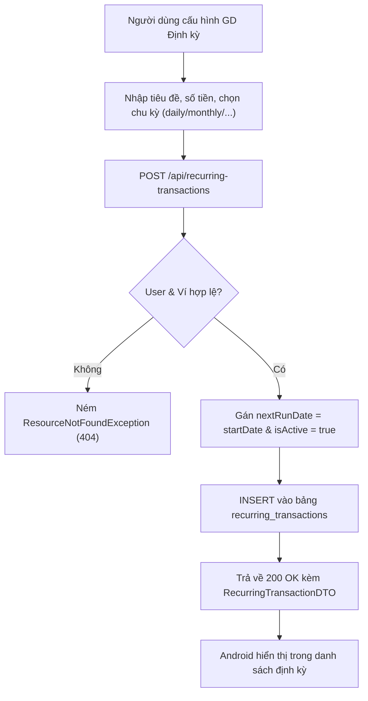
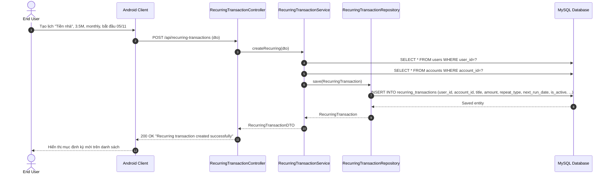
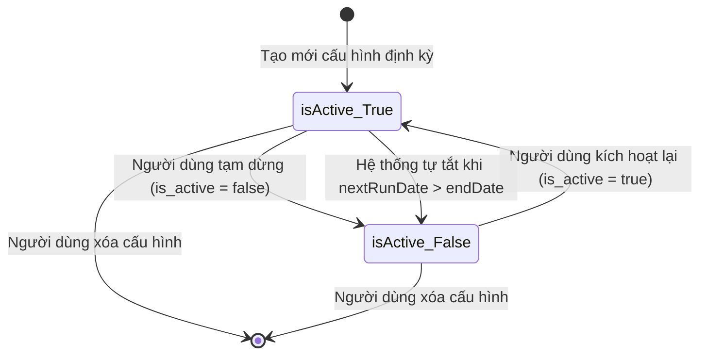
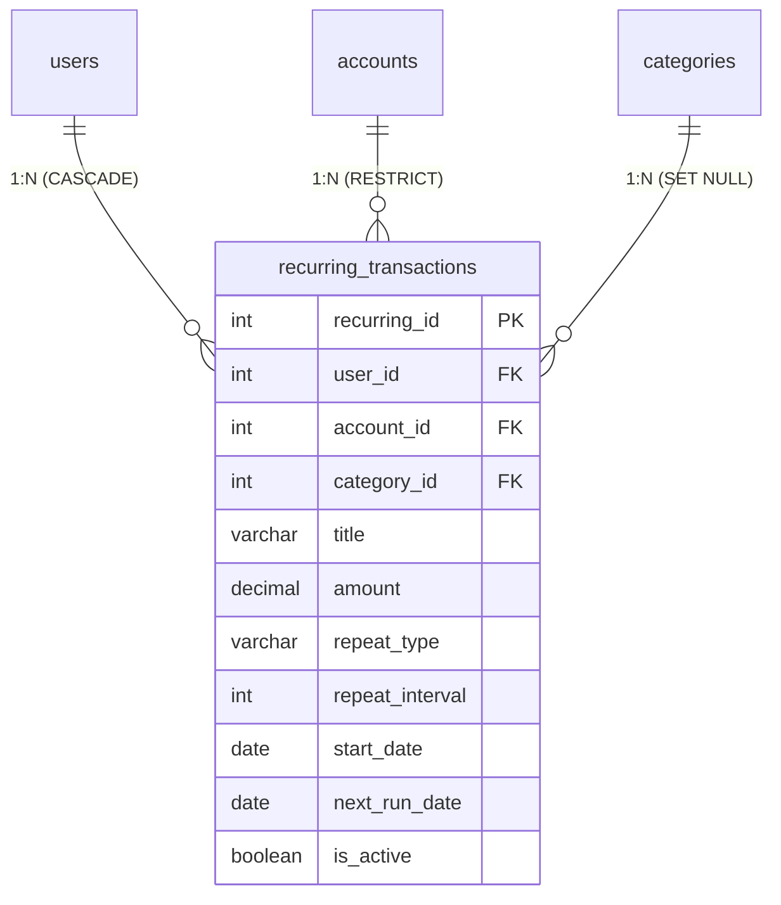

# F10 - QUẢN LÝ GIAO DỊCH ĐỊNH KỲ (RECURRING TRANSACTION SETUP)

## 1. Thông tin chung
| Trường | Giá trị |
| :--- | :--- |
| **ID** | F10 |
| **Tên chức năng** | Quản lý cấu hình Giao dịch lặp lại định kỳ (Tạo, Sửa, Xóa, Bật/Tắt) |
| **Module** | Module 6: Giao dịch Định kỳ |
| **Actor** | End User |
| **Mô tả ngắn** | Cho phép người dùng cấu hình các khoản thu chi phát sinh lặp lại đều đặn theo thời gian (tiền thuê nhà, hóa đơn điện nước, cước viễn thông, tiền lương) với các chu kỳ: hằng ngày, hằng tuần, hằng tháng, hằng năm. |
| **Trigger** | Người dùng mở màn hình Giao dịch định kỳ (`RecurringListFragment`) hoặc bấm thêm mới (`AddRecurringFragment`). |
| **Tiền điều kiện** | Người dùng đã đăng nhập; có ít nhất 1 ví tài khoản khả dụng. |
| **Hậu điều kiện** | Bản ghi cấu hình được lưu vào bảng `recurring_transactions` với ngày chạy đầu tiên `next_run_date = startDate` và cờ `is_active = TRUE`. |

## 2. Use case
### Main flow
1. Người dùng mở danh sách giao dịch định kỳ để theo dõi các hóa đơn sắp đến hạn.
2. Android gửi request `GET /api/recurring-transactions?userId={userId}`.
3. Backend trả về danh sách `RecurringTransactionDTO`.
4. Người dùng bấm "+" để tạo giao dịch định kỳ mới (ví dụ: "Tiền thuê trọ", 3,500,000 VND, chu kỳ `monthly`, ngày bắt đầu 05/11/2026, ví nguồn "Ví tiền mặt").
5. Android gửi request `POST /api/recurring-transactions` kèm body `RecurringTransactionDTO`.
6. Backend kiểm tra tính hợp lệ, tự động gán `next_run_date = startDate` và lưu vào bảng `recurring_transactions`.
7. Người dùng có thể sửa chu kỳ, số tiền hoặc bật/tắt tạm dừng (`is_active = false`) qua `PUT /api/recurring-transactions/{id}`.
8. Người dùng có thể xóa hẳn cấu hình lặp lại bằng request `DELETE /api/recurring-transactions/{id}`.

### Alternative flow
- Không có.

### Exception flow
- **E1 - Không tìm thấy User hoặc Ví nguồn:** Ném `ResourceNotFoundException`, trả về HTTP 404.
- **E2 - Thiếu trường bắt buộc hoặc số tiền <= 0:** Bị chặn tại validation `@Valid`, trả về HTTP 400 Bad Request.

## 3. Entry points
| Method | URL / Route | Auth | Request | Response | Status code | Nơi xử lý (file:dòng) |
| :---: | :--- | :---: | :--- | :--- | :---: | :--- |
| `GET` | `/api/recurring-transactions` | Bearer Token | Query: `userId` (bắt buộc) | `ApiResponse<List<RecurringTransactionDTO>>` | 200 OK | `RecurringTransactionController.java:22-26` |
| `POST` | `/api/recurring-transactions` | Bearer Token | Body: `RecurringTransactionDTO` (`userId`, `accountId`, `categoryId`, `title`, `amount`, `transactionType`, `repeatType`, `repeatInterval`, `startDate`, `endDate`) | `ApiResponse<RecurringTransactionDTO>` | 200 OK<br>400 Bad Request<br>404 Not Found | `RecurringTransactionController.java:28-32` |
| `PUT` | `/api/recurring-transactions/{id}` | Bearer Token | Path: `id`<br>Body: `RecurringTransactionDTO` | `ApiResponse<RecurringTransactionDTO>` | 200 OK<br>404 Not Found | `RecurringTransactionController.java:34-38` |
| `DELETE` | `/api/recurring-transactions/{id}` | Bearer Token | Path: `id` | `ApiResponse<Void>` | 200 OK<br>404 Not Found | `RecurringTransactionController.java:40-44` |
| Screen | `AddRecurringFragment` | Logged In | Nhập thông tin chu kỳ lặp lại | - | - | `AddRecurringFragment.kt:35-120` |

## 4. Luồng xử lý chi tiết
1. **Lấy danh sách định kỳ:**
   - `RecurringTransactionController.getRecurringTransactions` (`RecurringTransactionController.java:22-26`) gọi `RecurringTransactionService.getRecurringByUserId(userId)` (`RecurringTransactionService.java:39-45`).
   - Repository: `recurringTransactionRepository.findByUserUserId(userId)`.
   - Map sang DTO qua `toDTO(rt)` và trả về.
2. **Tạo cấu hình định kỳ (`RecurringTransactionService.createRecurring` - `RecurringTransactionService.java:47-76`):**
   - Tìm User, Account, Category.
   - Khởi tạo Entity:
     ```java
     RecurringTransaction rt = RecurringTransaction.builder()
             .user(user).account(account).category(category)
             .title(dto.getTitle()).amount(dto.getAmount())
             .transactionType(dto.getTransactionType())
             .repeatType(dto.getRepeatType())
             .repeatInterval(dto.getRepeatInterval() != null ? dto.getRepeatInterval() : 1)
             .startDate(dto.getStartDate())
             .endDate(dto.getEndDate())
             .nextRunDate(dto.getStartDate()) // Ngày chạy đầu tiên chính là ngày bắt đầu
             .note(dto.getNote())
             .isActive(true)
             .build();
     ```
   - Lưu: `recurringTransactionRepository.save(rt)` (`RecurringTransactionService.java:74`).
3. **Cập nhật cấu hình định kỳ (`RecurringTransactionService.updateRecurring` - `RecurringTransactionService.java:78-112`):**
   - Tìm bản ghi cũ theo `id`.
   - Cập nhật các trường thông tin có thay đổi.
   - Nếu thay đổi `startDate` mà chưa chỉ định `nextRunDate`, đặt lại `nextRunDate = startDate`.
   - Lưu lại DB.
4. **Xóa cấu hình:** `recurringTransactionRepository.deleteById(id)` (`RecurringTransactionService.java:114-117`).

## 5. Biểu đồ

### 5.1. Activity Diagram


### 5.2. Sequence Diagram


### 5.3. State Diagram


## 6. Danh sách hàm / class
| Layer | Class.method | Signature | Input | Output | Mô tả | Exception | File:dòng |
| :--- | :--- | :--- | :--- | :--- | :--- | :--- | :--- |
| Controller | `RecurringTransactionController.getRecurringTransactions` | `ResponseEntity<ApiResponse<List<RecurringTransactionDTO>>> getRecurringTransactions(Integer)` | `userId` | `ApiResponse<List<RecurringTransactionDTO>>` | Lấy danh sách | Không có | `RecurringTransactionController.java:22-26` |
| Controller | `RecurringTransactionController.createRecurringTransaction` | `ResponseEntity<ApiResponse<RecurringTransactionDTO>> createRecurringTransaction(RecurringTransactionDTO)` | `dto` | `ApiResponse<RecurringTransactionDTO>` | Tạo mới định kỳ | `ResourceNotFoundException` | `RecurringTransactionController.java:28-32` |
| Controller | `RecurringTransactionController.updateRecurringTransaction` | `ResponseEntity<ApiResponse<RecurringTransactionDTO>> updateRecurringTransaction(Integer, RecurringTransactionDTO)` | `id`, `dto` | `ApiResponse<RecurringTransactionDTO>` | Sửa định kỳ | `ResourceNotFoundException` | `RecurringTransactionController.java:34-38` |
| Controller | `RecurringTransactionController.deleteRecurringTransaction` | `ResponseEntity<ApiResponse<Void>> deleteRecurringTransaction(Integer)` | `id` | `ApiResponse<Void>` | Xóa định kỳ | Không có | `RecurringTransactionController.java:40-44` |
| Service | `RecurringTransactionService.createRecurring` | `RecurringTransactionDTO createRecurring(RecurringTransactionDTO)` | `dto` | `RecurringTransactionDTO` | Khởi tạo lịch định kỳ | `ResourceNotFoundException` | `RecurringTransactionService.java:47-76` |
| Service | `RecurringTransactionService.updateRecurring` | `RecurringTransactionDTO updateRecurring(Integer, RecurringTransactionDTO)` | `id`, `dto` | `RecurringTransactionDTO` | Cập nhật cấu hình | `ResourceNotFoundException` | `RecurringTransactionService.java:78-112` |

## 7. Cơ sở dữ liệu
- **Bảng liên quan:**
  - `recurring_transactions`: **C/R/U/D**. Cột: `recurring_id`, `user_id`, `account_id`, `category_id`, `title`, `amount`, `transaction_type`, `repeat_type`, `repeat_interval`, `start_date`, `end_date`, `next_run_date`, `note`, `is_active`, `created_at`, `updated_at`. Xem chi tiết tại [01-database/tables.md#6-bảng-recurring_transactions-giao-dịch-định-kỳ](../01-database/tables.md#6-bảng-recurring_transactions-giao-dịch-định-kỳ).
  - `accounts`: **R** (Bảo vệ ví nguồn qua khóa ngoại RESTRICT).
  - `categories`: **R** (Gắn danh mục qua SET NULL).
  - `users`: **R** (Chủ sở hữu qua CASCADE).
- **Ràng buộc:** `user_id` CASCADE, `account_id` RESTRICT, `category_id` SET NULL.
- **Transaction:** `@Transactional` bao bọc tại `createRecurring`, `updateRecurring`, `deleteRecurring`.
- **ERD con:**


## 8. Business rules và validation
| Mã quy tắc | Nội dung quy tắc | Nơi kiểm tra | File:dòng |
| :---: | :--- | :---: | :--- |
| **BR-10.1** | `repeat_interval` mặc định là 1 nếu không truyền | BE Service | `RecurringTransactionService.java:64` |
| **BR-10.2** | Giá trị ban đầu của `next_run_date` luôn bằng `start_date` khi vừa tạo mới | BE Service | `RecurringTransactionService.java:67` |
| **BR-10.3** | Không cho phép xóa một Ví tài khoản nếu ví đó đang được gắn vào giao dịch định kỳ (`RESTRICT`) | DB Constraint | `schema.sql:173-175` |

## 9. Phân quyền
- Yêu cầu xác thực Bearer Token hợp lệ.

## 10. Xử lý lỗi
| Tình huống | Exception / Mã lỗi | HTTP status | Thông báo | Hành vi rollback |
| :--- | :--- | :---: | :--- | :--- |
| `id` không tồn tại | `ResourceNotFoundException` | 404 | `"Recurring transaction not found"` | Không lưu DB |

## 11. Phụ thuộc và tích hợp
- Được tiêu thụ và thực thi tự động bởi tiến trình ngầm Cron Job [F11 - Tự động thực thi giao dịch định kỳ](F11-tu-dong-thuc-thi-giao-dich-dinh-ky.md).

## 12. Edge case, giới hạn, điểm chưa rõ
- Khi người dùng sửa `start_date` của một giao dịch định kỳ đã chạy nhiều kỳ trước đó, nếu không truyền `next_run_date` mới thì `next_run_date` sẽ bị reset về `start_date` mới (`RecurringTransactionService.java:92-94`).

## 13. Gợi ý test case
| Mã TC | Kịch bản kiểm thử | Dữ liệu đầu vào | Kết quả mong đợi |
| :---: | :--- | :--- | :--- |
| **TC-F10-01** | Tạo lịch định kỳ hàng tháng | `repeatType = "monthly"`, `startDate = 2026-11-05` | Lưu vào DB với `next_run_date = 2026-11-05`, `is_active = true` |
| **TC-F10-02** | Tạm dừng lịch định kỳ | `isActive = false` | Cập nhật `is_active = 0` trong DB |
| **TC-F10-03** | Xóa lịch định kỳ | `recurringId = 1` | Xóa thành công bản ghi khỏi `recurring_transactions` |
