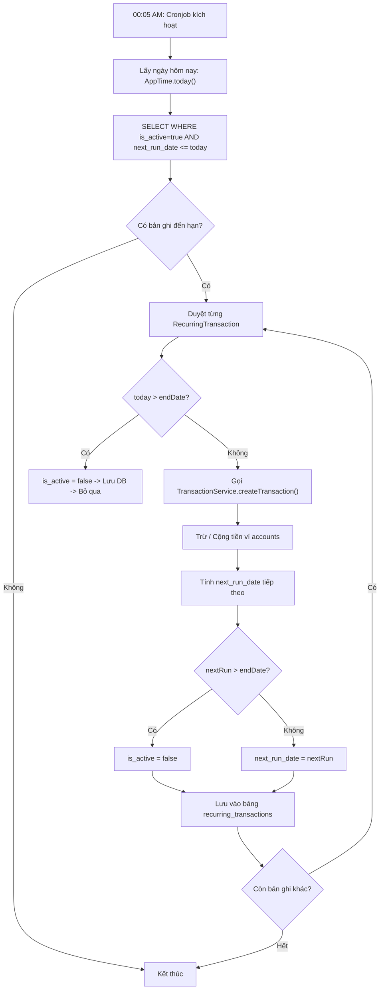
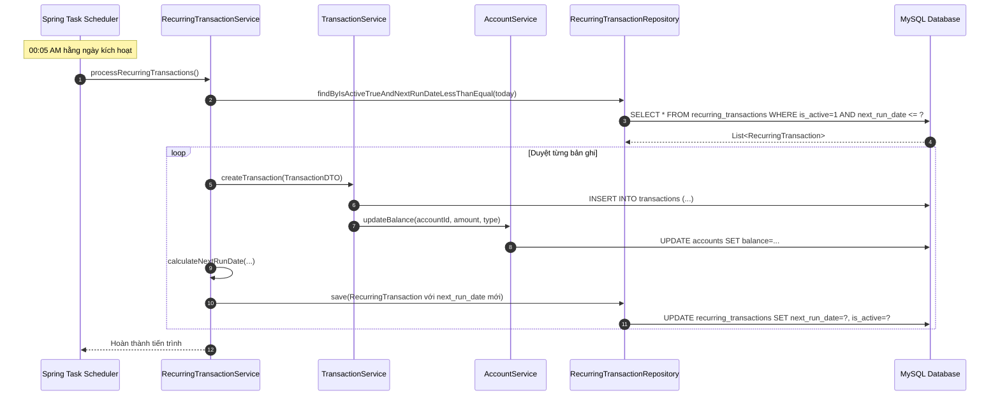

# F11 - TỰ ĐỘNG THỰC THI GIAO DỊCH ĐỊNH KỲ (SCHEDULED CRON JOB)

## 1. Thông tin chung
| Trường | Giá trị |
| :--- | :--- |
| **ID** | F11 |
| **Tên chức năng** | Tự động xử lý & Kích hoạt Giao dịch định kỳ đến hạn |
| **Module** | Module 6: Giao dịch Định kỳ |
| **Actor** | System Scheduler (Hệ thống ngầm), End User (thông qua manual test trigger) |
| **Mô tả ngắn** | Tiến trình chạy nền tự động được lập lịch chạy vào lúc 00:05 AM hằng ngày (múi giờ `Asia/Ho_Chi_Minh`). Tiến trình quét các bản ghi định kỳ đến hạn (`next_run_date <= TODAY` và `is_active = true`), tự động tạo giao dịch thực tế vào bảng `transactions`, trừ/cộng tiền ví `accounts` và tính toán lại ngày chạy tiếp theo (`next_run_date`). Cung cấp thêm API kích hoạt thủ công phục vụ kiểm thử. |
| **Trigger** | Tự động theo cron biểu thức `0 5 0 * * ?` hoặc gọi qua API `POST /api/recurring-transactions/trigger`. |
| **Tiền điều kiện** | Ứng dụng Backend Spring Boot đang chạy; `@EnableScheduling` được kích hoạt. |
| **Hậu điều kiện** | Giao dịch thực tế được tạo trong bảng `transactions`; số dư ví được cập nhật; trường `next_run_date` của bảng `recurring_transactions` được dời sang chu kỳ mới; các cấu hình quá hạn `endDate` được tự động chuyển thành `is_active = FALSE`. |

## 2. Use case
### Main flow
1. Đồng hồ hệ thống điểm 00:05 AM (hoặc Tester gọi API kích hoạt thủ công).
2. Spring Task Scheduler kích hoạt phương thức `RecurringTransactionService.processRecurringTransactions()`.
3. Hệ thống lấy ngày hiện tại: `today = AppTime.today()`.
4. Hệ thống truy vấn CSDL: tìm tất cả các bản ghi có `is_active = true` và `next_run_date <= today`.
5. Hệ thống duyệt qua từng bản ghi đến hạn:
   - **Kiểm tra hết hạn:** Nếu `endDate != null` và `today.isAfter(endDate)`, hệ thống đánh dấu `is_active = false`, lưu lại và bỏ qua.
   - **Tạo giao dịch thực tế:** Khởi tạo `TransactionDTO` với số tiền, danh mục, ví nguồn và `transactionDate = today`, ghi chú `"Giao dịch định kỳ tự động"`.
   - **Gọi tạo giao dịch:** Gọi `transactionService.createTransaction(tx)` để lưu vào bảng `transactions` và cập nhật số dư ví `accounts`.
   - **Tính toán ngày chạy tiếp theo:** Gọi hàm `calculateNextRunDate` căn cứ vào `repeatType` (DAILY, WEEKLY, MONTHLY, YEARLY) và khoảng lặp `repeatInterval`.
   - **Cập nhật ngày chạy mới:** Gán `rt.setNextRunDate(nextRun)`.
   - **Kiểm tra quá hạn mới:** Nếu `endDate != null` và `nextRun.isAfter(endDate)`, chuyển `is_active = false`.
   - **Lưu lại cấu hình:** Lưu bản ghi `rt` đã cập nhật vào bảng `recurring_transactions`.
6. Hoàn tất toàn bộ chu trình xử lý định kỳ.

### Alternative flow
- **Kích hoạt thủ công qua REST API:** Lập trình viên hoặc Quản trị viên gửi request `POST /api/recurring-transactions/trigger` để cưỡng bức chạy tiến trình ngay lập tức mà không cần đợi nửa đêm.

### Exception flow
- **E1 - Lỗi khi tạo giao dịch con:** Nếu 1 giao dịch con bị lỗi (ví dụ ví bị khóa), Spring rollback giao dịch con đó nhưng không làm sập toàn bộ cronjob của các bản ghi khác (nếu bọc try-catch) hoặc rollback toàn bộ transaction của cron job.

## 3. Entry points
| Method / Job | URL / Trigger | Auth | Request | Response | Status code | Nơi xử lý (file:dòng) |
| :---: | :--- | :---: | :--- | :--- | :---: | :--- |
| `@Scheduled` | Cron: `0 5 0 * * ?`<br>Zone: `Asia/Ho_Chi_Minh` | System Internal | Không | - | - | `RecurringTransactionService.java:119-164` |
| `POST` | `/api/recurring-transactions/trigger` | Bearer Token | Body: Rỗng | `ApiResponse<Void>` | 200 OK | `RecurringTransactionController.java:47-51` |

## 4. Luồng xử lý chi tiết
1. **Định nghĩa tác vụ lập lịch:**
   - Được gắn annotation `@Scheduled(cron = "0 5 0 * * ?", zone = AppTime.TIME_ZONE)` và `@Transactional` (`RecurringTransactionService.java:119-121`).
2. **Tìm các bản ghi đến hạn:**
   - `LocalDate today = AppTime.today();`
   - `List<RecurringTransaction> dueList = recurringTransactionRepository.findByIsActiveTrueAndNextRunDateLessThanEqual(today);` (`RecurringTransactionService.java:123-125`).
3. **Vòng lặp xử lý từng giao dịch:**
   - Kiểm tra ngày kết thúc: `if (rt.getEndDate() != null && today.isAfter(rt.getEndDate())) { rt.setIsActive(false); ... continue; }` (`RecurringTransactionService.java:128-132`).
   - Tạo giao dịch thực tế qua `TransactionService`:
     ```java
     TransactionDTO tx = TransactionDTO.builder()
             .userId(rt.getUser().getUserId())
             .accountId(rt.getAccount().getAccountId())
             .categoryId(rt.getCategory() != null ? rt.getCategory().getCategoryId() : null)
             .title(rt.getTitle())
             .amount(rt.getAmount())
             .transactionType(rt.getTransactionType())
             .transactionDate(today)
             .note(rt.getNote() != null ? rt.getNote() : "Giao dịch định kỳ tự động")
             .status("confirmed")
             .build();
     transactionService.createTransaction(tx);
     ```
   - Tính ngày tiếp theo: `LocalDate nextRun = calculateNextRunDate(rt.getNextRunDate(), rt.getStartDate(), rt.getRepeatType(), rt.getRepeatInterval());` (`RecurringTransactionService.java:150-155`).
   - Cập nhật và lưu: `rt.setNextRunDate(nextRun); recurringTransactionRepository.save(rt);`.
4. **Thuật toán tính ngày tiếp theo (`calculateNextRunDate` - `RecurringTransactionService.java:166-195`):**
   - **DAILY:** `current.plusDays(safeInterval)`
   - **WEEKLY:** `current.plusWeeks(safeInterval)`
   - **MONTHLY:** Giữ đúng ngày của tháng gốc (`startDate.getDayOfMonth()`), chuyển sang tháng mới `nextMonth = YearMonth.from(current).plusMonths(interval)`, lấy ngày an toàn `Math.min(targetDay, nextMonth.lengthOfMonth())` để xử lý tháng có 28, 30 hoặc 31 ngày.
   - **YEARLY:** Tương tự xử lý theo năm an toàn cho cả năm nhuận (ngày 29/02).

## 5. Biểu đồ

### 5.1. Activity Diagram


### 5.2. Sequence Diagram


### 5.3. State Diagram
Không áp dụng.

## 6. Danh sách hàm / class
| Layer | Class.method | Signature | Input | Output | Mô tả | Exception | File:dòng |
| :--- | :--- | :--- | :--- | :--- | :--- | :--- | :--- |
| Scheduler | `RecurringTransactionService.processRecurringTransactions` | `void processRecurringTransactions()` | Không | `void` | Tác vụ cron chạy ngầm tự động sinh giao dịch | Không có | `RecurringTransactionService.java:121-164` |
| Controller | `RecurringTransactionController.triggerRecurringTransactions` | `ResponseEntity<ApiResponse<Void>> triggerRecurringTransactions()` | Không | `ApiResponse<Void>` | Endpoint kích hoạt chạy tay phục vụ test | Không có | `RecurringTransactionController.java:47-51` |
| Utility | `RecurringTransactionService.calculateNextRunDate` | `LocalDate calculateNextRunDate(LocalDate, LocalDate, String, int)` | `current`, `start`, `type`, `interval` | `LocalDate` | Thuật toán tính ngày kế tiếp chuẩn lịch | Không có | `RecurringTransactionService.java:166-180` |

## 7. Cơ sở dữ liệu
- **Bảng liên quan:**
  - `recurring_transactions`: **R/U** (Đọc các bản ghi đến hạn và cập nhật `next_run_date`, `is_active`).
  - `transactions`: **C** (Tự động ghi nhận giao dịch mới).
  - `accounts`: **U** (Cập nhật số dư `balance`).
- **Ràng buộc:** Khóa ngoại liên kết chặt chẽ với `users`, `accounts`, `categories`.
- **Transaction:** `@Transactional` bao bọc phương thức `processRecurringTransactions`.
- **ERD con:** Tương tự F10.

## 8. Business rules và validation
| Mã quy tắc | Nội dung quy tắc | Nơi kiểm tra | File:dòng |
| :---: | :--- | :---: | :--- |
| **BR-11.1** | Chỉ xử lý các bản ghi có `is_active = TRUE` và `next_run_date <= TODAY` | BE Repository | `RecurringTransactionService.java:124` |
| **BR-11.2** | Đối với chu kỳ tháng, nếu ngày bắt đầu là 31 mà tháng kế tiếp chỉ có 30 ngày (hoặc 28/29 ngày với tháng 2), hệ thống tự động lùi về ngày cuối cùng của tháng đó | BE Logic | `RecurringTransactionService.java:182-187` |
| **BR-11.3** | Nếu ngày chạy mới vượt quá `endDate`, cấu hình tự động bị hủy kích hoạt (`is_active = false`) | BE Logic | `RecurringTransactionService.java:158-160` |

## 9. Phân quyền
- Chạy ngầm tự động không qua HTTP context.
- Endpoint kích hoạt test `POST /api/recurring-transactions/trigger` yêu cầu Bearer Token hợp lệ.

## 10. Xử lý lỗi
| Tình huống | Exception / Mã lỗi | HTTP status | Thông báo | Hành vi rollback |
| :--- | :--- | :---: | :--- | :--- |
| Lỗi CSDL khi đang duyệt giao dịch | `DataAccessException` | - | Ghi log hệ thống | Rollback toàn bộ các giao dịch sinh ra trong lượt |

## 11. Phụ thuộc và tích hợp
- Kích hoạt qua cấu hình `@EnableScheduling` trong `FinanceBackendApplication.java:7`.
- Tích hợp với múi giờ `AppTime.TIME_ZONE` (`"Asia/Ho_Chi_Minh"`).

## 12. Edge case, giới hạn, điểm chưa rõ
- **Edge case:** Nếu máy chủ bị tắt nguồn trong 3 ngày, khi bật lại vào ngày thứ 4, hàm `processRecurringTransactions()` chỉ chạy 1 lần và sinh 1 giao dịch cho kỳ gần nhất (chưa có vòng lặp bù các kỳ đã qua nhiều ngày).

## 13. Gợi ý test case
| Mã TC | Kịch bản kiểm thử | Dữ liệu đầu vào | Kết quả mong đợi |
| :---: | :--- | :--- | :--- |
| **TC-F11-01** | Kích hoạt khi có giao dịch đến hạn | Bản ghi có `next_run_date = TODAY` | Tạo 1 giao dịch mới trong `transactions`, trừ tiền ví, `next_run_date` nhảy sang chu kỳ sau |
| **TC-F11-02** | Kích hoạt khi giao dịch chưa đến hạn | Bản ghi có `next_run_date = TODAY + 2` | Không sinh giao dịch nào |
| **TC-F11-03** | Giao dịch định kỳ đến hạn ngày cuối cùng | `next_run_date = endDate` | Sinh giao dịch, sau đó `is_active` chuyển thành `false` |
