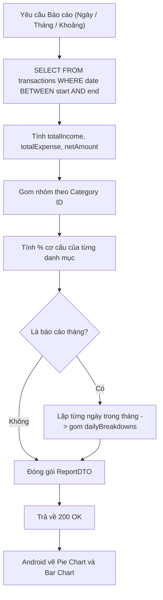
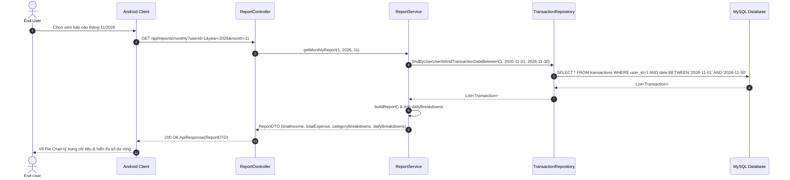
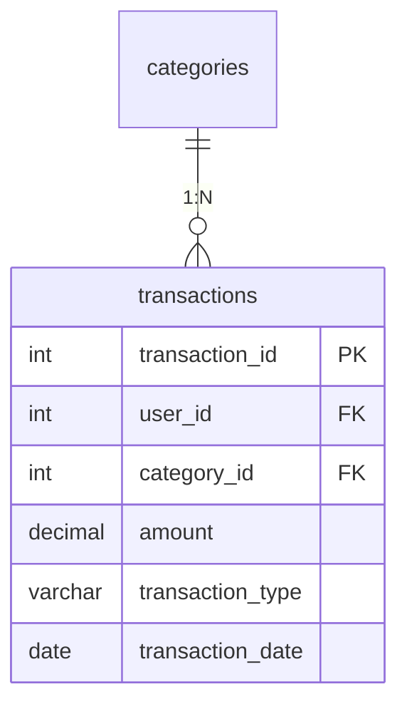

# F12 - BÁO CÁO VÀ THỐNG KÊ TÀI CHÍNH (REPORTING & ANALYTICS)

## 1. Thông tin chung
| Trường | Giá trị |
| :--- | :--- |
| **ID** | F12 |
| **Tên chức năng** | Báo cáo Thống kê Dòng tiền & Cơ cấu Chi tiêu (Ngày, Tháng, Danh mục) |
| **Module** | Module 7: Báo cáo & Thống kê |
| **Actor** | End User |
| **Mô tả ngắn** | Tổng hợp và phân tích dữ liệu tài chính theo ngày, theo tháng hoặc theo khoảng thời gian tùy chọn. Tính toán tổng thu nhập, tổng chi tiêu, số dư ròng (Net Amount), phân bổ tỷ lệ phần trăm theo danh mục phục vụ vẽ biểu đồ tròn (Pie Chart) và chi tiết thu chi từng ngày phục vụ vẽ biểu đồ cột/đường (Bar/Line Chart). |
| **Trigger** | Người dùng xem tổng quan tại `HomeFragment`, chọn ngày trên lịch (`DayDetailFragment`) hoặc mở màn hình Phân tích tài chính. |
| **Tiền điều kiện** | Người dùng đã đăng nhập; có `userId` hợp lệ. |
| **Hậu điều kiện** | Dữ liệu thống kê được tính toán và phản hồi dạng JSON có cấu trúc; ứng dụng vẽ trực quan hóa số liệu lên các biểu đồ Obsidian Dark Theme. |

## 2. Use case
### Main flow
1. Người dùng mở màn hình Báo cáo tháng (chọn Tháng 11/2026).
2. Android gửi request `GET /api/reports/monthly?userId={userId}&year=2026&month=11`.
3. Backend tiếp nhận, xác định ngày bắt đầu (`2026-11-01`) và ngày kết thúc (`2026-11-30`).
4. Backend truy vấn tất cả các giao dịch trong khoảng thời gian từ bảng `transactions`.
5. Backend tính tổng thu: $\sum amount$ của `income`.
6. Backend tính tổng chi: $\sum amount$ của `expense`.
7. Backend tính dòng tiền ròng: $net = totalIncome - totalExpense$.
8. Backend gom nhóm theo danh mục (`groupingBy Category`), tính tổng tiền và tỷ lệ phần trăm (%) của từng danh mục trên tổng chi tiêu.
9. Backend gom nhóm theo ngày (`groupingBy Date`), tạo danh sách `DailyBreakdown` (ngày, thu, chi) cho từng ngày trong tháng.
10. Backend trả về `ReportDTO` kèm đầy đủ số liệu phân rã.
11. Android hiển thị các thẻ tổng kết và vẽ biểu đồ Pie Chart / Bar Chart.

### Alternative flow
- **Xem báo cáo theo ngày:** Gửi `GET /api/reports/daily?userId={userId}&date={date}` để xem danh sách chi tiêu trong 1 ngày duy nhất.
- **Xem báo cáo theo khoảng tùy chọn:** Gửi `GET /api/reports/by-category?userId={userId}&startDate={start}&endDate={end}`.

### Exception flow
- **E1 - Sai định dạng ngày:** Định dạng không phải ISO DATE (`YYYY-MM-DD`). Backend trả về HTTP 400 Bad Request.

## 3. Entry points
| Method | URL / Route | Auth | Request | Response | Status code | Nơi xử lý (file:dòng) |
| :---: | :--- | :---: | :--- | :--- | :---: | :--- |
| `GET` | `/api/reports/daily` | Bearer Token | Query: `userId` (Integer), `date` (ISO Date: YYYY-MM-DD) | `ApiResponse<ReportDTO>` | 200 OK 400 Bad Request | `ReportController.java:22-28` |
| `GET` | `/api/reports/monthly` | Bearer Token | Query: `userId` (Integer), `year` (int), `month` (int) | `ApiResponse<ReportDTO>` | 200 OK 400 Bad Request | `ReportController.java:30-37` |
| `GET` | `/api/reports/by-category` | Bearer Token | Query: `userId` (Integer), `startDate` (ISO Date), `endDate` (ISO Date) | `ApiResponse<ReportDTO>` | 200 OK 400 Bad Request | `ReportController.java:39-45` |
| Screen | `HomeFragment` | Logged In | Xem tổng thu/chi và biểu đồ cơ cấu | - | - | `HomeFragment.kt:50-130` |

## 4. Luồng xử lý chi tiết
1. **Báo cáo tháng (`ReportService.getMonthlyReport` - `ReportService.java:31-68`):**
   - Xác định khoảng: `YearMonth yearMonth = YearMonth.of(year, month); LocalDate startDate = yearMonth.atDay(1); LocalDate endDate = yearMonth.atEndOfMonth();` (`ReportService.java:32-34`).
   - Truy vấn: `transactionRepository.findByUserUserIdAndTransactionDateBetween(userId, startDate, endDate)` (`ReportService.java:36-37`).
   - Gọi hàm tổng hợp `buildReport` (`ReportService.java:78-124`):
     - `totalIncome = transactions.stream().filter(income).map(amount).reduce(ZERO, add)`.
     - `totalExpense = transactions.stream().filter(expense).map(amount).reduce(ZERO, add)`.
     - `netAmount = totalIncome.subtract(totalExpense)`.
     - Gom nhóm theo danh mục và tính phần trăm làm tròn `RoundingMode.HALF_UP` 2 chữ số thập phân (`ReportService.java:101-105`).
   - Gom nhóm theo từng ngày (`ReportService.java:43-65`):
     - Lặp từ `startDate` đến `endDate`, nếu ngày nào có phát sinh thu hoặc chi thì thêm vào danh sách `dailyBreakdowns`.
2. **Báo cáo ngày (`ReportService.getDailyReport` - `ReportService.java:24-29`):**
   - Truy vấn `findByUserUserIdAndTransactionDateBetween(userId, date, date)`.
   - Tính toán `totalIncome`, `totalExpense`, `categoryBreakdowns` cho riêng ngày đó.

## 5. Biểu đồ

### 5.1. Activity Diagram

### 5.2. Sequence Diagram

### 5.3. State Diagram
Không áp dụng.

## 6. Danh sách hàm / class
| Layer | Class.method | Signature | Input | Output | Mô tả | Exception | File:dòng |
| :--- | :--- | :--- | :--- | :--- | :--- | :--- | :--- |
| Controller | `ReportController.getDailyReport` | `ResponseEntity<ApiResponse<ReportDTO>> getDailyReport(...)` | `userId`, `date` | `ApiResponse<ReportDTO>` | Báo cáo theo ngày | Không có | `ReportController.java:22-28` |
| Controller | `ReportController.getMonthlyReport` | `ResponseEntity<ApiResponse<ReportDTO>> getMonthlyReport(...)` | `userId`, `year`, `month` | `ApiResponse<ReportDTO>` | Báo cáo theo tháng | Không có | `ReportController.java:30-37` |
| Controller | `ReportController.getByCategory` | `ResponseEntity<ApiResponse<ReportDTO>> getByCategory(...)` | `userId`, `startDate`, `endDate` | `ApiResponse<ReportDTO>` | Báo cáo khoảng tùy chọn | Không có | `ReportController.java:39-45` |
| Service | `ReportService.getMonthlyReport` | `ReportDTO getMonthlyReport(Integer, int, int)` | `userId`, `year`, `month` | `ReportDTO` | Tính toán số liệu tháng | Không có | `ReportService.java:31-68` |
| Service | `ReportService.buildReport` | `ReportDTO buildReport(Integer, String, String, List<Transaction>)` | `userId`, `type`, `period`, `txList` | `ReportDTO` | Thuật toán gom nhóm danh mục và tính % | Không có | `ReportService.java:78-124` |

## 7. Cơ sở dữ liệu
- **Bảng liên quan:**
  - `transactions`: **R** (Bảng nguồn dữ liệu duy nhất để tổng hợp thu chi).
  - `categories`: **R** (Lấy tên và phân loại danh mục).
- **Chỉ mục sử dụng:** `idx_transactions_date` (`schema.sql:188`) và `idx_transactions_user_id` (`schema.sql:186`) giúp tối ưu hóa truy vấn trong phạm vi ngày.
- **Transaction:** Read-only queries, không thay đổi CSDL.
- **ERD con:**

## 8. Business rules và validation
| Mã quy tắc | Nội dung quy tắc | Nơi kiểm tra | File:dòng |
| :---: | :--- | :---: | :--- |
| **BR-12.1** | `netAmount` luôn bằng `totalIncome - totalExpense` | BE Service | `ReportService.java:89` |
| **BR-12.2** | Tỷ lệ phần trăm danh mục được tính trên tổng phát sinh và làm tròn 2 chữ số thập phân (`HALF_UP`) | BE Service | `ReportService.java:103-104` |

## 9. Phân quyền
- Yêu cầu xác thực Bearer Token hợp lệ.

## 10. Xử lý lỗi
| Tình huống | Exception / Mã lỗi | HTTP status | Thông báo | Hành vi rollback |
| :--- | :--- | :---: | :--- | :--- |
| Định dạng ngày sai | `MethodArgumentTypeMismatchException` | 400 | Lỗi tham số URL | Không truy vấn DB |

## 11. Phụ thuộc và tích hợp
- Tiêu thụ dữ liệu từ [F07 - Ghi chép giao dịch](F07-ghi-chep-quan-ly-giao-dich.md).

## 12. Edge case, giới hạn, điểm chưa rõ
- Khi tháng không có giao dịch nào (`transactions.isEmpty()`), hệ thống trả về `totalIncome = 0`, `totalExpense = 0`, `netAmount = 0` và danh sách mảng rỗng `[]`, không ném ngoại lệ chia cho 0 (`ReportService.java:102`).

## 13. Gợi ý test case
| Mã TC | Kịch bản kiểm thử | Dữ liệu đầu vào | Kết quả mong đợi |
| :---: | :--- | :--- | :--- |
| **TC-F12-01** | Báo cáo tháng có giao dịch | `userId = 1`, `year = 2026`, `month = 11` | Trả về tổng thu, chi, netAmount và danh sách phần trăm danh mục |
| **TC-F12-02** | Báo cáo tháng không có giao dịch | Tháng trống dữ liệu | `totalIncome = 0`, `totalExpense = 0`, danh sách rỗng, 200 OK |
