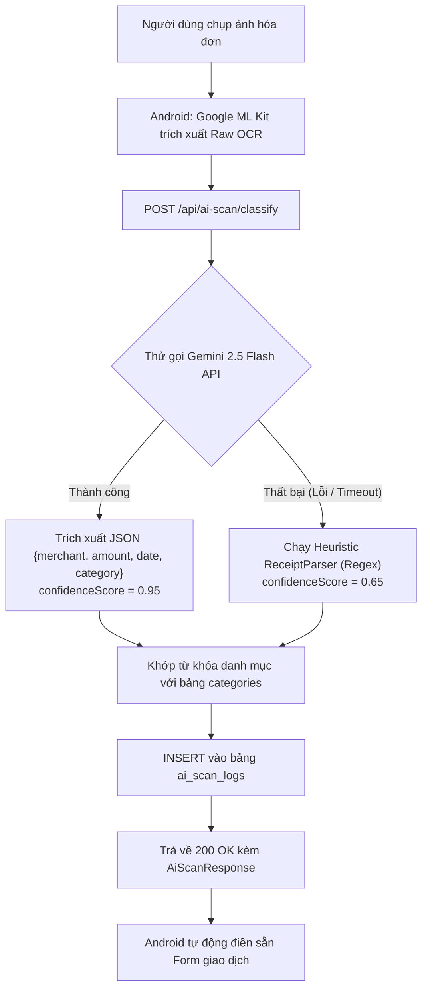
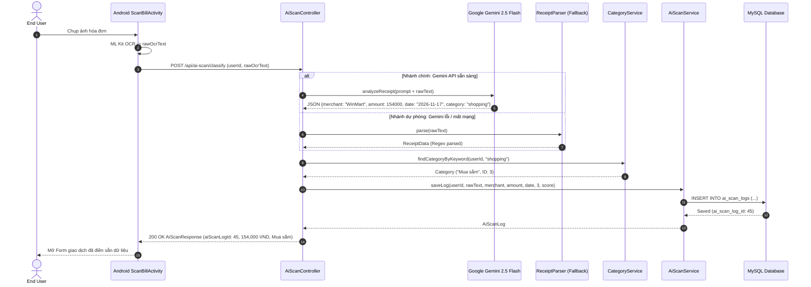
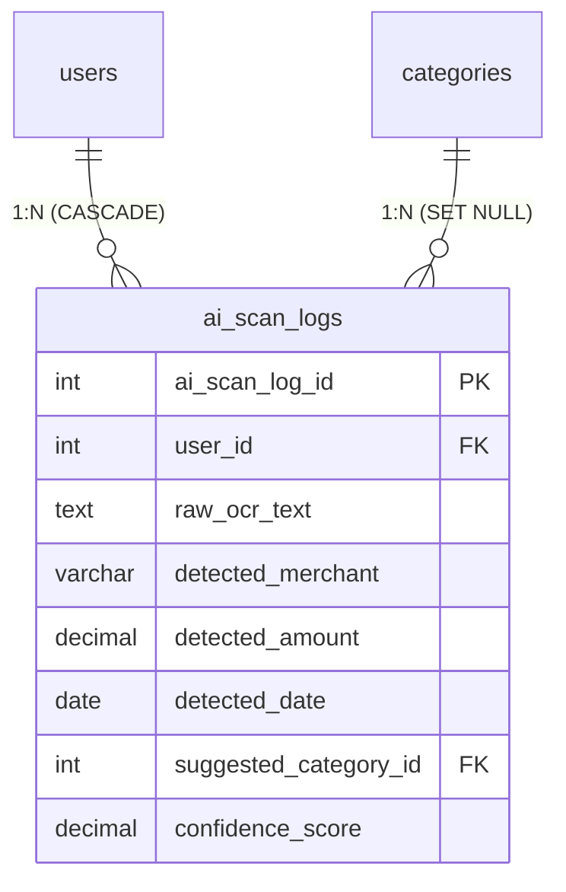

# F13 - QUÉT VÀ BÓC TÁCH HÓA ĐƠN THÔNG MINH (OCR & GEMINI FALLBACK)

## 1. Thông tin chung
| Trường | Giá trị |
| :--- | :--- |
| **ID** | F13 |
| **Tên chức năng** | Quét & Bóc tách hóa đơn thông minh (ML Kit OCR + Regex + Gemini 2.5 Flash Fallback) |
| **Module** | Module 8: AI OCR Hóa đơn |
| **Actor** | End User, Google Gemini AI Service |
| **Mô tả ngắn** | Cho phép người dùng chụp ảnh hóa đơn bán lẻ hoặc hóa đơn dịch vụ. Ứng dụng Android chạy Google ML Kit Text Recognition on-device để bóc tách chuỗi chữ thô (`rawOcrText`), sau đó gửi lên Backend. Backend ưu tiên phân tích bằng Google Gemini 2.5 Flash API với Structured Output JSON; nếu Gemini lỗi hoặc offline, hệ thống tự động Fallback về bộ phân tích Heuristic Regex tiếng Việt (`ReceiptParser`), tự động dự đoán danh mục và tạo bản ghi lưu vết trong `ai_scan_logs`. |
| **Trigger** | Người dùng mở tính năng Scan Hóa đơn trên màn hình thêm giao dịch hoặc chọn `ScanBillActivity`. |
| **Tiền điều kiện** | Người dùng đã đăng nhập; cấp quyền Camera/Thư viện ảnh; ảnh chụp có chứa văn bản hóa đơn đọc được. |
| **Hậu điều kiện** | Tạo một bản ghi log trong bảng `ai_scan_logs`; trả về thông tin đã trích xuất (`detectedMerchant`, `detectedAmount`, `detectedDate`, `suggestedCategoryId`, `confidenceScore`) để tự động điền Form tạo giao dịch trên Android. |

## 2. Use case
### Main flow
1. Người dùng chụp ảnh hóa đơn thanh toán trên màn hình `ScanBillActivity`.
2. Mô hình Google ML Kit Text Recognition trên Android nhận diện toàn bộ chuỗi văn bản thô từ ảnh.
3. Android gửi request `POST /api/ai-scan/classify` kèm `userId` và `rawOcrText`.
4. Backend tiếp nhận chuỗi văn bản thô:
   - **Thử nghiệm nhánh chính (Gemini 2.5 Flash):** Gửi Prompt yêu cầu trích xuất có cấu trúc kèm `rawOcrText` sang Google Gemini API với `responseMimeType = "application/json"`.
   - Gemini API phản hồi JSON: `{merchant, amount, date, category}`.
   - Backend giải mã JSON, gán độ tin cậy `confidenceScore = 0.95`.
5. Backend gọi `CategoryService.findCategoryByKeyword` để ánh xạ từ khóa tiếng Anh (`food`, `transport`, `shopping`,...) sang `Category` tiếng Việt trong MySQL.
6. Backend lưu vết toàn bộ thông tin vào bảng `ai_scan_logs` qua `aiScanService.saveLog(...)`.
7. Backend trả về `AiScanResponse` chứa đầy đủ các trường đã phát hiện và `aiScanLogId`.
8. Android tự động điền sẵn Form tạo giao dịch (Số tiền, Ngày, Danh mục gợi ý, Tên cửa hàng) để người dùng kiểm tra và xác nhận.

### Alternative flow
- **Nhánh phụ dự phòng (Fallback Regex):** Nếu gọi Gemini API gặp lỗi (mất mạng ngoài, hết hạn quota hoặc timeout), khối `catch` kích hoạt:
  - Backend gọi `ReceiptParser.parse(rawText)` để bóc tách bằng biểu thức chính quy (Regex tìm tổng tiền, ngày, cửa hàng).
  - Backend gọi `guessFallbackCategory(normalizedText, merchant)` để đoán từ khóa danh mục.
  - Backend gán độ tin cậy `confidenceScore = 0.65` và tiếp tục luồng lưu log bình thường.

### Exception flow
- **E1 - Chuỗi OCR rỗng:** `rawOcrText` rỗng. Bị chặn bởi `@NotBlank`, trả về HTTP 400 Bad Request.

## 3. Entry points
| Method | URL / Route | Auth | Request | Response | Status code | Nơi xử lý (file:dòng) |
| :---: | :--- | :---: | :--- | :--- | :---: | :--- |
| `POST` | `/api/ai-scan/classify` | Bearer Token | Body: `AiScanClassifyRequest` (`userId`, `rawOcrText`) | `ApiResponse<AiScanResponse>` | 200 OK<br>400 Bad Request | `AiScanController.java:49-116` |
| Screen | `ScanBillActivity` | Logged In | Chụp ảnh hóa đơn qua CameraX | Tự động điền form giao dịch | - | `ScanBillActivity.kt:40-160` |

## 4. Luồng xử lý chi tiết
1. **Tiếp nhận Request:** `AiScanController.classifyBill` (`AiScanController.java:49-116`).
2. **Xử lý trích xuất thực thể:**
   - **Khối Primary (Gemini):**
     ```java
     GeminiReceiptResponse geminiResult = geminiService.analyzeReceipt(rawText);
     amount = geminiResult.getAmount();
     date = geminiResult.getDate();
     merchant = geminiResult.getMerchant();
     categoryKeyword = geminiResult.getCategory();
     confidenceScore = BigDecimal.valueOf(0.95);
     ```
   - **Khối Catch Fallback (Regex):**
     ```java
     ReceiptData parsed = receiptParser.parse(rawText);
     amount = parsed.getAmount();
     date = parsed.getDate();
     merchant = parsed.getMerchant();
     categoryKeyword = guessFallbackCategory(parsed.getNormalizedText(), merchant);
     confidenceScore = BigDecimal.valueOf(0.65);
     ```
3. **Ánh xạ danh mục:** Gọi `categoryService.findCategoryByKeyword(request.getUserId(), categoryKeyword)` (`AiScanController.java:90`):
   - Ánh xạ keyword tiếng Anh (`food`, `transport`, `shopping`, `bills`, `entertainment`, `health`) sang danh mục tiếng Việt tương ứng (`Ăn uống`, `Di chuyển`, `Mua sắm`,...).
4. **Lưu vết CSDL:** Gọi `aiScanService.saveLog(...)` (`AiScanController.java:97-105`):
   - Lưu vào bảng `ai_scan_logs` với `raw_ocr_text`, `detected_merchant`, `detected_amount`, `detected_date`, `suggested_category_id`, `confidence_score`.
5. **Phản hồi:** Trả về `AiScanResponse` kèm `aiScanLogId`.

## 5. Biểu đồ

### 5.1. Activity Diagram


### 5.2. Sequence Diagram


### 5.3. State Diagram
Không áp dụng.

## 6. Danh sách hàm / class
| Layer | Class.method | Signature | Input | Output | Mô tả | Exception | File:dòng |
| :--- | :--- | :--- | :--- | :--- | :--- | :--- | :--- |
| Controller | `AiScanController.classifyBill` | `ResponseEntity<ApiResponse<AiScanResponse>> classifyBill(AiScanClassifyRequest)` | `request` | `ApiResponse<AiScanResponse>` | Tiếp nhận OCR và bóc tách thực thể | Không có | `AiScanController.java:49-116` |
| Service | `GeminiService.analyzeReceipt` | `GeminiReceiptResponse analyzeReceipt(String)` | `rawOcrText` | `GeminiReceiptResponse` | Gọi Gemini LLM với Structured JSON Schema | `RuntimeException` | `GeminiService.java:43-112` |
| Parser | `ReceiptParser.parse` | `ReceiptData parse(String)` | `rawOcrText` | `ReceiptData` | Heuristic regex parser tiếng Việt | Không có | `ReceiptParser.java:25-90` |
| Service | `AiScanService.saveLog` | `AiScanLog saveLog(...)` | `userId`, `rawOcrText`, `amount`, ... | `AiScanLog` | Lưu nhật ký quét hóa đơn | `ResourceNotFoundException` | `AiScanService.java:37-60` |

## 7. Cơ sở dữ liệu
- **Bảng liên quan:**
  - `ai_scan_logs`: **C**. Cột: `ai_scan_log_id`, `user_id`, `raw_ocr_text`, `detected_merchant`, `detected_amount`, `detected_date`, `suggested_category_id`, `confidence_score`, `created_at`. Xem chi tiết tại [01-database/tables.md#8-bảng-ai_scan_logs-nhật-ký-quét-hóa-đơn-ocr](../01-database/tables.md#8-bảng-ai_scan_logs-nhật-ký-quét-hóa-đơn-ocr).
  - `categories`: **R** (Gợi ý danh mục).
  - `users`: **R** (Người dùng thực hiện quét).
- **Ràng buộc:** `user_id` CASCADE, `suggested_category_id` SET NULL.
- **Transaction:** `@Transactional` tại `AiScanService.saveLog`.
- **ERD con:**


## 8. Business rules và validation
| Mã quy tắc | Nội dung quy tắc | Nơi kiểm tra | File:dòng |
| :---: | :--- | :---: | :--- |
| **BR-13.1** | `rawOcrText` không được để trống | BE Validation | `AiScanClassifyRequest.java` |
| **BR-13.2** | Ưu tiên gọi Gemini Flash 2.5 với Structured JSON; chỉ kích hoạt Regex khi gọi Gemini thất bại | BE Controller | `AiScanController.java:62-81` |
| **BR-13.3** | Mọi lần scan đều phải tạo bản ghi log trong `ai_scan_logs` để phục vụ đánh giá độ chính xác | BE Controller | `AiScanController.java:97-105` |

## 9. Phân quyền
- Yêu cầu xác thực Bearer Token hợp lệ.

## 10. Xử lý lỗi
| Tình huống | Exception / Mã lỗi | HTTP status | Thông báo | Hành vi rollback |
| :--- | :--- | :---: | :--- | :--- |
| Lỗi gọi Gemini API (Timeout, 429, 500) | `RuntimeException` | - | Chuyển sang Fallback Regex | Không ném lỗi ra client |
| Lỗi CSDL khi lưu log | `DataAccessException` | 500 | Lỗi hệ thống | Rollback bản ghi log |

## 11. Phụ thuộc và tích hợp
- **Dịch vụ ngoài:** Google Gemini 2.5 Flash API (cấu hình trong `ai-settings.properties`).
- **On-device AI:** Google ML Kit Text Recognition on Android.
- Tích hợp với [F14 - Phản hồi hóa đơn AI](F14-phan-hoi-xac-nhan-hoa-don-ai.md).

## 12. Edge case, giới hạn, điểm chưa rõ
- **Edge case:** Hóa đơn bị rách hoặc mờ khiến số tiền nhận diện bị thiếu số 0 cuối (ví dụ: `15.000` thành `15.00`). Khi điền sẵn form, người dùng vẫn có toàn quyền sửa lại số tiền trước khi bấm Lưu.

## 13. Gợi ý test case
| Mã TC | Kịch bản kiểm thử | Dữ liệu đầu vào | Kết quả mong đợi |
| :---: | :--- | :--- | :--- |
| **TC-F13-01** | Bóc tách hóa đơn chuẩn qua Gemini | Text hóa đơn Highlands Coffee | Trả về 200 OK, `detectedMerchant = "Highlands Coffee"`, `suggestedCategory = "Ăn uống"`, `confidence = 0.95` |
| **TC-F13-02** | Bóc tách khi Gemini API mất mạng | Ngắt kết nối ngoài | Tự động chạy fallback Regex, trả về 200 OK, `confidence = 0.65` |
| **TC-F13-03** | Gửi chuỗi OCR rỗng | `rawOcrText = ""` | Trả về 400 Bad Request |
