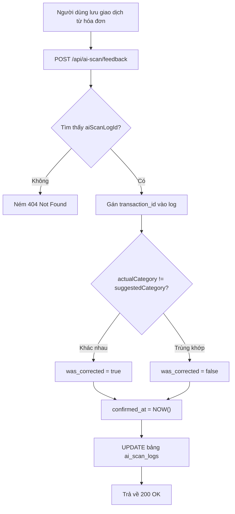
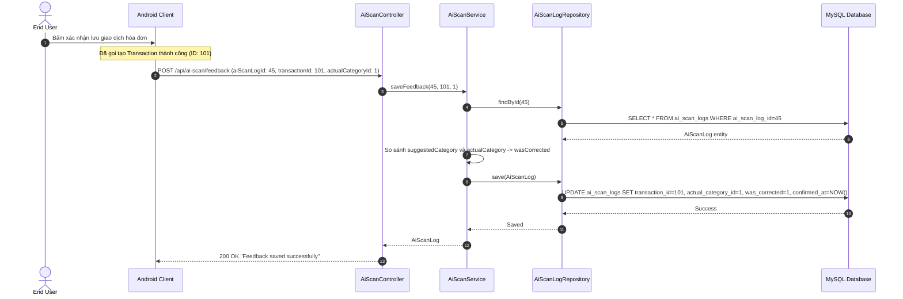
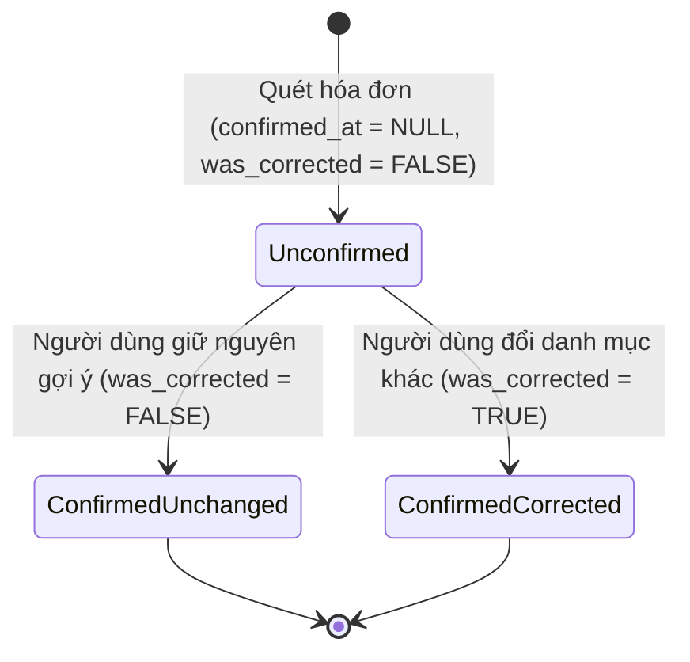
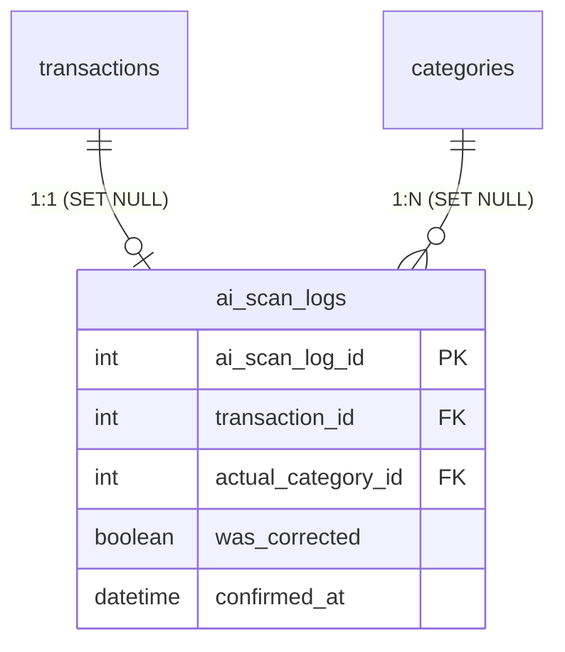

# F14 - THU THẬP PHẢN HỒI VÀ LƯU VẾT HÓA ĐƠN AI (AI SCAN FEEDBACK)

## 1. Thông tin chung
| Trường | Giá trị |
| :--- | :--- |
| **ID** | F14 |
| **Tên chức năng** | Thu thập phản hồi & Lưu vết xác nhận hóa đơn AI |
| **Module** | Module 8: AI OCR Hóa đơn |
| **Actor** | End User |
| **Mô tả ngắn** | Sau khi người dùng kiểm tra form giao dịch được điền sẵn từ tính năng Quét hóa đơn và nhấn nút Lưu giao dịch, Android gọi API Feedback gửi `aiScanLogId`, `transactionId` và `actualCategoryId`. Hệ thống cập nhật bản ghi log trong bảng `ai_scan_logs`, đánh dấu cờ `was_corrected = TRUE` nếu người dùng đổi danh mục khác so với gợi ý của AI, ghi nhận thời điểm xác nhận `confirmed_at = NOW()`. |
| **Trigger** | Người dùng nhấn nút "Xác nhận & Lưu giao dịch" trên màn hình sau khi quét hóa đơn. |
| **Tiền điều kiện** | Đã thực hiện quét hóa đơn (có `aiScanLogId` từ F13); giao dịch đã được tạo thành công trong bảng `transactions` (có `transactionId` từ F07). |
| **Hậu điều kiện** | Bản ghi trong `ai_scan_logs` được liên kết với `transaction_id`, cập nhật `actual_category_id`, `was_corrected` và `confirmed_at`. |

## 2. Use case
### Main flow
1. Người dùng kiểm tra thông tin điền sẵn từ hóa đơn trên màn hình Android.
2. Nếu danh mục gợi ý chưa đúng, người dùng chọn lại danh mục mong muốn (ví dụ: AI gợi ý "Mua sắm" nhưng người dùng sửa thành "Ăn uống").
3. Người dùng nhấn nút "Lưu giao dịch".
4. Android gọi API tạo giao dịch F07 thành công và nhận được `transactionId`.
5. Android lập tức gửi request `POST /api/ai-scan/feedback` kèm `aiScanLogId`, `transactionId`, `actualCategoryId`.
6. Backend tìm bản ghi `AiScanLog` theo `aiScanLogId`.
7. Backend kiểm tra xem `actualCategoryId` có khác với `suggestedCategory.categoryId` ban đầu không:
   - Nếu khác: gán `was_corrected = true`.
   - Nếu giống: gán `was_corrected = false`.
8. Backend cập nhật `confirmedAt = LocalDateTime.now()`, liên kết `transactionId` và lưu lại vào bảng `ai_scan_logs`.
9. Backend trả về thông báo 200 OK `"Feedback saved successfully"`.

### Alternative flow
- **Người dùng giữ nguyên gợi ý của AI:** `was_corrected` được lưu là `false`.

### Exception flow
- **E1 - Không tìm thấy `aiScanLogId`:** Backend ném `ResourceNotFoundException("AI scan log not found with id: ...")`, trả về HTTP 404.

## 3. Entry points
| Method | URL / Route | Auth | Request | Response | Status code | Nơi xử lý (file:dòng) |
| :---: | :--- | :---: | :--- | :--- | :---: | :--- |
| `POST` | `/api/ai-scan/feedback` | Bearer Token | Body: `AiScanFeedbackRequest` (`aiScanLogId`, `transactionId`, `actualCategoryId`) | `ApiResponse<String>` | 200 OK<br>404 Not Found | `AiScanController.java:118-126` |

## 4. Luồng xử lý chi tiết
1. **Tiếp nhận Request:** `AiScanController.saveFeedback` (`AiScanController.java:118-126`) gọi `AiScanService.saveFeedback` (`AiScanService.java:63-87`).
2. **Tìm bản ghi log:** `aiScanLogRepository.findById(aiScanLogId)` -> nếu rỗng ném 404 (`AiScanService.java:64-65`).
3. **Liên kết Giao dịch:** Nếu `transactionId != null`, tìm trong `transactionRepository` và gán `log.setTransaction(transaction)` (`AiScanService.java:67-70`).
4. **Xác định Danh mục thực tế & Cờ điều chỉnh:**
   - Tìm `actualCategory` từ `categoryRepository` (`AiScanService.java:74-75`).
   - Gán `log.setActualCategory(actualCategory)` (`AiScanService.java:78`).
   - Tính toán cờ:
     ```java
     boolean wasCorrected = actualCategory != null
             && (log.getSuggestedCategory() == null
             || !log.getSuggestedCategory().getCategoryId().equals(actualCategory.getCategoryId()));
     log.setWasCorrected(wasCorrected);
     log.setConfirmedAt(LocalDateTime.now());
     ```
5. **Lưu CSDL:** `aiScanLogRepository.save(log)` (`AiScanService.java:86`).
6. **Phản hồi:** Trả về `ApiResponse.success("Feedback saved successfully", "Thank you for your feedback")`.

## 5. Biểu đồ

### 5.1. Activity Diagram


### 5.2. Sequence Diagram


### 5.3. State Diagram


## 6. Danh sách hàm / class
| Layer | Class.method | Signature | Input | Output | Mô tả | Exception | File:dòng |
| :--- | :--- | :--- | :--- | :--- | :--- | :--- | :--- |
| Controller | `AiScanController.saveFeedback` | `ResponseEntity<ApiResponse<String>> saveFeedback(AiScanFeedbackRequest)` | `request` | `ApiResponse<String>` | Nhận phản hồi hóa đơn | Không có | `AiScanController.java:118-126` |
| Service | `AiScanService.saveFeedback` | `AiScanLog saveFeedback(Integer, Integer, Integer)` | `logId`, `txId`, `actualCatId` | `AiScanLog` | So khớp và cập nhật cờ điều chỉnh | `ResourceNotFoundException` | `AiScanService.java:63-87` |

## 7. Cơ sở dữ liệu
- **Bảng liên quan:**
  - `ai_scan_logs`: **R/U**. Cột: `ai_scan_log_id`, `transaction_id`, `actual_category_id`, `was_corrected`, `confirmed_at`. Xem chi tiết tại [01-database/tables.md#8-bảng-ai_scan_logs-nhật-ký-quét-hóa-đơn-ocr](../01-database/tables.md#8-bảng-ai_scan_logs-nhật-ký-quét-hóa-đơn-ocr).
  - `transactions`: **R** (Liên kết ID giao dịch sinh ra).
  - `categories`: **R** (Ghi nhận danh mục người dùng lựa chọn).
- **Ràng buộc:** `transaction_id` SET NULL, `actual_category_id` SET NULL.
- **Transaction:** `@Transactional` tại `AiScanService.saveFeedback`.
- **ERD con:**


## 8. Business rules và validation
| Mã quy tắc | Nội dung quy tắc | Nơi kiểm tra | File:dòng |
| :---: | :--- | :---: | :--- |
| **BR-14.1** | `aiScanLogId` bắt buộc phải tồn tại trong CSDL | BE Service | `AiScanService.java:64-65` |
| **BR-14.2** | Cờ `was_corrected = TRUE` nếu danh mục thực tế khác danh mục gợi ý ban đầu | BE Service | `AiScanService.java:80-82` |

## 9. Phân quyền
- Yêu cầu xác thực Bearer Token hợp lệ.

## 10. Xử lý lỗi
| Tình huống | Exception / Mã lỗi | HTTP status | Thông báo | Hành vi rollback |
| :--- | :--- | :---: | :--- | :--- |
| `aiScanLogId` không tồn tại | `ResourceNotFoundException` | 404 | `"AI scan log not found with id: ..."` | Không lưu DB |

## 11. Phụ thuộc và tích hợp
- Nhận đầu vào từ [F13 - Quét hóa đơn OCR](F13-quet-boc-tach-hoa-don-ocr-gemini.md) và [F07 - Ghi chép giao dịch](F07-ghi-chep-quan-ly-giao-dich.md). Dữ liệu này là nguồn dataset quý giá phục vụ tái huấn luyện (Active Learning) các mô hình nhận diện hóa đơn sau này.

## 12. Edge case, giới hạn, điểm chưa rõ
- Nếu người dùng thoát ứng dụng mà không bấm Lưu giao dịch, bản ghi trong `ai_scan_logs` vẫn tồn tại với `confirmed_at = NULL` và `transaction_id = NULL`. Điều này cho phép phân tích tỷ lệ bỏ dở (abandonment rate) của người dùng khi quét hóa đơn.

## 13. Gợi ý test case
| Mã TC | Kịch bản kiểm thử | Dữ liệu đầu vào | Kết quả mong đợi |
| :---: | :--- | :--- | :--- |
| **TC-F14-01** | Người dùng giữ nguyên danh mục gợi ý | `actualCategoryId = suggestedCategoryId` | Cập nhật `was_corrected = false`, `confirmed_at` có giá trị |
| **TC-F14-02** | Người dùng sửa sang danh mục khác | `actualCategoryId != suggestedCategoryId` | Cập nhật `was_corrected = true`, liên kết đúng `transaction_id` |
| **TC-F14-03** | Gửi `aiScanLogId` không tồn tại | `aiScanLogId = 99999` | Trả về 404 Not Found |
