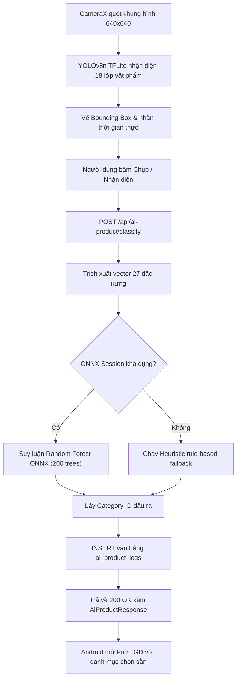
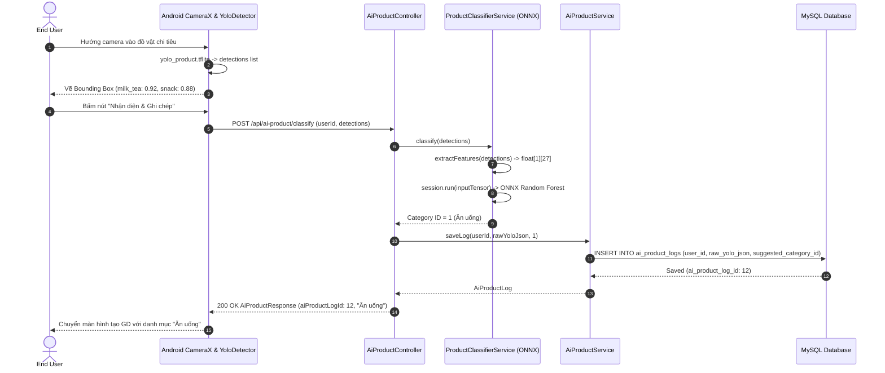
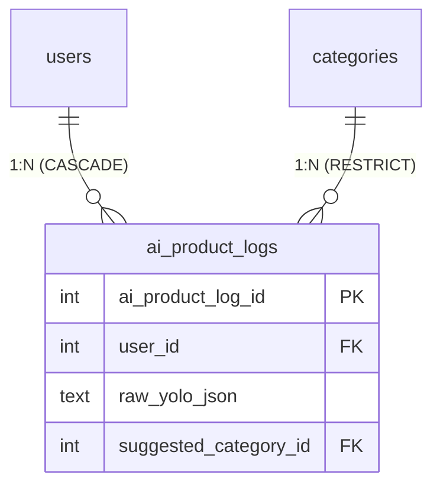

# F15 - NHẬN DIỆN ĐỒ VẬT VÀ PHÂN LOẠI DANH MỤC (YOLO & RANDOM FOREST)

## 1. Thông tin chung
| Trường | Giá trị |
| :--- | :--- |
| **ID** | F15 |
| **Tên chức năng** | Nhận diện đồ vật thời gian thực & Phân loại danh mục (YOLOv8n TFLite + Random Forest ONNX) |
| **Module** | Module 9: AI Nhận diện Đồ vật |
| **Actor** | End User |
| **Mô tả ngắn** | Cho phép người dùng hướng Camera vào các đồ vật chi tiêu (thức ăn, nước uống, quần áo, giày dép, sách vở, xe máy, linh kiện điện tử). Mô hình YOLOv8n TFLite on-device phát hiện đồ vật thời gian thực trên CameraX, trích xuất nhãn và tọa độ Bounding Box. Khi người dùng bấm chụp, danh sách phát hiện được gửi lên Backend. Backend trích xuất 27 vector đặc trưng và nạp vào mô hình Random Forest (200 cây quyết định qua ONNX Runtime Java) để dự đoán danh mục thu chi phù hợp nhất, lưu vết vào `ai_product_logs`. |
| **Trigger** | Người dùng chọn chế độ "Quét đồ vật AI" trên `ScanProductActivity`. |
| **Tiền điều kiện** | Người dùng đã đăng nhập; cấp quyền Camera; mô hình TFLite và ONNX đã nạp thành công. |
| **Hậu điều kiện** | Tạo một bản ghi log trong `ai_product_logs`; trả về `suggestedCategoryId` và `suggestedCategoryName` để tự động chọn sẵn danh mục trên Form giao dịch. |

## 2. Use case
### Main flow
1. Người dùng mở `ScanProductActivity`, hướng camera về phía vật phẩm chi tiêu (ví dụ: ly trà sữa và đĩa thức ăn nhanh).
2. CameraX nạp từng frame ảnh ($640 	imes 640$) vào `YoloDetector.kt` (chạy mô hình `yolo_product.tflite`).
3. Giao diện vẽ khung nhận diện Bounding Box cùng nhãn lớp (`milk_tea`, `fastfood`) và độ tin cậy thời gian thực.
4. Người dùng bấm nút "Nhận diện & Tạo giao dịch".
5. Android gửi request `POST /api/ai-product/classify` kèm danh sách phát hiện `detections` (`className`, `confidence`, `box`).
6. Backend tiếp nhận mảng phát hiện và gọi `ProductClassifierService.classify(detections)`:
   - Trích xuất 27 vector đặc trưng: đếm tần suất 18 lớp, nhóm đếm danh mục, tổng số vật phẩm, độ tin cậy tối đa, độ tin cậy trung bình, số lượng vật phẩm có độ tin cậy thấp.
   - Nạp tensor `float[1][27]` vào phiên làm việc `OrtSession` của mô hình `random_forest_model.onnx`.
   - Mô hình suy luận và trả về nhãn danh mục (Category ID: 1 - Ăn uống).
7. Backend kiểm tra danh mục có tồn tại trong CSDL không và lấy tên hiển thị ("Ăn uống").
8. Backend lưu chuỗi JSON kết quả phát hiện thô vào bảng `ai_product_logs` qua `AiProductService.saveLog(...)`.
9. Backend trả về `AiProductResponse` chứa `aiProductLogId`, `suggestedCategoryId` và `suggestedCategoryName`.
10. Android mở Form tạo giao dịch với danh mục "Ăn uống" đã được chọn sẵn tự động.

### Alternative flow
- **Mô hình ONNX không khả dụng:** Nếu khởi tạo ONNX runtime lỗi, hệ thống tự động kích hoạt bộ phân loại quy tắc dự phòng (`fallbackClassify`), cộng điểm theo trọng số các nhóm để chọn danh mục có điểm cao nhất.

### Exception flow
- **E1 - Mảng phát hiện rỗng:** Client gửi `detections` rỗng. Backend fallback về danh mục mặc định `7` ("Khác").

## 3. Entry points
| Method | URL / Route | Auth | Request | Response | Status code | Nơi xử lý (file:dòng) |
| :---: | :--- | :---: | :--- | :--- | :---: | :--- |
| `POST` | `/api/ai-product/classify` | Bearer Token | Body: `AiProductClassifyRequest` (`userId`, `detections`) | `ApiResponse<AiProductResponse>` | 200 OK 400 Bad Request 404 Not Found | `AiProductController.java:41-68` |
| Screen | `ScanProductActivity` | Logged In | Quét đồ vật bằng CameraX + YOLOv8n TFLite | Tự động chọn danh mục | - | `ScanProductActivity.kt:35-180` |

## 4. Luồng xử lý chi tiết
1. **Tiếp nhận Request:** `AiProductController.classifyProduct` (`AiProductController.java:41-68`).
2. **Suy luận mô hình Random Forest qua ONNX Runtime (`ProductClassifierService.java:73-138`):**
   - **Trích xuất 27 đặc trưng (`extractFeatures` - `ProductClassifierService.java:140-176`):**
     - `features[0..17]`: One-hot flag cho 18 lớp vật phẩm.
     - `features[18]`: Đếm nhóm Thực phẩm (`bottled_water`, `bread`, `coffee_cup`, `fastfood`, `milk_tea`, `noodle`, `rice_meal`, `snack`, `soft_drink`).
     - `features[19]`: Đếm nhóm Di chuyển (`motorbike`, `taxi_car`, `helmet`).
     - `features[20]`: Đếm nhóm Mua sắm (`clothes`, `cosmetic`, `electronic_item`, `shoes`).
     - `features[21]`: Đếm nhóm Giải trí (`toy_game`).
     - `features[22]`: Đếm nhóm Sức khỏe (`medicine`).
     - `features[23]`: Tổng số lượng detection (`total`).
     - `features[24]`: Điểm tin cậy cao nhất (`maxConfidence`).
     - `features[25]`: Điểm tin cậy trung bình (`avgConfidence`).
     - `features[26]`: Số lượng vật phẩm có độ tin cậy thấp (`< 0.5`).
   - **Tạo OnnxTensor:** `OnnxTensor.createTensor(env, inputData)` với shape `[1, 27]`.
   - **Thực thi suy luận:** `session.run(Map.of(inputName, inputTensor))` (`ProductClassifierService.java:87-90`).
   - **Đọc kết quả:** Lấy label đầu ra, kiểm tra tính hợp lệ trong tập ID CSDL `{1, 2, 3, 5, 6, 7}` (`ProductClassifierService.java:119-123`).
3. **Lưu nhật ký:**
   - Chuỗi hóa JSON: `objectMapper.writeValueAsString(request.getDetections())` (`AiProductController.java:55-59`).
   - Gọi `aiProductService.saveLog(userId, rawYoloJson, suggestedCategoryId)` (`AiProductController.java:61`).
   - Lưu vào bảng `ai_product_logs`.
4. **Phản hồi:** Trả về `AiProductResponse(aiProductLogId, suggestedCategoryId, suggestedCategoryName)` (`AiProductController.java:63-67`).

## 5. Biểu đồ

### 5.1. Activity Diagram

### 5.2. Sequence Diagram

### 5.3. State Diagram
Không áp dụng.

## 6. Danh sách hàm / class
| Layer | Class.method | Signature | Input | Output | Mô tả | Exception | File:dòng |
| :--- | :--- | :--- | :--- | :--- | :--- | :--- | :--- |
| Controller | `AiProductController.classifyProduct` | `ResponseEntity<ApiResponse<AiProductResponse>> classifyProduct(...)` | `request` | `ApiResponse<AiProductResponse>` | Nhận diện vật phẩm | `ResourceNotFoundException` | `AiProductController.java:41-68` |
| Service | `ProductClassifierService.classify` | `int classify(List<YoloDetectionDTO>)` | `detections` | `int` (categoryId) | Chạy mô hình ONNX Random Forest | Không có | `ProductClassifierService.java:73-138` |
| Service | `ProductClassifierService.extractFeatures` | `double[] extractFeatures(List<YoloDetectionDTO>)` | `detections` | `double[27]` | Trích xuất 27 đặc trưng | Không có | `ProductClassifierService.java:140-176` |
| Service | `AiProductService.saveLog` | `AiProductLog saveLog(Integer, String, Integer)` | `userId`, `rawJson`, `catId` | `AiProductLog` | Lưu nhật ký nhận diện YOLO | `ResourceNotFoundException` | `AiProductService.java:33-47` |

## 7. Cơ sở dữ liệu
- **Bảng liên quan:**
  - `ai_product_logs`: **C**. Cột: `ai_product_log_id`, `user_id`, `transaction_id`, `raw_yolo_json`, `suggested_category_id`, `created_at`. Xem chi tiết tại [01-database/tables.md#9-bảng-ai_product_logs-nhật-ký-nhận-diện-vật-phẩm-yolo](../01-database/tables.md#9-bảng-ai_product_logs-nhật-ký-nhận-diện-vật-phẩm-yolo).
  - `categories`: **R** (Danh mục gợi ý qua khóa ngoại RESTRICT).
  - `users`: **R** (Chủ sở hữu qua CASCADE).
- **Ràng buộc:** `user_id` CASCADE, `suggested_category_id` RESTRICT.
- **Transaction:** `@Transactional` tại `AiProductService.saveLog`.
- **ERD con:**

## 8. Business rules và validation
| Mã quy tắc | Nội dung quy tắc | Nơi kiểm tra | File:dòng |
| :---: | :--- | :---: | :--- |
| **BR-15.1** | Vector đặc trưng đưa vào mô hình Random Forest bắt buộc phải có đúng 27 chiều | BE Service | `ProductClassifierService.java:82` |
| **BR-15.2** | Kết quả đầu ra từ mô hình ONNX bắt buộc phải thuộc tập ID danh mục hợp lệ: `{1, 2, 3, 5, 6, 7}` | BE Service | `ProductClassifierService.java:29,120` |

## 9. Phân quyền
- Yêu cầu xác thực Bearer Token hợp lệ.

## 10. Xử lý lỗi
| Tình huống | Exception / Mã lỗi | HTTP status | Thông báo | Hành vi rollback |
| :--- | :--- | :---: | :--- | :--- |
| Lỗi suy luận ONNX Runtime | `OrtException` | - | Chuyển sang fallback rule-based | Không ném lỗi ra ngoài |
| Không tìm thấy danh mục theo ID | `ResourceNotFoundException` | 404 | `"Category not found with id: ..."` | Không lưu DB |

## 11. Phụ thuộc và tích hợp
- File mô hình máy học: `random_forest_model.onnx` đặt trong `backend/src/main/resources/`.
- File mô hình thiết bị: `yolo_product.tflite` đặt trong `android-app/app/src/main/assets/`.
- Tích hợp với [F16 - Phản hồi nhận diện đồ vật](F16-phan-hoi-nhan-dien-do-vat-ai.md).

## 12. Edge case, giới hạn, điểm chưa rõ
- Nếu khung hình chứa nhiều đồ vật thuộc nhiều nhóm khác nhau (ví dụ: vừa có điện thoại - Mua sắm, vừa có cà phê - Ăn uống), Random Forest sẽ dựa trên tổng số lượng và độ tin cậy của từng nhóm để quyết định danh mục chiếm ưu thế nhất.

## 13. Gợi ý test case
| Mã TC | Kịch bản kiểm thử | Dữ liệu đầu vào | Kết quả mong đợi |
| :---: | :--- | :--- | :--- |
| **TC-F15-01** | Nhận diện thực phẩm đồ uống | `detections = [{"className": "milk_tea", "confidence": 0.95}]` | Gợi ý Category ID = 1 ("Ăn uống"), trả về 200 OK |
| **TC-F15-02** | Nhận diện quần áo giày dép | `detections = [{"className": "clothes", "confidence": 0.88}]` | Gợi ý Category ID = 3 ("Mua sắm"), trả về 200 OK |
| **TC-F15-03** | Mảng detections rỗng | `detections = []` | Fallback về Category ID = 7 ("Khác"), trả về 200 OK |
