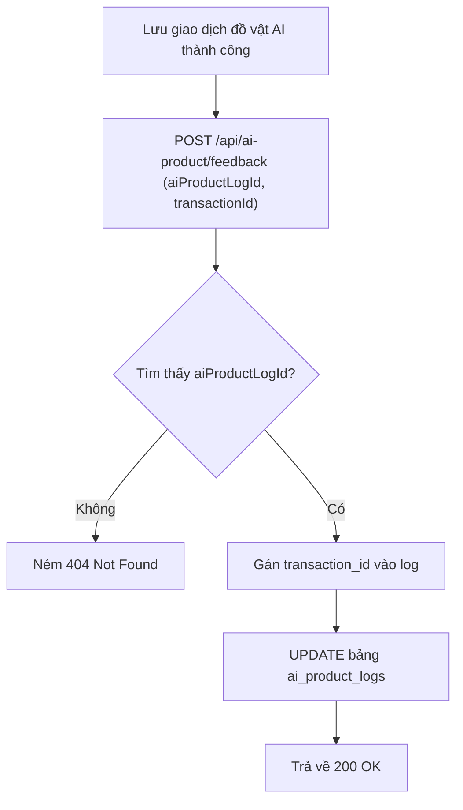
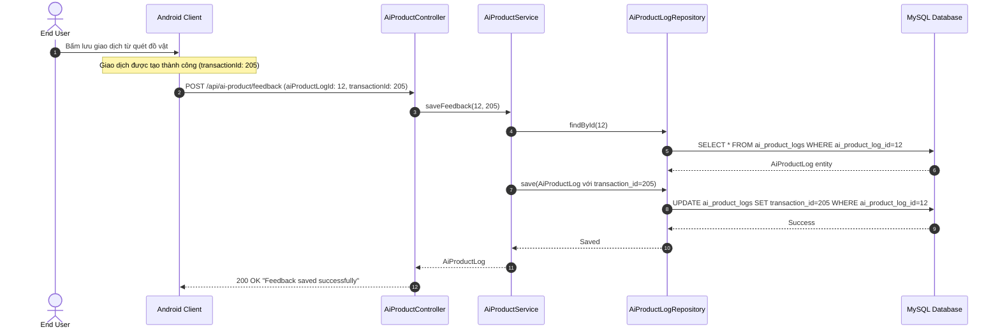
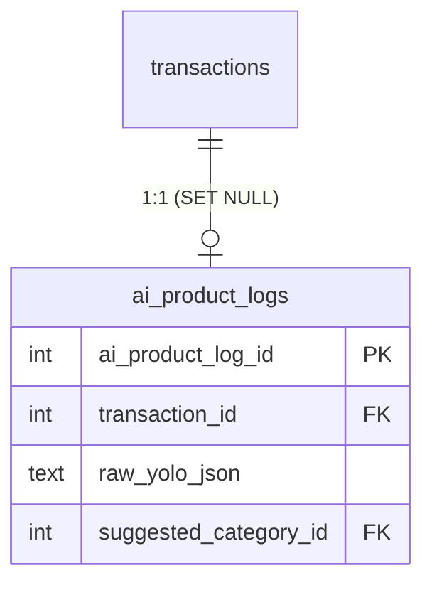

# F16 - THU THẬP PHẢN HỒI VÀ LƯU VẾT NHẬN DIỆN ĐỒ VẬT (AI PRODUCT FEEDBACK)

## 1. Thông tin chung
| Trường | Giá trị |
| :--- | :--- |
| **ID** | F16 |
| **Tên chức năng** | Thu thập phản hồi & Lưu vết nhận diện đồ vật AI |
| **Module** | Module 9: AI Nhận diện Đồ vật |
| **Actor** | End User |
| **Mô tả ngắn** | Sau khi người dùng quét đồ vật qua Camera và tiến hành lưu giao dịch thành công, Android gọi API feedback gửi `aiProductLogId` và `transactionId` để liên kết nhật ký nhận diện YOLO ban đầu với giao dịch thu chi thực tế trong CSDL. |
| **Trigger** | Người dùng hoàn tất việc lưu giao dịch phát sinh từ tính năng quét đồ vật AI. |
| **Tiền điều kiện** | Đã thực hiện quét đồ vật (có `aiProductLogId` từ F15); giao dịch đã được tạo thành công trong bảng `transactions` (có `transactionId` từ F07). |
| **Hậu điều kiện** | Bản ghi trong `ai_product_logs` được cập nhật trường `transaction_id`. |

## 2. Use case
### Main flow
1. Người dùng xác nhận lưu giao dịch được đề xuất từ kết quả nhận diện đồ vật.
2. Android gọi API tạo giao dịch F07 thành công và nhận về `transactionId`.
3. Android gửi request `POST /api/ai-product/feedback` kèm `aiProductLogId` và `transactionId`.
4. Backend tìm bản ghi `AiProductLog` theo `aiProductLogId`.
5. Backend liên kết `transactionId` tương ứng vào bản ghi log và lưu vào bảng `ai_product_logs`.
6. Backend trả về 200 OK `"Feedback saved successfully"`.

### Alternative flow
- Không có.

### Exception flow
- **E1 - Không tìm thấy `aiProductLogId`:** Backend ném `ResourceNotFoundException("AI product log not found with id: ...")`, trả về HTTP 404.

## 3. Entry points
| Method | URL / Route | Auth | Request | Response | Status code | Nơi xử lý (file:dòng) |
| :---: | :--- | :---: | :--- | :--- | :---: | :--- |
| `POST` | `/api/ai-product/feedback` | Bearer Token | Body: `AiProductFeedbackRequest` (`aiProductLogId`, `transactionId`) | `ApiResponse<String>` | 200 OK 404 Not Found | `AiProductController.java:70-75` |

## 4. Luồng xử lý chi tiết
1. **Tiếp nhận Request:** `AiProductController.saveFeedback` (`AiProductController.java:70-75`) gọi `AiProductService.saveFeedback` (`AiProductService.java:50-61`).
2. **Tìm bản ghi log:** `aiProductLogRepository.findById(aiProductLogId)` -> nếu không thấy ném 404 (`AiProductService.java:51-52`).
3. **Liên kết Giao dịch:** Nếu `transactionId != null`, tìm trong `transactionRepository` và gán `log.setTransaction(transaction)` (`AiProductService.java:54-57`).
4. **Lưu CSDL:** `aiProductLogRepository.save(log)` (`AiProductService.java:59`).
5. **Phản hồi:** Trả về `ApiResponse.success("Feedback saved successfully", "Thank you for your feedback")`.

## 5. Biểu đồ

### 5.1. Activity Diagram

### 5.2. Sequence Diagram

### 5.3. State Diagram
Không áp dụng.

## 6. Danh sách hàm / class
| Layer | Class.method | Signature | Input | Output | Mô tả | Exception | File:dòng |
| :--- | :--- | :--- | :--- | :--- | :--- | :--- | :--- |
| Controller | `AiProductController.saveFeedback` | `ResponseEntity<ApiResponse<String>> saveFeedback(AiProductFeedbackRequest)` | `request` | `ApiResponse<String>` | Nhận phản hồi đồ vật | Không có | `AiProductController.java:70-75` |
| Service | `AiProductService.saveFeedback` | `AiProductLog saveFeedback(Integer, Integer)` | `logId`, `txId` | `AiProductLog` | Cập nhật liên kết transaction | `ResourceNotFoundException` | `AiProductService.java:50-61` |

## 7. Cơ sở dữ liệu
- **Bảng liên quan:**
  - `ai_product_logs`: **R/U**. Cột: `ai_product_log_id`, `transaction_id`. Xem chi tiết tại [01-database/tables.md#9-bảng-ai_product_logs-nhật-ký-nhận-diện-vật-phẩm-yolo](../01-database/tables.md#9-bảng-ai_product_logs-nhật-ký-nhận-diện-vật-phẩm-yolo).
  - `transactions`: **R** (Khóa ngoại liên kết).
- **Ràng buộc:** `transaction_id` SET NULL (nếu giao dịch bị xóa thì log YOLO vẫn giữ nguyên).
- **Transaction:** `@Transactional` tại `AiProductService.saveFeedback`.
- **ERD con:**

## 8. Business rules và validation
| Mã quy tắc | Nội dung quy tắc | Nơi kiểm tra | File:dòng |
| :---: | :--- | :---: | :--- |
| **BR-16.1** | `aiProductLogId` bắt buộc phải tồn tại trong CSDL | BE Service | `AiProductService.java:51-52` |

## 9. Phân quyền
- Yêu cầu xác thực Bearer Token hợp lệ.

## 10. Xử lý lỗi
| Tình huống | Exception / Mã lỗi | HTTP status | Thông báo | Hành vi rollback |
| :--- | :--- | :---: | :--- | :--- |
| `aiProductLogId` không tồn tại | `ResourceNotFoundException` | 404 | `"AI product log not found with id: ..."` | Không lưu DB |

## 11. Phụ thuộc và tích hợp
- Hoàn thiện chu trình quét đồ vật bắt đầu từ [F15 - Nhận diện đồ vật](F15-nhan-dien-do-vat-yolo-random-forest.md).

## 12. Edge case, giới hạn, điểm chưa rõ
- Nếu người dùng quét đồ vật nhưng sau đó hủy không lưu giao dịch, bản ghi trong `ai_product_logs` vẫn được lưu với `transaction_id = NULL`, đóng vai trò dữ liệu thống kê tần suất quét của người dùng.

## 13. Gợi ý test case
| Mã TC | Kịch bản kiểm thử | Dữ liệu đầu vào | Kết quả mong đợi |
| :---: | :--- | :--- | :--- |
| **TC-F16-01** | Gửi feedback hợp lệ | `aiProductLogId = 12`, `transactionId = 205` | Cập nhật `transaction_id = 205` trong `ai_product_logs`, trả về 200 OK |
| **TC-F16-02** | Gửi logId không tồn tại | `aiProductLogId = 99999` | Trả về 404 Not Found |
