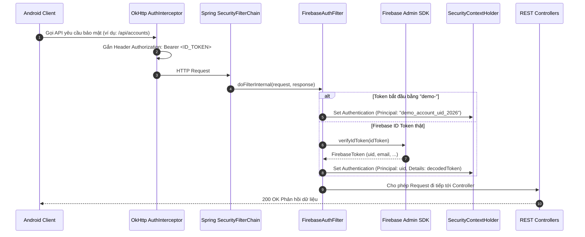

# CƠ CHẾ XÁC THỰC VÀ PHÂN QUYỀN (AUTHENTICATION & AUTHORIZATION)

**Hệ thống:** Personal Finance App  
**Truy vết mã nguồn:**  
- `backend/src/main/java/com/example/financebackend/config/SecurityConfig.java:1-36`  
- `backend/src/main/java/com/example/financebackend/config/FirebaseAuthFilter.java:1-74`  
- `backend/src/main/java/com/example/financebackend/config/FirebaseConfig.java:1-35`  
- `android-app/app/src/main/java/com/example/personalfinance/api/AuthInterceptor.kt:1-30`  

---

## 1. Tổng quan cơ chế bảo mật

Hệ thống áp dụng kiến trúc bảo mật **Stateless Token-Based Authentication** dựa trên **Firebase Authentication ID Token (JWT)**, kết hợp cơ chế bypass linh hoạt cho tài khoản Demo.

---

## 2. Cấu hình Spring Security (`SecurityConfig.java`)
* **Truy vết:** `SecurityConfig.java:20-33`
* **CSRF:** Bị vô hiệu hóa (`csrf(AbstractHttpConfigurer::disable)`) do toàn bộ API là Stateless REST API.
* **Session Management:** `SessionCreationPolicy.STATELESS` (không lưu HTTP Session trên máy chủ).
* **Phân quyền Route:**
  - `permitAll()` cho các đường dẫn public:
    - `/api/auth/**`: Đăng nhập, đồng bộ User (`/api/auth/firebase-login`, `/api/auth/demo-login`).
    - `/uploads/**`: Phục vụ xem hình ảnh tĩnh (Avatar, hóa đơn tải lên).
  - `authenticated()`: Toàn bộ các API còn lại (`/api/accounts/**`, `/api/transactions/**`, `/api/budgets/**`, `/api/categories/**`, `/api/reports/**`, `/api/ai-scan/**`, `/api/ai-product/**`) bắt buộc phải có Bearer Token hợp lệ.
* **Bộ lọc tùy chỉnh:** Đặt `FirebaseAuthFilter` chạy trước `UsernamePasswordAuthenticationFilter`.

---

## 3. Bộ lọc `FirebaseAuthFilter` (`FirebaseAuthFilter.java`)
* **Truy vết:** `FirebaseAuthFilter.java:23-73`
* **Xử lý Header:**
  1. Trích xuất Header `Authorization`.
  2. Kiểm tra định dạng: `authHeader != null && authHeader.startsWith("Bearer ")`.
  3. Trích xuất chuỗi: `idToken = authHeader.substring(7)`.
* **Hai chế độ xác thực:**
  - **Chế độ Demo:** Nếu `idToken.startsWith("demo-")`:
    - Tạo `UsernamePasswordAuthenticationToken("demo_account_uid_2026", null, Collections.emptyList())`.
    - Nạp vào `SecurityContextHolder.getContext().setAuthentication(authentication)`.
  - **Chế độ Firebase Cloud:**
    - Gọi `FirebaseAuth.getInstance().verifyIdToken(idToken)`.
    - Trích xuất `uid = decodedToken.getUid()`.
    - Tạo `UsernamePasswordAuthenticationToken(uid, decodedToken, Collections.emptyList())`.
    - Nạp vào `SecurityContextHolder`.
* **Xử lý lỗi Token:**
  - Bắt ngoại lệ `FirebaseAuthException`:
    - Đặt trạng thái: `response.setStatus(HttpServletResponse.SC_UNAUTHORIZED)` (401).
    - Trả về JSON: `{"success":false,"message":"Invalid or expired token","data":null}`.
    - Dừng chuỗi Filter (không gọi `filterChain.doFilter`).

---

## 4. Phía Mobile Client (`AuthInterceptor.kt`)
* **Truy vết:** `android-app/app/src/main/java/com/example/personalfinance/api/AuthInterceptor.kt`
* Tự động can thiệp vào mọi Request HTTP gửi qua Retrofit / OkHttp.
* Đọc Token từ `EncryptedSharedPreferences`:
  - Nếu có Token, tự động thêm Header: `Authorization: Bearer <token>`.
  - Nếu là tài khoản Demo, gửi Token `demo-session-token`.
