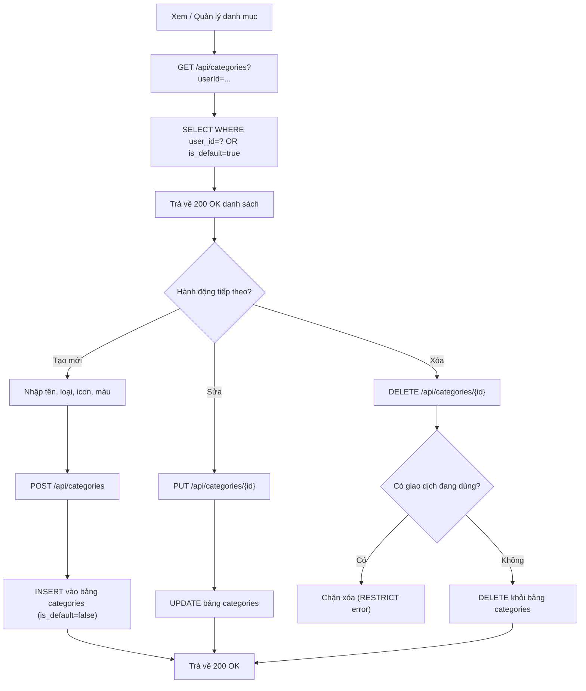
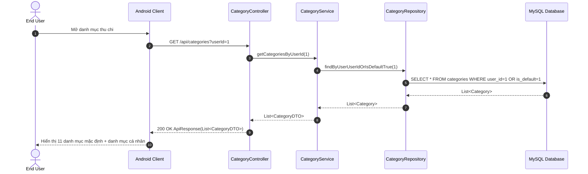
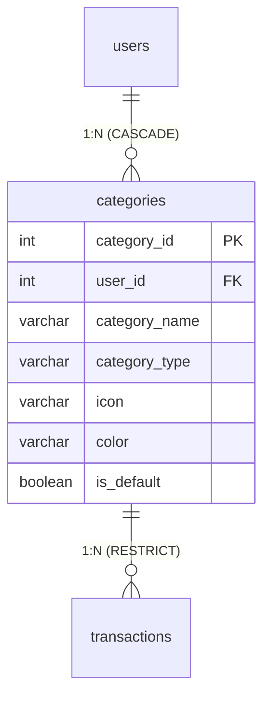

# F06 - QUẢN LÝ DANH MỤC THU CHI (CATEGORY MANAGEMENT)

## 1. Thông tin chung
| Trường | Giá trị |
| :--- | :--- |
| **ID** | F06 |
| **Tên chức năng** | Quản lý Danh mục Thu Chi (Xem, Tạo mới, Chỉnh sửa, Xóa danh mục cá nhân) |
| **Module** | Module 3: Quản lý Danh mục |
| **Actor** | End User |
| **Mô tả ngắn** | Cung cấp hệ thống phân loại khoản thu / chi tiêu. Tự động kế thừa 11 danh mục mặc định của hệ thống và cho phép người dùng tạo thêm các danh mục cá nhân với tên, icon và màu sắc tùy biến. |
| **Trigger** | Người dùng xem danh mục tại màn hình Thêm giao dịch, màn hình Quản lý hạn mức (`CategoryLimitFragment`) hoặc mở dialog tạo danh mục mới. |
| **Tiền điều kiện** | Người dùng đã đăng nhập; có `userId` hợp lệ. |
| **Hậu điều kiện** | Danh mục mới được tạo với `is_default = FALSE` gắn với `user_id` của người dùng; xuất hiện trong bộ chọn danh mục khi ghi chép giao dịch. |

## 2. Use case
### Main flow
1. Người dùng mở màn hình thêm giao dịch hoặc quản lý danh mục.
2. Android gửi request `GET /api/categories?userId={userId}`.
3. Backend truy vấn CSDL: gom toàn bộ các danh mục mặc định (`is_default = TRUE`) và danh mục riêng của user (`user_id = {userId}`).
4. Backend trả về danh sách `CategoryDTO`.
5. Người dùng nhấn nút "Thêm danh mục mới" (ví dụ: tạo danh mục "Nuôi thú cưng", loại "expense", màu "#E91E63", icon "ic_pet").
6. Android gửi request `POST /api/categories` kèm body `CategoryDTO`.
7. Backend lưu bản ghi mới vào bảng `categories` và trả về kết quả 200 OK.
8. Người dùng có thể chỉnh sửa tên, icon, màu sắc của danh mục cá nhân qua request `PUT /api/categories/{id}`.
9. Người dùng có thể xóa danh mục cá nhân bằng request `DELETE /api/categories/{id}`.

### Alternative flow
- Không có.

### Exception flow
- **E1 - Xóa danh mục đang có giao dịch sử dụng:** Bảng `transactions` đang liên kết với danh mục qua khóa ngoại `ON DELETE RESTRICT`. CSDL chặn xóa, backend trả về lỗi vi phạm ràng buộc dữ liệu.
- **E2 - Không tìm thấy danh mục:** Sửa hoặc xóa danh mục có `id` không tồn tại. Ném `ResourceNotFoundException`, trả về 404.

## 3. Entry points
| Method | URL / Route | Auth | Request | Response | Status code | Nơi xử lý (file:dòng) |
| :---: | :--- | :---: | :--- | :--- | :---: | :--- |
| `GET` | `/api/categories` | Bearer Token | Query: `userId` (Integer, bắt buộc) | `ApiResponse<List<CategoryDTO>>` | 200 OK | `CategoryController.java:22-26` |
| `POST` | `/api/categories` | Bearer Token | Body: `CategoryDTO` (`userId`, `categoryName`, `categoryType`, `icon`, `color`) | `ApiResponse<CategoryDTO>` | 200 OK 400 Bad Request | `CategoryController.java:28-32` |
| `PUT` | `/api/categories/{id}` | Bearer Token | Path: `id` Body: `CategoryDTO` | `ApiResponse<CategoryDTO>` | 200 OK 404 Not Found | `CategoryController.java:34-38` |
| `DELETE` | `/api/categories/{id}` | Bearer Token | Path: `id` | `ApiResponse<Void>` | 200 OK 404 Not Found 400/500 (RESTRICT) | `CategoryController.java:40-44` |
| Screen | `DialogAddCategory` | Logged In | Nhập tên danh mục, chọn loại thu/chi, chọn icon & màu | Tạo danh mục mới | - | `dialog_add_category.xml` |

## 4. Luồng xử lý chi tiết
1. **Lấy danh sách danh mục:**
   - `CategoryController.getCategoriesByUserId` (`CategoryController.java:22-26`) gọi `CategoryService.getCategoriesByUserId(userId)` (`CategoryService.java:27-32`).
   - Repository: `categoryRepository.findByUserUserIdOrIsDefaultTrue(userId)` (`CategoryService.java:28`).
   - Lọc và trả về danh sách DTO.
2. **Tạo danh mục mới:**
   - `CategoryController.createCategory` (`CategoryController.java:28-32`) gọi `CategoryService.createCategory(dto)` (`CategoryService.java:82-101`).
   - Tìm User sở hữu nếu có: `userRepository.findById(dto.getUserId())` (`CategoryService.java:85`).
   - Tạo Entity: `Category.builder().categoryName(dto.getCategoryName()).categoryType(dto.getCategoryType()).isDefault(false)...build()`.
   - Lưu: `categoryRepository.save(category)` (`CategoryService.java:99`).
3. **Cập nhật danh mục:**
   - `CategoryController.updateCategory` (`CategoryController.java:34-38`) gọi `CategoryService.updateCategory(id, dto)` (`CategoryService.java:103-115`).
   - Cập nhật `categoryName`, `categoryType`, `icon`, `color`.
4. **Xóa danh mục:**
   - `CategoryController.deleteCategory` (`CategoryController.java:40-44`) gọi `CategoryService.deleteCategory(id)` (`CategoryService.java:117-122`).
   - Kiểm tra `categoryRepository.existsById(categoryId)` -> gọi `deleteById(categoryId)`.

## 5. Biểu đồ

### 5.1. Activity Diagram

### 5.2. Sequence Diagram

### 5.3. State Diagram
Không áp dụng.

## 6. Danh sách hàm / class
| Layer | Class.method | Signature | Input | Output | Mô tả | Exception | File:dòng |
| :--- | :--- | :--- | :--- | :--- | :--- | :--- | :--- |
| Controller | `CategoryController.getCategoriesByUserId` | `ResponseEntity<ApiResponse<List<CategoryDTO>>> getCategoriesByUserId(Integer)` | `userId` | `ApiResponse<List<CategoryDTO>>` | Lấy danh mục | Không có | `CategoryController.java:22-26` |
| Controller | `CategoryController.createCategory` | `ResponseEntity<ApiResponse<CategoryDTO>> createCategory(CategoryDTO)` | `dto` | `ApiResponse<CategoryDTO>` | Tạo mới danh mục | `ResourceNotFoundException` | `CategoryController.java:28-32` |
| Controller | `CategoryController.updateCategory` | `ResponseEntity<ApiResponse<CategoryDTO>> updateCategory(Integer, CategoryDTO)` | `id`, `dto` | `ApiResponse<CategoryDTO>` | Sửa danh mục | `ResourceNotFoundException` | `CategoryController.java:34-38` |
| Controller | `CategoryController.deleteCategory` | `ResponseEntity<ApiResponse<Void>> deleteCategory(Integer)` | `id` | `ApiResponse<Void>` | Xóa danh mục | `ResourceNotFoundException`, DataIntegrity | `CategoryController.java:40-44` |
| Service | `CategoryService.findCategoryByKeyword` | `Category findCategoryByKeyword(Integer, String)` | `userId`, `keyword` | `Category` | Tìm danh mục khớp với từ khóa AI OCR | Không có | `CategoryService.java:34-70` |

## 7. Cơ sở dữ liệu
- **Bảng liên quan:** `categories` (**C/R/U/D**). Cột: `category_id`, `user_id`, `category_name`, `category_type`, `icon`, `color`, `is_default`, `created_at`. Xem chi tiết tại [01-database/tables.md#3-bảng-categories-danh-mục-thu-chi](../01-database/tables.md#3-bảng-categories-danh-mục-thu-chi).
- **Ràng buộc:** `categories.user_id` tham chiếu `users(user_id)` ON DELETE CASCADE. `transactions.category_id` tham chiếu `categories(category_id)` ON DELETE RESTRICT.
- **Transaction:** `@Transactional` bao bọc tại `createCategory`, `updateCategory`, `deleteCategory`.
- **ERD con:**

## 8. Business rules và validation
| Mã quy tắc | Nội dung quy tắc | Nơi kiểm tra | File:dòng |
| :---: | :--- | :---: | :--- |
| **BR-06.1** | Danh mục mặc định hệ thống có `is_default = TRUE` và `user_id = NULL` | DB Seed | `schema.sql:40,45`, `seed_data.sql:6-20` |
| **BR-06.2** | Danh mục do người dùng tạo có `is_default = FALSE` và gắn với `user_id` của họ | BE Service | `CategoryService.java:96` |
| **BR-06.3** | Không cho phép xóa danh mục khi đang có giao dịch trong `transactions` liên kết tới nó | DB FK | `schema.sql:73-75` |

## 9. Phân quyền
- Yêu cầu xác thực Bearer Token hợp lệ.

## 10. Xử lý lỗi
| Tình huống | Exception / Mã lỗi | HTTP status | Thông báo | Hành vi rollback |
| :--- | :--- | :---: | :--- | :--- |
| `id` không tồn tại | `ResourceNotFoundException` | 404 | `"Category not found with id: ..."` | Không thay đổi DB |
| Xóa danh mục có giao dịch | `DataIntegrityViolationException` | 500 / 400 | Lỗi ràng buộc khóa ngoại | Rollback câu lệnh xóa |

## 11. Phụ thuộc và tích hợp
- Khởi tạo sẵn 11 danh mục mặc định qua [01-database/enums-constants.md#2-dữ-liệu-danh-mục-mặc-định-11-default-categories](../01-database/enums-constants.md#2-dữ-liệu-danh-mục-mặc-định-11-default-categories).
- Tích hợp với bộ phân loại AI OCR qua hàm `findCategoryByKeyword` (`CategoryService.java:34-70`).

## 12. Edge case, giới hạn, điểm chưa rõ
- **Edge case:** Nếu người dùng tạo danh mục trùng tên với danh mục mặc định (ví dụ: tạo thêm "Ăn uống"), hệ thống vẫn cho phép lưu vì bảng `categories` không đặt UNIQUE trên `category_name`.

## 13. Gợi ý test case
| Mã TC | Kịch bản kiểm thử | Dữ liệu đầu vào | Kết quả mong đợi |
| :---: | :--- | :--- | :--- |
| **TC-F06-01** | Lấy toàn bộ danh mục của User | `userId = 1` | Trả về 11 danh mục mặc định + danh mục riêng |
| **TC-F06-02** | Tạo danh mục riêng mới | `categoryName = "Đồ chơi"`, `type = "expense"` | Lưu vào DB với `is_default = false`, trả về 200 OK |
| **TC-F06-03** | Xóa danh mục đang có giao dịch | `categoryId = 1` (Ăn uống) | Bị chặn xóa bởi ràng buộc RESTRICT |
