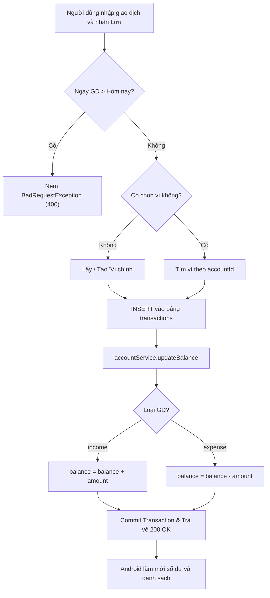
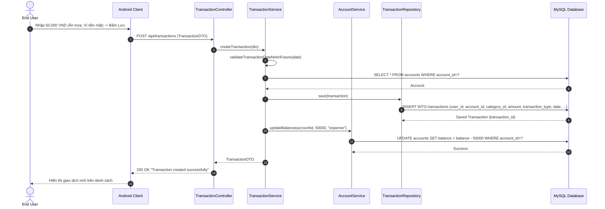
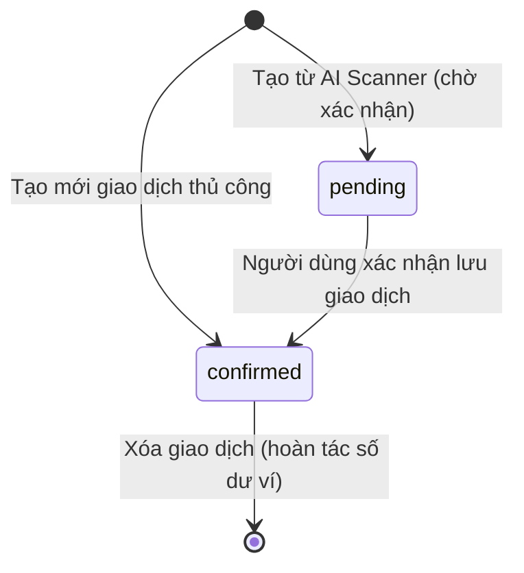
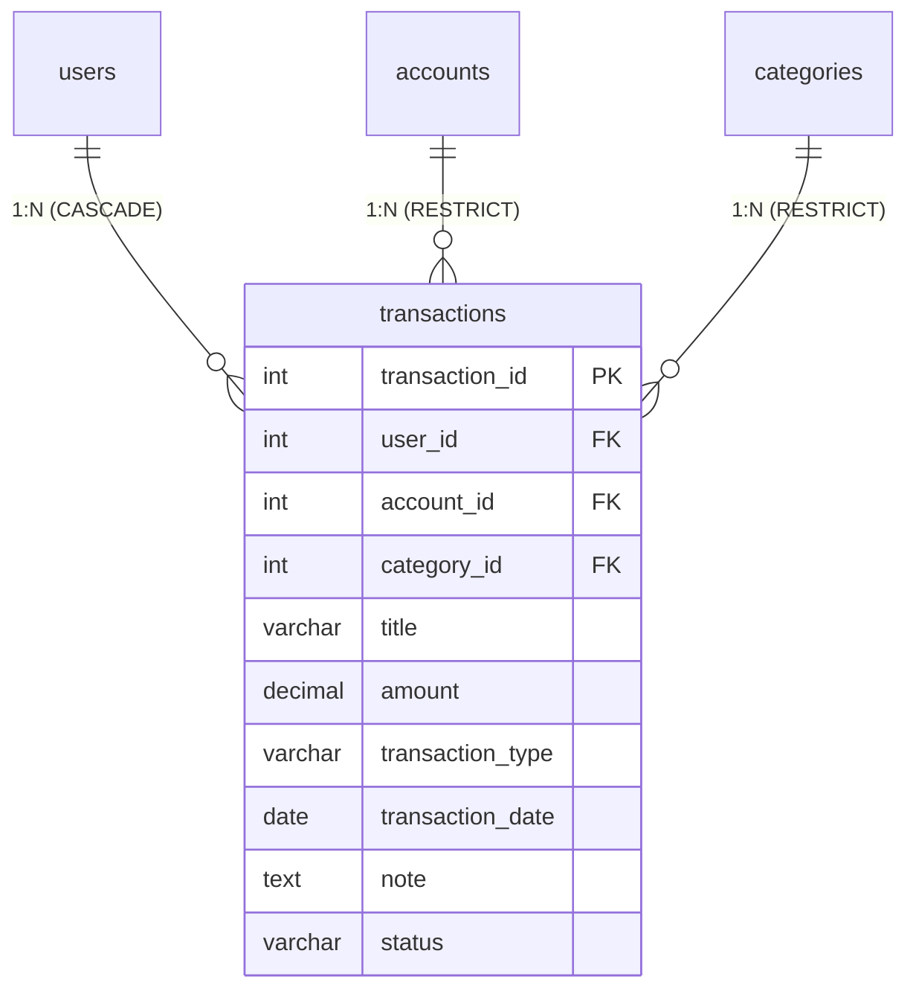

# F07 - GHI CHÉP VÀ QUẢN LÝ GIAO DỊCH THU CHI (TRANSACTION MANAGEMENT)

## 1. Thông tin chung
| Trường | Giá trị |
| :--- | :--- |
| **ID** | F07 |
| **Tên chức năng** | Ghi chép & Quản lý giao dịch thu chi thủ công (Tạo, Sửa, Xóa, Lọc theo khoảng ngày) |
| **Module** | Module 4: Quản lý Giao dịch |
| **Actor** | End User |
| **Mô tả ngắn** | Nghiệp vụ trung tâm của ứng dụng cho phép người dùng ghi chép chi tiêu/thu nhập hàng ngày, tự động cộng/trừ số dư ví nguồn, kiểm tra ngày giao dịch không được trong tương lai, chỉnh sửa và hoàn tác số dư khi xóa giao dịch. |
| **Trigger** | Người dùng nhấn nút "+" trên thanh Bottom Navigation để thêm giao dịch (`AddTransactionFragment`) hoặc xem danh sách tại tab Lịch sử (`TransactionFragment`). |
| **Tiền điều kiện** | Người dùng đã đăng nhập; có ít nhất 1 ví tài khoản khả dụng. |
| **Hậu điều kiện** | Bản ghi giao dịch được lưu vào bảng `transactions`; số dư `balance` bảng `accounts` được cập nhật tương ứng; số tiền chi tiêu tích lũy `spent_amount` của `budgets` được cập nhật. |

## 2. Use case
### Main flow
1. Người dùng nhấn nút "+" trên Bottom Navigation để mở màn hình Thêm giao dịch.
2. Người dùng nhập số tiền (bằng bàn phím tùy chỉnh), chọn loại giao dịch (Chi tiêu / Thu nhập), chọn Danh mục, chọn Ví thanh toán nguồn, ngày giao dịch và ghi chú.
3. Người dùng nhấn "Lưu giao dịch".
4. Android gửi request `POST /api/transactions` kèm body `TransactionDTO`.
5. Backend kiểm tra tính hợp lệ: `transactionDate` không được lớn hơn ngày hiện tại (`AppTime.today()`).
6. Backend mở Database Transaction:
   - Ghi bản ghi mới vào bảng `transactions`.
   - Cập nhật số dư ví trong bảng `accounts`: nếu `income` thì cộng dồn, nếu `expense` thì trừ đi số tiền tương ứng.
7. Backend Commit Transaction và phản hồi 200 OK kèm `TransactionDTO` vừa tạo.
8. Android hiển thị thông báo thành công, làm mới Dashboard và danh sách giao dịch.

### Alternative flow
- **Người dùng không chọn ví:** Backend tự động gọi `accountService.getOrCreateDefaultAccount(userId)` để gán giao dịch vào `"Ví chính"`.
- **Chỉnh sửa giao dịch:** Người dùng sửa số tiền hoặc loại giao dịch. Backend hoàn trả số tiền cũ vào ví (`reverse balance`), sau đó áp dụng số tiền mới và lưu lại.
- **Xóa giao dịch:** Người dùng xóa giao dịch. Backend hoàn tác lại tác động số dư trước đó vào ví rồi mới xóa bản ghi khỏi bảng `transactions`.

### Exception flow
- **E1 - Ngày giao dịch trong tương lai:** Người dùng chọn ngày sau hôm nay. Backend ném `BadRequestException("Không thể tạo giao dịch cho ngày trong tương lai")`, trả về HTTP 400.
- **E2 - Số tiền <= 0 hoặc thiếu trường bắt buộc:** Bị chặn tại validation `@Valid`, trả về HTTP 400 Bad Request.
- **E3 - Không tìm thấy Ví hoặc Danh mục:** Ném `ResourceNotFoundException`, trả về HTTP 404.

## 3. Entry points
| Method | URL / Route | Auth | Request | Response | Status code | Nơi xử lý (file:dòng) |
| :---: | :--- | :---: | :--- | :--- | :---: | :--- |
| `GET` | `/api/transactions` | Bearer Token | Query: `userId` (bắt buộc), `startDate` (optional), `endDate` (optional) | `ApiResponse<List<TransactionDTO>>` | 200 OK | `TransactionController.java:24-33` |
| `GET` | `/api/transactions/{id}` | Bearer Token | Path: `id` | `ApiResponse<TransactionDTO>` | 200 OK<br>404 Not Found | `TransactionController.java:35-39` |
| `POST` | `/api/transactions` | Bearer Token | Body: `TransactionDTO` (`userId`, `amount`, `transactionType`, `transactionDate`, `accountId`, `categoryId`, `title`) | `ApiResponse<TransactionDTO>` | 200 OK<br>400 Bad Request<br>404 Not Found | `TransactionController.java:41-45` |
| `PUT` | `/api/transactions/{id}` | Bearer Token | Path: `id`<br>Body: `TransactionDTO` | `ApiResponse<TransactionDTO>` | 200 OK<br>400 Bad Request<br>404 Not Found | `TransactionController.java:47-51` |
| `DELETE` | `/api/transactions/{id}` | Bearer Token | Path: `id` | `ApiResponse<Void>` | 200 OK<br>404 Not Found | `TransactionController.java:53-56` |
| Screen | `AddTransactionFragment` | Logged In | Nhập thông tin và lưu giao dịch | - | - | `AddTransactionFragment.kt:40-150` |

## 4. Luồng xử lý chi tiết
1. **Tạo giao dịch (`TransactionService.createTransaction` - `TransactionService.java:61-101`):**
   - **Kiểm tra ngày:** Gọi `validateTransactionDateNotInFuture(dto.getTransactionDate())` (`TransactionService.java:62,159-166`):
     - Nếu `transactionDate.isAfter(AppTime.today())` -> ném `BadRequestException("Không thể tạo giao dịch cho ngày trong tương lai")`.
   - **Kiểm tra User:** `userRepository.findById(dto.getUserId())` (`TransactionService.java:64`).
   - **Xác định Ví nguồn:** Nếu `dto.getAccountId() != null` thì tìm trong DB; nếu null thì gọi `accountService.getOrCreateDefaultAccount(dto.getUserId())` (`TransactionService.java:68-74`).
   - **Xác định Danh mục:** Tìm `categoryRepository.findById(dto.getCategoryId())` (`TransactionService.java:78`).
   - **Tạo Entity Transaction:**
     ```java
     Transaction transaction = Transaction.builder()
             .user(user).account(account).category(category)
             .title(dto.getTitle()).amount(dto.getAmount())
             .transactionType(dto.getTransactionType())
             .transactionDate(dto.getTransactionDate())
             .note(dto.getNote())
             .status(dto.getStatus() != null ? dto.getStatus() : "confirmed")
             .build();
     transaction = transactionRepository.save(transaction);
     ```
   - **Cập nhật số dư ví:** Gọi `accountService.updateBalance(account.getAccountId(), dto.getAmount(), dto.getTransactionType())` (`TransactionService.java:98`).
   - **Chuyển đổi DTO:** Gọi `toDTO(transaction)` (tự động kèm URL ảnh từ `transactionImageRepository` nếu có) và trả về.
2. **Cập nhật giao dịch (`TransactionService.updateTransaction` - `TransactionService.java:103-146`):**
   - Hoàn tác số dư cũ: `accountService.updateBalance(oldAccountId, oldAmount, reverseType)` (`TransactionService.java:112-116`).
   - Cập nhật thông tin mới vào entity và lưu vào DB.
   - Áp dụng số dư mới: `accountService.updateBalance(newAccountId, newAmount, newType)` (`TransactionService.java:139-143`).
3. **Xóa giao dịch (`TransactionService.deleteTransaction` - `TransactionService.java:148-157`):**
   - Tìm giao dịch.
   - Hoàn tác số dư: `accountService.updateBalance(accountId, amount, reverseType)`.
   - Xóa: `transactionRepository.delete(transaction)`.

## 5. Biểu đồ

### 5.1. Activity Diagram


### 5.2. Sequence Diagram


### 5.3. State Diagram


## 6. Danh sách hàm / class
| Layer | Class.method | Signature | Input | Output | Mô tả | Exception | File:dòng |
| :--- | :--- | :--- | :--- | :--- | :--- | :--- | :--- |
| Controller | `TransactionController.createTransaction` | `ResponseEntity<ApiResponse<TransactionDTO>> createTransaction(TransactionDTO)` | `dto` | `ApiResponse<TransactionDTO>` | Tạo mới giao dịch | `BadRequestException`, `ResourceNotFoundException` | `TransactionController.java:41-45` |
| Controller | `TransactionController.updateTransaction` | `ResponseEntity<ApiResponse<TransactionDTO>> updateTransaction(Integer, TransactionDTO)` | `id`, `dto` | `ApiResponse<TransactionDTO>` | Chỉnh sửa giao dịch | `BadRequestException`, `ResourceNotFoundException` | `TransactionController.java:47-51` |
| Controller | `TransactionController.deleteTransaction` | `ResponseEntity<ApiResponse<Void>> deleteTransaction(Integer)` | `id` | `ApiResponse<Void>` | Xóa giao dịch | `ResourceNotFoundException` | `TransactionController.java:53-56` |
| Controller | `TransactionController.getTransactions` | `ResponseEntity<ApiResponse<List<TransactionDTO>>> getTransactions(...)` | `userId`, `startDate`, `endDate` | `ApiResponse<List<TransactionDTO>>` | Lọc danh sách GD | Không có | `TransactionController.java:24-33` |
| Service | `TransactionService.createTransaction` | `TransactionDTO createTransaction(TransactionDTO)` | `dto` | `TransactionDTO` | Xử lý tạo và trừ tiền ví | `BadRequestException`, `ResourceNotFoundException` | `TransactionService.java:61-101` |
| Service | `TransactionService.updateTransaction` | `TransactionDTO updateTransaction(Integer, TransactionDTO)` | `id`, `dto` | `TransactionDTO` | Hoàn tác ví cũ, trừ ví mới | `BadRequestException`, `ResourceNotFoundException` | `TransactionService.java:103-146` |
| Service | `TransactionService.deleteTransaction` | `void deleteTransaction(Integer)` | `id` | `void` | Hoàn tác ví và xóa bản ghi | `ResourceNotFoundException` | `TransactionService.java:148-157` |

## 7. Cơ sở dữ liệu
- **Bảng liên quan:**
  - `transactions`: **C/R/U/D**. Cột: `transaction_id`, `user_id`, `account_id`, `category_id`, `title`, `amount`, `transaction_type`, `transaction_date`, `note`, `status`, `created_at`, `updated_at`. Xem chi tiết tại [01-database/tables.md#4-bảng-transactions-giao-dịch-thu-chi](../01-database/tables.md#4-bảng-transactions-giao-dịch-thu-chi).
  - `accounts`: **R/U** (Cập nhật trường `balance`).
  - `categories`: **R** (Gắn danh mục).
  - `users`: **R** (Xác định chủ sở hữu).
- **Ràng buộc:** `user_id` CASCADE, `account_id` RESTRICT, `category_id` RESTRICT.
- **Transaction:** `@Transactional` bao trùm tại `createTransaction`, `updateTransaction`, `deleteTransaction`. Đảm bảo tính ACID tuyệt đối: nếu lưu giao dịch lỗi thì số dư ví không bị trừ.
- **ERD con:**


## 8. Business rules và validation
| Mã quy tắc | Nội dung quy tắc | Nơi kiểm tra | File:dòng |
| :---: | :--- | :---: | :--- |
| **BR-07.1** | `transaction_date` bắt buộc không được lớn hơn ngày hiện tại (`isAfter(AppTime.today())`) | BE Service | `TransactionService.java:163-165` |
| **BR-07.2** | Nếu không truyền `accountId`, hệ thống tự động gán vào `"Ví chính"` | BE Service | `TransactionService.java:73` |
| **BR-07.3** | Xóa hoặc sửa giao dịch bắt buộc phải hoàn tác lại đúng số tiền chênh lệch vào số dư ví | BE Service | `TransactionService.java:112,152` |

## 9. Phân quyền
- Yêu cầu xác thực Bearer Token hợp lệ.

## 10. Xử lý lỗi
| Tình huống | Exception / Mã lỗi | HTTP status | Thông báo | Hành vi rollback |
| :--- | :--- | :---: | :--- | :--- |
| Ngày giao dịch trong tương lai | `BadRequestException` | 400 | `"Không thể tạo giao dịch cho ngày trong tương lai"` | Không lưu DB |
| Không tìm thấy User / Account / Category | `ResourceNotFoundException` | 404 | `"Transaction not found with id: ..."` | Rollback toàn bộ |
| Số tiền âm hoặc rỗng | `MethodArgumentNotValidException` | 400 | `"Dữ liệu đầu vào không hợp lệ"` | Không lưu DB |

## 11. Phụ thuộc và tích hợp
- Ảnh hưởng trực tiếp đến bảng tính ngân sách [F09 - Giám sát ngân sách](F09-thiet-lap-giam-sat-ngan-sach.md) và [F12 - Báo cáo thống kê](F12-bao-cao-thong-ke-tai-chinh.md).

## 12. Edge case, giới hạn, điểm chưa rõ
- **Edge case:** Khi đổi ví thanh toán của một giao dịch cũ từ Ví A sang Ví B: hệ thống hoàn trả số tiền về Ví A và trừ số tiền tương ứng khỏi Ví B một cách chính xác.

## 13. Gợi ý test case
| Mã TC | Kịch bản kiểm thử | Dữ liệu đầu vào | Kết quả mong đợi |
| :---: | :--- | :--- | :--- |
| **TC-F07-01** | Tạo giao dịch chi tiêu hợp lệ | `amount = 100000`, `type = "expense"`, `date = TODAY` | Lưu vào `transactions`, ví bị trừ 100,000 VND |
| **TC-F07-02** | Tạo giao dịch ngày tương lai | `date = TODAY + 1 day` | Trả về 400 Bad Request, báo lỗi ngày tương lai |
| **TC-F07-03** | Xóa giao dịch chi tiêu cũ | Xóa giao dịch 100,000 VND | Bản ghi bị xóa, ví được cộng lại 100,000 VND |
